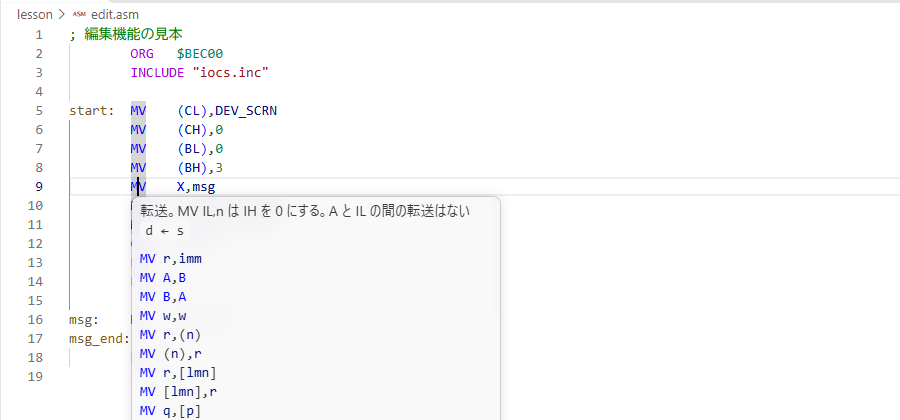

# 5. 命令一覧

この章は、SC62015 の全命令の辞書です。命令ごとに、働き、書ける形、変わるフラグ、例を載せています。「メモリをコピーしたい」「比べて分かれたい」のように、したいことから探すときは [5.2 早見表](#52-早見表)から、短い手本が欲しいときは[逆引きレシピ](20_RECIPES.md)から入ってください。

書き方の決まりは[アセンブラの文法](04_ASSEMBLER_REFERENCE.md#45-オペランド)、機械語のバイト列は [CPU（SC62015）](../analysis/02_CPU.md) の §2.14〜§2.15 にあります。VS Code では、命令にマウスを乗せると説明が出ます。



[目次へ戻る](README.md)

## 5.1 表の読み方

| 記号 | 意味 |
|---|---|
| `r` | `A` `IL` `BA` `I` `X` `Y` `U` `S` |
| `w` | `BA` `I` `X` `Y` `U` `S` |
| `v` | `A` `IL` `BA` `I` |
| `r2` | `BA` `I` |
| `r3` | `X` `Y` `U` `S` |
| `n`、`mn`、`lmn` | 1、2、3 バイトの値 |
| `(m)`、`(n)` | 内部 RAM |
| `[lmn]` | 外部メモリのアドレス |
| `[X]` | `X` `Y` `U` `S` のどれか。`[X+m]` は `[X-m]` も |
| `[(n)]` | 内部 RAM に入っているアドレス。`[(n)+m]` は `[(n)-m]` も |
| `label` | 行き先 |

- **バイト**と**サイクル**は、内部 RAM を `(BP+n)` の形で書いたときの値です。ほかの形（`(n)`、`(PX+n)` など）では PRE が付いて、どちらも 1 増えます。
- 「8、16、20 ビット」の順に並べた値は、レジスタの幅で変わることを表します。`IL` に読むときは、`[lmn]` 以外で 1 増えます。
- 1 サイクルは約 1.30 マイクロ秒です（1 秒で 768000 サイクル）。
- 条件付きの分岐のサイクルは「飛ぶとき / 飛ばないとき」です。
- **フラグ**は変わるものを書いています。`C` は桁上がり、`Z` は結果が 0 です。

## 5.2 早見表

| 種類 | 命令 |
|---|---|
| [転送と交換](#53-転送と交換) | [`MV`](#mv) [`MVW`](#mvw) [`MVP`](#mvp) [`MVL`](#mvl) [`MVLD`](#mvld) [`EX`](#ex) [`EXW`](#exw) [`EXP`](#exp) [`EXL`](#exl) [`SWAP`](#swap) |
| [加算と減算](#54-加算と減算) | [`ADD`](#add) [`SUB`](#sub) [`ADC`](#adc) [`SBC`](#sbc) [`ADCL`](#adcl) [`SBCL`](#sbcl) [`DADL`](#dadl) [`DSBL`](#dsbl) [`INC`](#inc) [`DEC`](#dec) [`PMDF`](#pmdf) |
| [論理と比較](#55-論理と比較) | [`AND`](#and) [`OR`](#or) [`XOR`](#xor) [`TEST`](#test) [`CMP`](#cmp) [`CMPW`](#cmpw) [`CMPP`](#cmpp) [`SC`](#sc) [`RC`](#rc) |
| [シフトと回転](#56-シフトと回転) | [`ROR`](#ror) [`ROL`](#rol) [`SHR`](#shr) [`SHL`](#shl) [`DSRL`](#dsrl) [`DSLL`](#dsll) |
| [スタック](#57-スタック) | [`PUSHU`](#pushu) [`POPU`](#popu) [`PUSHS`](#pushs) [`POPS`](#pops) |
| [分岐](#58-分岐) | [`JR`](#jr) [`JRZ`](#jrz) [`JRNZ`](#jrnz) [`JRC`](#jrc) [`JRNC`](#jrnc) [`JP`](#jp) [`JPZ`](#jpz) [`JPNZ`](#jpnz) [`JPC`](#jpc) [`JPNC`](#jpnc) [`JPF`](#jpf) |
| [呼び出しと戻り](#59-呼び出しと戻り) | [`CALL`](#call) [`CALLF`](#callf) [`RET`](#ret) [`RETF`](#retf) [`RETI`](#reti) |
| [CPU の制御](#510-cpu-の制御) | [`NOP`](#nop) [`WAIT`](#wait) [`HALT`](#halt) [`OFF`](#off) [`TCL`](#tcl) [`IR`](#ir) [`INT`](#int) [`RESET`](#reset) [`PRE`](#pre) |

### 命令の選び方

| やりたいこと | 命令 |
|---|---|
| 1 バイト移す | `MV` |
| まとめて移す | `I` に数を入れて `MVL` |
| 8 ビットの計算 | `ADD A,…`、`SUB A,…` |
| 16 ビットの計算 | `ADD BA,I`、`SUB BA,I` |
| アドレスの計算 | `ADD X,A`、`INC X` |
| 3 バイト以上の計算 | `ADCL`、`SBCL` |
| 10 進（BCD）の計算 | `DADL`、`DSBL` |
| 比べて飛ぶ | `CMP` と `JRC` / `JRZ` / `JRNC` / `JRNZ` |
| ビットを調べる | `TEST` と `JRZ` / `JRNZ` |
| 2 倍、半分 | `RC` と `SHL A`、`RC` と `SHR A` |
| 繰り返す | `DEC IL` と `JRNZ` |
| 値を預ける | `PUSHU` と `POPU` |

## 5.3 転送と交換

### MV

転送。MV IL,n は IH を 0 にする。A と IL の間の転送はない。

- **動作**: 左 ← 右
- **フラグ**: 変わらない

| 書き方 | バイト | サイクル |
|---|---|---|
| `MV A,n`、`MV IL,n` | 2 | 2、3 |
| `MV BA,mn`、`MV I,mn` | 3 | 3 |
| `MV X,lmn`（`Y` `U` `S` も） | 4 | 4 |
| `MV A,B`、`MV B,A` | 1 | 1 |
| `MV w,w` | 2 | 2 |
| `MV r,(n)`、`MV (n),r` | 2 | 3、4、5（8、16、20 ビット） |
| `MV r,[lmn]` | 4 | 6、7、8 |
| `MV [lmn],r` | 4 | 5、6、7 |
| `MV r,[X]`、`MV [X],r` | 2 | 4、5、6 |
| `MV r,[X++]`、`MV [X++],r` | 2 | 4、5、7 |
| `MV r,[--X]`、`MV [--X],r` | 2 | 5、6、8 |
| `MV r,[X+m]`、`MV [X+m],r` | 3 | 6、7、8 |
| `MV r,[(n)]`、`MV [(n)],r` | 3 | 9、10、11 |
| `MV r,[(n)+m]`、`MV [(n)+m],r` | 4 | 11、12、13 |
| `MV (m),n` | 3 | 3 |
| `MV (m),(n)` | 3 | 6 |
| `MV (n),[lmn]` | 5 | 7 |
| `MV [lmn],(n)` | 5 | 6 |
| `MV (n),[X]`、`MV [X],(n)` | 3 | 6（`[X++]` 6、`[--X]` 7） |
| `MV (n),[X+m]`、`MV [X+m],(n)` | 4 | 8 |
| `MV (m),[(n)]`、`MV [(m)],(n)` | 4 | 11 |
| `MV (m),[(n)+l]`、`MV [(m)+l],(n)` | 5 | 13 |

```asm
        MV    A,10              ; A = 10
        MV    A,[$BED00]        ; メモリ → A
        MV    [X++],A           ; X の指す所に書いて X を進める
        MV    ($20),($21)       ; 内部 RAM どうし
        MV    X,BA              ; X の上位 4 ビットは 0
```

- `MV A,IL` と `MV IL,A` はありません。内部 RAM を通します（`MV ($20),IL` → `MV A,($20)`）。
- `IL` に書くと `I` の上位 8 ビットが 0 になります。`INC IL` や `ADD IL,…` の結果を書くときも同じです。
- `X`、`Y`、`U`、`S` は 3 バイトでメモリに入ります。16 ビットのレジスタから移すと上位 4 ビットは 0 です。
- S スタックへ積むのは `MV [--S],r`、取り出すのは `MV r,[S++]` です。

### MVW

2 バイトの転送。

- **動作**: 左 ← 右（2 バイト）
- **フラグ**: 変わらない

| 書き方 | バイト | サイクル |
|---|---|---|
| `MVW (m),mn` | 4 | 4 |
| `MVW (m),(n)` | 3 | 8 |
| `MVW (n),[lmn]` | 5 | 8 |
| `MVW [lmn],(n)` | 5 | 7 |
| `MVW (n),[X]`、`MVW [X],(n)` | 3 | 7（`[X++]` 7、`[--X]` 10） |
| `MVW (n),[X+m]`、`MVW [X+m],(n)` | 4 | 9 |
| `MVW (m),[(n)]`、`MVW [(m)],(n)` | 4 | 12 |
| `MVW (m),[(n)+l]`、`MVW [(m)+l],(n)` | 5 | 14 |

```asm
        MVW   ($20),$1234       ; 20h = 34h、21h = 12h
        MVW   ($20),[X++]       ; X は 2 進む
```

### MVP

3 バイトの転送。

- **動作**: 左 ← 右（3 バイト）
- **フラグ**: 変わらない

| 書き方 | バイト | サイクル |
|---|---|---|
| `MVP (m),lmn` | 5 | 5 |
| `MVP (m),(n)` | 3 | 10 |
| `MVP (n),[lmn]` | 5 | 9 |
| `MVP [lmn],(n)` | 5 | 8 |
| `MVP (n),[X]`、`MVP [X],(n)` | 3 | 8（`[X++]` 9、`[--X]` 10） |
| `MVP (n),[X+m]`、`MVP [X+m],(n)` | 4 | 10 |
| `MVP (m),[(n)]`、`MVP [(m)],(n)` | 4 | 13 |
| `MVP (m),[(n)+l]`、`MVP [(m)+l],(n)` | 5 | 15 |

```asm
        MVP   ($20),$BED00      ; 3 バイト（アドレスなど）
        MVP   [$BED00],($20)
```

### MVL

I バイトの転送（アドレスを増やしながら）。実行後 I = 0。

- **動作**: 左 ← 右（I バイト、アドレスを増やしながら）
- **フラグ**: 変わらない

| 書き方 | バイト | サイクル |
|---|---|---|
| `MVL (m),(n)` | 3 | 5+2×I |
| `MVL (n),[lmn]`、`MVL [lmn],(n)` | 5 | 6+2×I |
| `MVL (n),[X++]`、`MVL [X++],(n)` | 3 | 5+2×I |
| `MVL (n),[--X]`、`MVL [--X],(n)` | 3 | 7+2×I |
| `MVL (n),[X+m]`、`MVL [X+m],(n)`（`[X]` も） | 4 | 5+2×I |
| `MVL (m),[(n)]`、`MVL [(m)],(n)` | 4 | 10+2×I |
| `MVL (m),[(n)+l]`、`MVL [(m)+l],(n)` | 5 | 12+2×I |

```asm
        MV    I,16
        MVL   ($20),[X++]       ; 16 バイト読む。X は 16 進み、I = 0
```

- `I` = 0 で実行すると 65536 バイト移します。
- 実行の間は割り込みが入りません。長いとキーやタイマが遅れます。
- 外部メモリどうしは直接移せません。内部 RAM を通します。
- **`[--X]` の形だけは、両方のアドレスが減ります。** 外部メモリは `X` の 1 つ手前から、内部 RAM は書いたアドレスから下へ進みます。`MV IL,4` の後の `MVL [--S],($D9)` は、D6h〜D9h の 4 バイトを、並びを変えずに S スタックへ積みます。戻すときは先頭を書いて `MVL ($D6),[S++]` とします。

### MVLD

I バイトの転送（アドレスを減らしながら）。実行後 I = 0。

- **動作**: 左 ← 右（I バイト、アドレスを減らしながら）
- **フラグ**: 変わらない

| 書き方 | バイト | サイクル |
|---|---|---|
| `MVLD (m),(n)` | 3 | 5+2×I |

```asm
        MV    I,8
        MVLD  ($28),($27)       ; 20h〜27h を 1 つ後ろへずらす
```

- 重なった範囲を後ろ（大きいアドレス）へずらすときに使います。

### EX

交換。

- **動作**: 左 ↔ 右
- **フラグ**: 変わらない

| 書き方 | バイト | サイクル |
|---|---|---|
| `EX (m),(n)` | 3 | 7 |
| `EX A,B` | 1 | 3 |
| `EX w,w` | 2 | 4 |

```asm
        EX    A,B
        EX    X,Y
        EX    ($20),($21)
```

### EXW

2 バイトの交換。

- **動作**: 左 ↔ 右（2 バイト）
- **フラグ**: 変わらない

| 書き方 | バイト | サイクル |
|---|---|---|
| `EXW (m),(n)` | 3 | 10 |

```asm
        EXW   ($20),($22)
```

### EXP

3 バイトの交換。

- **動作**: 左 ↔ 右（3 バイト）
- **フラグ**: 変わらない

| 書き方 | バイト | サイクル |
|---|---|---|
| `EXP (m),(n)` | 3 | 13 |

```asm
        EXP   ($20),($23)
```

### EXL

I バイトの交換。実行後 I = 0。

- **動作**: 左 ↔ 右（I バイト）
- **フラグ**: 変わらない

| 書き方 | バイト | サイクル |
|---|---|---|
| `EXL (m),(n)` | 3 | 5+3×I |

```asm
        MV    I,8
        EXL   ($20),($30)
```

### SWAP

A の上位 4 ビットと下位 4 ビットの交換。

- **動作**: A7-4 ↔ A3-0
- **フラグ**: `Z`

| 書き方 | バイト | サイクル |
|---|---|---|
| `SWAP A` | 1 | 3 |

```asm
        SWAP  A                 ; 12h → 21h
```

## 5.4 加算と減算

### ADD

加算。

- **動作**: 左 ← 左 + 右
- **フラグ**: `C`、`Z`

| 書き方 | バイト | サイクル |
|---|---|---|
| `ADD A,n` | 2 | 3 |
| `ADD (m),n` | 3 | 4 |
| `ADD A,(n)` | 2 | 4 |
| `ADD (n),A` | 2 | 4 |
| `ADD r2,v` | 2 | 5 |
| `ADD r3,r` | 2 | 7 |
| `ADD A/IL,A/IL` | 2 | 3 |

```asm
        ADD   A,5
        ADD   ($20),A
        ADD   BA,I              ; 16 ビット
        ADD   X,A               ; アドレスに足す
```

- `C` は転送先の一番上のビットからの桁上がりです（20 ビットのレジスタならビット 19）。
- 右が左より狭いときは、上位を 0 とみなします。

### SUB

減算。

- **動作**: 左 ← 左 - 右
- **フラグ**: `C`、`Z`

| 書き方 | バイト | サイクル |
|---|---|---|
| `SUB A,n` | 2 | 3 |
| `SUB (m),n` | 3 | 4 |
| `SUB A,(n)` | 2 | 4 |
| `SUB (n),A` | 2 | 4 |
| `SUB r2,v` | 2 | 5 |
| `SUB r3,r` | 2 | 7 |
| `SUB A/IL,A/IL` | 2 | 3 |

```asm
        SUB   A,5
        SUB   BA,I
        SUB   X,BA
```

- `C` は借りが出たとき（左 < 右）に 1 になります。
- `SUB BA,BA` のように自分を引くと 0 になります。

### ADC

キャリー付き加算。

- **動作**: 左 ← 左 + 右 + C
- **フラグ**: `C`、`Z`

| 書き方 | バイト | サイクル |
|---|---|---|
| `ADC A,n` | 2 | 3 |
| `ADC (m),n` | 3 | 4 |
| `ADC A,(n)` | 2 | 4 |
| `ADC (n),A` | 2 | 4 |

```asm
        ADC   A,0               ; C だけ足す
```

### SBC

キャリー付き減算。

- **動作**: 左 ← 左 - 右 - C
- **フラグ**: `C`、`Z`

| 書き方 | バイト | サイクル |
|---|---|---|
| `SBC A,n` | 2 | 3 |
| `SBC (m),n` | 3 | 4 |
| `SBC A,(n)` | 2 | 4 |
| `SBC (n),A` | 2 | 4 |

```asm
        SBC   A,0               ; C だけ引く
```

### ADCL

I バイトの 2 進加算（アドレスを増やしながら）。実行後 I = 0。

- **動作**: 左 ← 左 + 右（I バイト。2 バイト目からは + C）
- **フラグ**: `C`、`Z`

| 書き方 | バイト | サイクル |
|---|---|---|
| `ADCL (m),(n)` | 3 | 5+2×I |
| `ADCL (n),A` | 2 | 4+I |

```asm
        MV    I,3
        ADCL  ($20),($23)       ; 3 バイトの足し算（20h が最下位）
```

- 最初のバイトには、実行前の `C` を足しません。
- 数は下位のバイトを小さいアドレスに置きます。

### SBCL

I バイトの 2 進減算（アドレスを増やしながら）。実行後 I = 0。

- **動作**: 左 ← 左 - 右（I バイト。2 バイト目からは - C）
- **フラグ**: `C`、`Z`

| 書き方 | バイト | サイクル |
|---|---|---|
| `SBCL (m),(n)` | 3 | 5+2×I |
| `SBCL (n),A` | 2 | 4+I |

```asm
        MV    I,3
        SBCL  ($20),($23)
```

- 最初のバイトからは、実行前の `C` を引きません。
- 数は下位のバイトを小さいアドレスに置きます。

### DADL

I バイトの BCD 加算（アドレスを減らしながら）。実行後 I = 0。

- **動作**: 左 ← 左 + 右（BCD、I バイト。2 バイト目からは + C）
- **フラグ**: `C`、`Z`

| 書き方 | バイト | サイクル |
|---|---|---|
| `DADL (m),(n)` | 3 | 5+2×I |
| `DADL (n),A` | 2 | 4+I |

```asm
        MV    I,4
        DADL  ($23),($27)       ; 4 バイトの 10 進（23h が最下位、20h が最上位）
```

- 数は上位の桁を小さいアドレスに置き、最下位のアドレスを指定します（`ADCL` とは逆）。

### DSBL

I バイトの BCD 減算（アドレスを減らしながら）。実行後 I = 0。

- **動作**: 左 ← 左 - 右（BCD、I バイト。2 バイト目からは - C）
- **フラグ**: `C`、`Z`

| 書き方 | バイト | サイクル |
|---|---|---|
| `DSBL (m),(n)` | 3 | 5+2×I |
| `DSBL (n),A` | 2 | 4+I |

```asm
        MV    I,4
        DSBL  ($23),($27)
```

- 数は上位の桁を小さいアドレスに置き、最下位のアドレスを指定します。

### INC

1 を足す（C は変わらない）。

- **動作**: 対象 ← 対象 + 1
- **フラグ**: `Z`

| 書き方 | バイト | サイクル |
|---|---|---|
| `INC r` | 2 | 3 |
| `INC (n)` | 2 | 3 |

```asm
        INC   X
        INC   ($20)
```

- `C` は変わりません。

### DEC

1 を引く（C は変わらない）。

- **動作**: 対象 ← 対象 - 1
- **フラグ**: `Z`

| 書き方 | バイト | サイクル |
|---|---|---|
| `DEC r` | 2 | 3 |
| `DEC (n)` | 2 | 3 |

```asm
        DEC   IL
        DEC   ($20)
```

- `C` は変わりません。`DEC IL` と `JRNZ` の組で繰り返しを作ります。

### PMDF

ポインタ修正：フラグを変えずに足す。

- **動作**: 左 ← 左 + 右
- **フラグ**: 変わらない

| 書き方 | バイト | サイクル |
|---|---|---|
| `PMDF (m),n` | 3 | 4 |
| `PMDF (n),A` | 2 | 4 |

```asm
        PMDF  ($ED),2           ; PX を 2 進める（フラグは変わらない）
```

## 5.5 論理と比較

### AND

論理積。

- **動作**: 左 ← 左 ∧ 右
- **フラグ**: `Z`

| 書き方 | バイト | サイクル |
|---|---|---|
| `AND A,n` | 2 | 3 |
| `AND (m),n` | 3 | 4 |
| `AND [lmn],n` | 5 | 7 |
| `AND (n),A` | 2 | 4 |
| `AND (m),(n)` | 3 | 6 |
| `AND A,(n)` | 2 | 4 |

```asm
        AND   A,$0F             ; 下位 4 ビットを残す
        AND   ($FD),$8F         ; ブザーを止める
```

### OR

論理和。

- **動作**: 左 ← 左 ∨ 右
- **フラグ**: `Z`

| 書き方 | バイト | サイクル |
|---|---|---|
| `OR A,n` | 2 | 3 |
| `OR (m),n` | 3 | 4 |
| `OR [lmn],n` | 5 | 7 |
| `OR (n),A` | 2 | 4 |
| `OR (m),(n)` | 3 | 6 |
| `OR A,(n)` | 2 | 4 |

```asm
        OR    A,$80             ; ビット 7 を 1 にする
```

### XOR

排他的論理和。

- **動作**: 左 ← 左 ⊻ 右
- **フラグ**: `Z`

| 書き方 | バイト | サイクル |
|---|---|---|
| `XOR A,n` | 2 | 3 |
| `XOR (m),n` | 3 | 4 |
| `XOR [lmn],n` | 5 | 7 |
| `XOR (n),A` | 2 | 4 |
| `XOR (m),(n)` | 3 | 6 |
| `XOR A,(n)` | 2 | 4 |

```asm
        XOR   A,$FF             ; 全ビットを反転
```

### TEST

ビットテスト：論理積の結果で Z だけ変える。

- **動作**: 左 ∧ 右 → Z
- **フラグ**: `Z`

| 書き方 | バイト | サイクル |
|---|---|---|
| `TEST A,n` | 2 | 3 |
| `TEST (m),n` | 3 | 4 |
| `TEST [lmn],n` | 5 | 6 |
| `TEST (n),A` | 2 | 4 |

```asm
        TEST  A,$01             ; ビット 0 を調べる
        JRZ   even              ; 0 なら飛ぶ
```

- 結果が 0（調べたビットが全部 0）なら `Z` = 1 です。

### CMP

比較。C = 小さい、Z = 等しい。

- **動作**: 左 - 右 → C, Z
- **フラグ**: `C`、`Z`

| 書き方 | バイト | サイクル |
|---|---|---|
| `CMP A,n` | 2 | 3 |
| `CMP (m),n` | 3 | 4 |
| `CMP [lmn],n` | 5 | 6 |
| `CMP (n),A` | 2 | 4 |
| `CMP (m),(n)` | 3 | 6 |

```asm
        CMP   A,10
        JRC   less              ; A < 10
        JRZ   equal             ; A = 10
```

- 数は符号なしで比べます。`JRC` は左 < 右、`JRZ` は等しい、`JRNC` は左 ≧ 右です。

### CMPW

2 バイトの比較。

- **動作**: 左 - 右 → C, Z（2 バイト）
- **フラグ**: `C`、`Z`

| 書き方 | バイト | サイクル |
|---|---|---|
| `CMPW (m),(n)` | 3 | 8 |
| `CMPW (m),r2` | 3 | 7 |

```asm
        CMPW  ($20),BA
```

- 小さいアドレスが下位です。

### CMPP

3 バイトの比較。

- **動作**: 左 - 右 → C, Z（3 バイト）
- **フラグ**: `C`、`Z`

| 書き方 | バイト | サイクル |
|---|---|---|
| `CMPP (m),(n)` | 3 | 10 |
| `CMPP (m),r3` | 3 | 9 |

```asm
        CMPP  ($20),X
```

- 小さいアドレスが下位です。

### SC

C ← 1。

- **動作**: C ← 1
- **フラグ**: `C`

| 書き方 | バイト | サイクル |
|---|---|---|
| `SC` | 1 | 1 |

```asm
        SC
```

- `C` = 1 で BASIC に戻るとエラーになります（`A` がエラーの番号）。

### RC

C ← 0。

- **動作**: C ← 0
- **フラグ**: `C`

| 書き方 | バイト | サイクル |
|---|---|---|
| `RC` | 1 | 1 |

```asm
        RC
```

- BASIC に戻る前に置くと、エラーになりません。

## 5.6 シフトと回転

### ROR

右回転（8 ビット）。

- **動作**: → 7 6 5 4 3 2 1 0 → 7, C
- **フラグ**: `C`、`Z`

| 書き方 | バイト | サイクル |
|---|---|---|
| `ROR A` | 1 | 2 |
| `ROR (n)` | 2 | 3 |

```asm
        ROR   A                 ; 01h → 80h、C = 1
```

### ROL

左回転（8 ビット）。

- **動作**: C, 0 ← 7 6 5 4 3 2 1 0 ←
- **フラグ**: `C`、`Z`

| 書き方 | バイト | サイクル |
|---|---|---|
| `ROL A` | 1 | 2 |
| `ROL (n)` | 2 | 3 |

```asm
        ROL   A                 ; 80h → 01h、C = 1
```

### SHR

C を含む 9 ビットの右回転。

- **動作**: C → 7 6 5 4 3 2 1 0 → C
- **フラグ**: `C`、`Z`

| 書き方 | バイト | サイクル |
|---|---|---|
| `SHR A` | 1 | 2 |
| `SHR (n)` | 2 | 3 |

```asm
        RC                      ; 上から 0 を入れる
        SHR   A                 ; A ÷ 2、余りは C
```

- `C` が上から入る 9 ビットの回転です。0 を入れたいときは先に `RC` を置きます。

### SHL

C を含む 9 ビットの左回転。

- **動作**: C ← 7 6 5 4 3 2 1 0 ← C
- **フラグ**: `C`、`Z`

| 書き方 | バイト | サイクル |
|---|---|---|
| `SHL A` | 1 | 2 |
| `SHL (n)` | 2 | 3 |

```asm
        RC
        SHL   A                 ; A × 2、あふれは C
```

- `C` が下から入る 9 ビットの回転です。0 を入れたいときは先に `RC` を置きます。

### DSRL

I バイトを 4 ビット右へ（アドレスを増やしながら）。空いた桁は、C に関係なく 0。実行後 I = 0。

- **フラグ**: `Z`

| 書き方 | バイト | サイクル |
|---|---|---|
| `DSRL (n)` | 2 | 4+I |

```asm
        MV    I,4
        DSRL  ($20)             ; 4 バイトを 1 桁右へ
```

### DSLL

I バイトを 4 ビット左へ（アドレスを減らしながら）。空いた桁は、C に関係なく 0。実行後 I = 0。

- **フラグ**: `Z`

| 書き方 | バイト | サイクル |
|---|---|---|
| `DSLL (n)` | 2 | 4+I |

```asm
        MV    I,4
        DSLL  ($23)             ; 4 バイトを 1 桁左へ
```

## 5.7 スタック

### PUSHU

U スタックに積む。PUSHU IMR は割り込みも禁止する。

- **フラグ**: 変わらない

| 書き方 | バイト | サイクル |
|---|---|---|
| `PUSHU A` | 1 | 3 |
| `PUSHU IL` | 1 | 3 |
| `PUSHU BA` | 1 | 4 |
| `PUSHU I` | 1 | 4 |
| `PUSHU X` | 1 | 5 |
| `PUSHU Y` | 1 | 5 |
| `PUSHU F` | 1 | 3 |
| `PUSHU IMR` | 1 | 3 |

```asm
        PUSHU IMR               ; 積んで、割り込みを止める
        PUSHU X
```

- 積んだ数だけ `POPU` で取り出します。後から積んだものが先に出ます。
- `PUSHU IMR` は積んだ後に割り込みを禁止します。

### POPU

U スタックから取り出す。POPU F はフラグを戻す。

- **フラグ**: `POPU F` のときだけ `C`、`Z`

| 書き方 | バイト | サイクル |
|---|---|---|
| `POPU A` | 1 | 2 |
| `POPU IL` | 1 | 3 |
| `POPU BA` | 1 | 3 |
| `POPU I` | 1 | 3 |
| `POPU X` | 1 | 4 |
| `POPU Y` | 1 | 4 |
| `POPU F` | 1 | 2 |
| `POPU IMR` | 1 | 2 |

```asm
        POPU  X
        POPU  IMR               ; 割り込みを元に戻す
```

- `POPU IL` は `I` の上位を 0 にします。
- `POPU F` は `C` と `Z` も変えます。

### PUSHS

S スタックに積む。

- **フラグ**: 変わらない

| 書き方 | 同じ命令 | バイト | サイクル |
|---|---|---|---|
| `PUSHS A`、`PUSHS IL` | `MV [--S],A` など | 2 | 5 |
| `PUSHS BA`、`PUSHS I` | `MV [--S],BA` など | 2 | 6 |
| `PUSHS X`、`PUSHS Y` | `MV [--S],X` など | 2 | 8 |
| `PUSHS F` | − | 1 | 3 |
| `PUSHS IMR` | `MV [--S],($FB)` | 4 | 8 |

```asm
        PUSHS F
        PUSHS X
```

- 専用の機械語があるのは `F` だけです。ほかは、同じ働きの `MV` に置き換わります。逆アセンブルすると `MV` で出ます。
- `PUSHS IMR` は `MV` なので、`PUSHU IMR` と違って割り込みを止めません。
- S には `CALL` の戻り先も入っています。`RET` の前に、積んだ数だけ `POPS` で取り出します。

### POPS

S スタックから取り出す。POPS F はフラグを戻す。

- **フラグ**: `POPS F` のときだけ `C`、`Z`

| 書き方 | 同じ命令 | バイト | サイクル |
|---|---|---|---|
| `POPS A` | `MV A,[S++]` | 2 | 4 |
| `POPS IL` | `MV IL,[S++]` | 2 | 5 |
| `POPS BA`、`POPS I` | `MV BA,[S++]` など | 2 | 5 |
| `POPS X`、`POPS Y` | `MV X,[S++]` など | 2 | 7 |
| `POPS F` | − | 1 | 2 |
| `POPS IMR` | `MV ($FB),[S++]` | 4 | 7 |

```asm
        POPS  X
        POPS  F
```

- 後から積んだものが先に出ます。
- `POPS IL` は `I` の上位を 0 にします。

## 5.8 分岐

条件付きの分岐は、直前の `CMP`、`TEST`、`DEC` などで決まったフラグを見ます。

### JR

相対ジャンプ（前後 255 バイト）。

- **動作**: PC ← PC ± n
- **フラグ**: 変わらない

| 書き方 | バイト | サイクル |
|---|---|---|
| `JR label` | 2 | 3 |

```asm
        JR    next
```

- 届く範囲は前後 255 バイトです。`JRZ` など条件付きも同じです。

### JRZ

Z = 1 なら相対ジャンプ。

- **動作**: Z = 1 のとき PC ← PC ± n
- **フラグ**: 変わらない

| 書き方 | バイト | サイクル |
|---|---|---|
| `JRZ label` | 2 | 3/2 |

```asm
        JRZ   next
```

### JRNZ

Z = 0 なら相対ジャンプ。

- **動作**: Z = 0 のとき PC ← PC ± n
- **フラグ**: 変わらない

| 書き方 | バイト | サイクル |
|---|---|---|
| `JRNZ label` | 2 | 3/2 |

```asm
        JRNZ  next
```

### JRC

C = 1 なら相対ジャンプ。

- **動作**: C = 1 のとき PC ← PC ± n
- **フラグ**: 変わらない

| 書き方 | バイト | サイクル |
|---|---|---|
| `JRC label` | 2 | 3/2 |

```asm
        JRC   next
```

### JRNC

C = 0 なら相対ジャンプ。

- **動作**: C = 0 のとき PC ← PC ± n
- **フラグ**: 変わらない

| 書き方 | バイト | サイクル |
|---|---|---|
| `JRNC label` | 2 | 3/2 |

```asm
        JRNC  next
```

### JP

ジャンプ（label は同じ 64KB の中。(n) と r3 はどこへでも）。

- **動作**: PC ← 行き先
- **フラグ**: 変わらない

| 書き方 | バイト | サイクル |
|---|---|---|
| `JP label` | 3 | 4 |
| `JP (n)` | 2 | 6 |
| `JP r3` | 2 | 4 |

```asm
        JP    next
        JP    X                 ; X のアドレスへ
        JP    ($20)             ; 内部 RAM 20h〜22h のアドレスへ
```

- ラベルは同じ 64 KB の中だけです。`JP X` と `JP (n)` はどこへでも飛べます。

### JPZ

Z = 1 ならジャンプ。

- **動作**: Z = 1 のとき PC ← 行き先
- **フラグ**: 変わらない

| 書き方 | バイト | サイクル |
|---|---|---|
| `JPZ label` | 3 | 4/3 |

```asm
        JPZ   next
```

### JPNZ

Z = 0 ならジャンプ。

- **動作**: Z = 0 のとき PC ← 行き先
- **フラグ**: 変わらない

| 書き方 | バイト | サイクル |
|---|---|---|
| `JPNZ label` | 3 | 4/3 |

```asm
        JPNZ  next
```

### JPC

C = 1 ならジャンプ。

- **動作**: C = 1 のとき PC ← 行き先
- **フラグ**: 変わらない

| 書き方 | バイト | サイクル |
|---|---|---|
| `JPC label` | 3 | 4/3 |

```asm
        JPC   next
```

### JPNC

C = 0 ならジャンプ。

- **動作**: C = 0 のとき PC ← 行き先
- **フラグ**: 変わらない

| 書き方 | バイト | サイクル |
|---|---|---|
| `JPNC label` | 3 | 4/3 |

```asm
        JPNC  next
```

### JPF

どこへでもジャンプ。

- **動作**: PS, PC ← 行き先
- **フラグ**: 変わらない

| 書き方 | バイト | サイクル |
|---|---|---|
| `JPF label` | 4 | 5 |

```asm
        JPF   next
```

## 5.9 呼び出しと戻り

### CALL

呼び出し（同じ 64KB の中）。RET で戻る。

- **フラグ**: 変わらない

| 書き方 | バイト | サイクル |
|---|---|---|
| `CALL label` | 3 | 6 |

```asm
        CALL  next
```

- S スタックに 2 バイト積みます。`RET` で戻ります。

### CALLF

どこでも呼び出し。RETF で戻る。

- **フラグ**: 変わらない

| 書き方 | バイト | サイクル |
|---|---|---|
| `CALLF lmn` | 4 | 8 |

```asm
        CALLF $FFFE8            ; IOCS
```

- S スタックに 3 バイト積みます。`RETF` で戻ります。

### RET

CALL から戻る。

- **フラグ**: 変わらない

| 書き方 | バイト | サイクル |
|---|---|---|
| `RET` | 1 | 4 |

```asm
        RET
```

- `CALL` から戻るときに使います。

### RETF

CALLF から戻る。BASIC の CALL からもこれで戻る。

- **フラグ**: 変わらない

| 書き方 | バイト | サイクル |
|---|---|---|
| `RETF` | 1 | 5 |

```asm
        RETF
```

- BASIC の `CALL` からは必ずこれで戻ります。

### RETI

割り込みから戻る。

- **フラグ**: `C`、`Z`

| 書き方 | バイト | サイクル |
|---|---|---|
| `RETI` | 1 | 7 |

```asm
        RETI
```

- 割り込み処理の終わりに使います。フラグと `IMR` も戻ります。

## 5.10 CPU の制御

### NOP

何もしない。

- **フラグ**: 変わらない

| 書き方 | バイト | サイクル |
|---|---|---|
| `NOP` | 1 | 1 |

```asm
        NOP
```

### WAIT

I を 0 まで減らしながら待つ。

- **フラグ**: 変わらない

| 書き方 | バイト | サイクル |
|---|---|---|
| `WAIT` | 1 | 1+I |

```asm
        MV    I,768             ; 約 1 ミリ秒
        WAIT
```

- 実行の間は割り込みが入りません。

### HALT

割り込みまで CPU を止める。

- **フラグ**: 変わらない

| 書き方 | バイト | サイクル |
|---|---|---|
| `HALT` | 1 | 2（止まらずに通過するとき） |

```asm
        HALT
```

### OFF

電源を切る。

- **フラグ**: 変わらない

| 書き方 | バイト | サイクル |
|---|---|---|
| `OFF` | 1 | 2 |

```asm
        OFF
```

### TCL

タイマをクリアする。

- **フラグ**: 変わらない

| 書き方 | バイト | サイクル |
|---|---|---|
| `TCL` | 1 | 1 |

```asm
        TCL
```

### IR

ソフトウェア割り込み。

- **フラグ**: 変わらない

| 書き方 | バイト | サイクル |
|---|---|---|
| `IR` | 1 | 12 |

```asm
        IR
```

### INT

ソフトウェア割り込み（IR と同じ）。

- **フラグ**: 変わらない

| 書き方 | バイト | サイクル |
|---|---|---|
| `INT` | 1 | 12 |

```asm
        INT
```

### RESET

リセットベクタへ。

- **フラグ**: 変わらない

| 書き方 | バイト | サイクル |
|---|---|---|
| `RESET` | 1 | 6 |

```asm
        RESET
```

### PRE

PRE バイトを直接置く（ふつうは自動で付く）。

- **フラグ**: 変わらない

| 書き方 | バイト | サイクル |
|---|---|---|
| `PRE n` | 1 | 1 |

```asm
        PRE   $32
```

- ふつうは自動で付くので、書く必要はありません。
