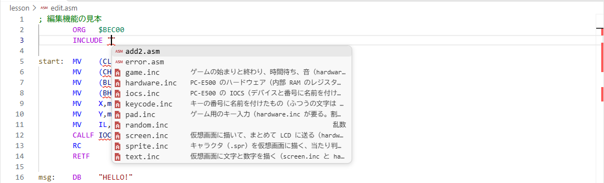
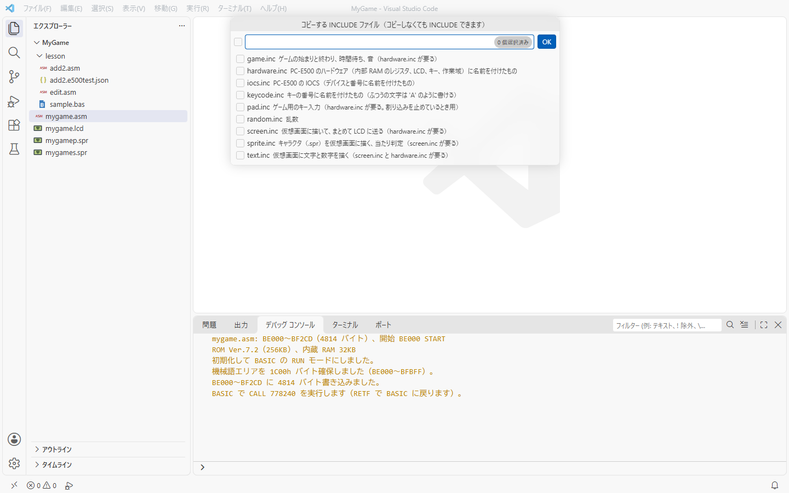
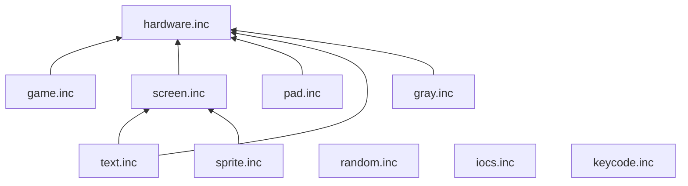
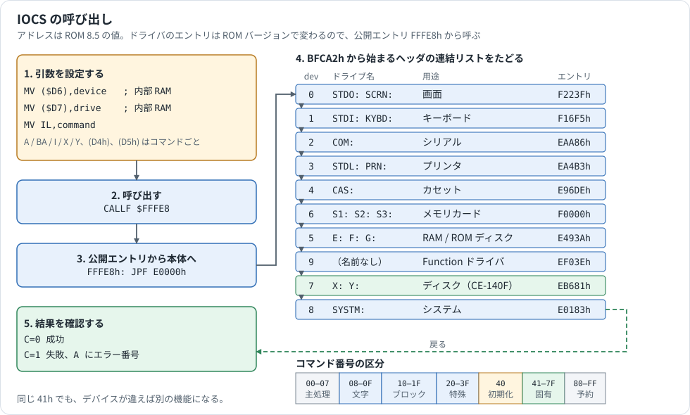
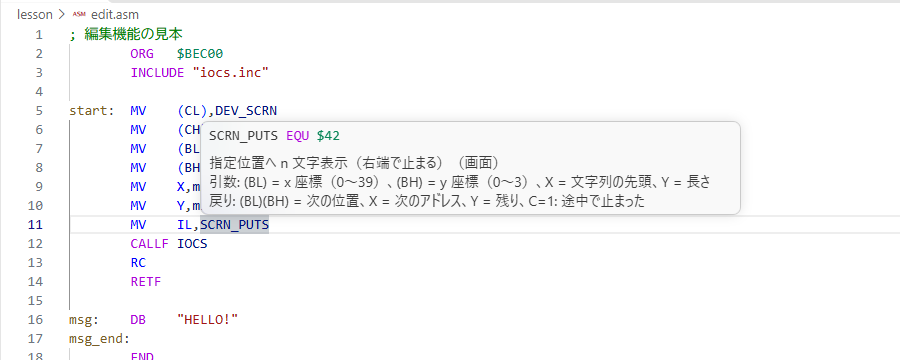
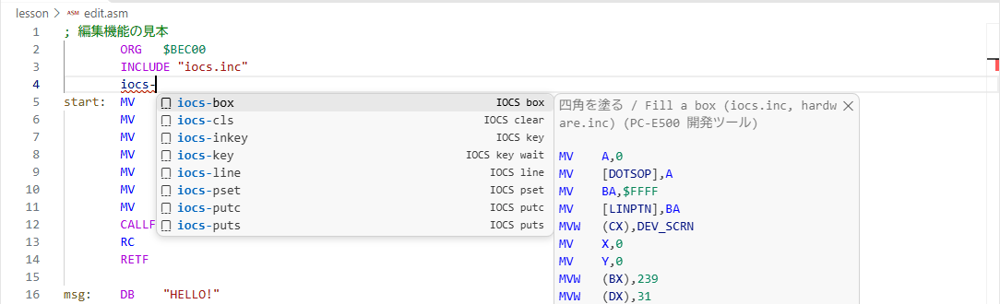

# 6. INCLUDE ファイル

この章は VS Code 拡張に入っている ASM 用の部品の説明です。画面に絵を出す、キーを読む、乱数を作る、といった処理は、どのプログラムでも同じように必要になります。毎回書く代わりに、テスト済みの部品を使えるようにしたのが INCLUDE ファイルです。中身もふつうの ASM なので、読んで学ぶ手本にも、コピーして直す材料にもなります（中のしくみは[設計](../design/08_INCLUDE_FILES.md)）。

`INCLUDE` の 1 行で、IOCS の名前や、画面、キャラクタ、キー、文字、乱数の処理が使えます。

[目次へ戻る](README.md)

| ファイル | 種類 | 内容 |
|---|---|---|
| [`iocs.inc`](#iocsinc) | 名前 | IOCS のデバイス、番号、引数、エラー |
| [`hardware.inc`](#hardwareinc) | 名前 | 内部 RAM のレジスタ、割り込み、ブザー、LCD、作業域 |
| [`keycode.inc`](#keycodeinc) | 名前 | キーの文字コードと行列コード |
| [`game.inc`](#gameinc) | 処理 | 始まりと終わり、時間待ち、音 |
| [`screen.inc`](#screeninc) | 処理 | 仮想画面、背景、LCD への転送 |
| [`screen_part.inc`](#変わった所だけを送る) | 処理 | 仮想画面の一部だけを LCD に送る（`screen.inc` が INCLUDE する） |
| [`sprite.inc`](#spriteinc) | 処理 | キャラクタを描く、当たり判定 |
| [`pad.inc`](#padinc) | 処理 | キーの同時読み取り |
| [`text.inc`](#textinc) | 処理 | 文字と数字を描く |
| [`random.inc`](#randominc) | 処理 | 乱数 |
| [`gray.inc`](#grayinc) | 処理 | 4 階調（白、灰色 2 段、黒）で描いて表示する |

「名前」は値に名前を付けるだけで、プログラムの大きさは変わりません。「処理」は、読み込んだ所に命令とデータが入ります。

## 使い方

```asm
        ORG   $BE000
        INCLUDE "hardware.inc"      ; 名前のファイルは先頭
start:  …
        RETF

        INCLUDE "game.inc"          ; 処理のファイルは RETF の後
        INCLUDE "screen.inc"
        END
```

どのフォルダのソースからもそのまま `INCLUDE` できます。`INCLUDE "` まで打つと一覧が出ます。



`Ctrl` を押しながらファイル名をクリックすると、中身を読めます。

### 書き換えて使う、e500asm で使う

エクスプローラーでフォルダを右クリックし、「INCLUDE ファイルをコピー」を選ぶと、ソースの隣にコピーできます。隣に同じ名前のファイルがあれば、そちらが使われます。



- 中身を自分用に変えたいときは、コピーしたものを書き換えます。
- `e500asm` だけでアセンブルするときも、コピーしておけば追加の指定は要りません。

### 組み合わせ



矢印の先のファイルも `INCLUDE` します。

### 内部 RAM の使い分け

`game_start` から `game_end` までは、内部 RAM の 00h〜BFh を自由に使えます（元の内容は退避され、最後に戻ります）。

| アドレス | 使うもの |
|---|---|
| 00h〜1Fh | **自分の変数** |
| 20h〜5Fh | INCLUDE ファイルの変数と作業用 |
| 60h〜BFh | `screen.inc` と `text.inc` の作業用（呼ぶと壊れる） |
| D4h〜DFh | IOCS の引数 |

## iocs.inc

IOCS の名前です。呼び方はいつも同じです。

```asm
        MV    (CL),DEV_SCRN         ; デバイス
        MV    (CH),0                ; ドライブ
        MV    IL,SCRN_CLEAR         ; 番号
        CALLF IOCS                  ; C = 1 なら A にエラー番号
        JRC   error
```



VS Code では `MV IL,` の後で候補に出ます（直前に `(CL)` へ入れたデバイスのものから）。名前や `$42` のような数にマウスを乗せると、機能と引数が出ます。



### エントリと引数

| 名前 | 値 | 内容 |
|---|---|---|
| `IOCS` | FFFE8h | IOCS のエントリ |
| `FCS` | FFFE4h | ファイル制御のエントリ |
| `BL`、`BH` | D4h、D5h | 引数（`BX` は 2 バイトまとめて D4h） |
| `CL`、`CH` | D6h、D7h | デバイス、ドライブ（`CX` は D6h） |
| `DL`、`DH` | D8h、D9h | 引数（`DX` は D8h） |
| `SI`、`DI` | DAh、DDh | 引数（3 バイト） |

### デバイス

| 名前 | 番号 | デバイス | BASIC での名前 |
|---|---|---|---|
| `DEV_SCRN` | 0 | 画面 | `STDO: SCRN:` |
| `DEV_KYBD` | 1 | キーボード | `STDI: KYBD:` |
| `DEV_COM` | 2 | シリアル | `COM:` |
| `DEV_PRN` | 3 | プリンタ | `STDL: PRN:` |
| `DEV_CAS` | 4 | テープ | `CAS:` |
| `DEV_RAMDISK` | 5 | RAM ディスク | `E: F: G:` |
| `DEV_MEM` | 6 | メモリブロック | `S1: S2: S3:` |
| `DEV_DISK` | 7 | ポケットディスク | `X: Y:` |
| `DEV_SYSTM` | 8 | システム | `SYSTM:` |

### 番号

FCS は `(CX)` を残しません。ハンドルは呼ぶたびに `(CL)` へ入れ直します。引数の並びや細かい動作は [IOCS と FCS](../analysis/11_IOCS.md) にあります。

#### どのデバイスにもある番号

| 名前 | 番号 | 機能 | 渡すもの | 返るもの |
|---|---|---|---|---|
| `IO_FIND_DRIVE` | 00h | ドライブ名から番号を調べる | X = ドライブ名（: まで） | (CL) = デバイス、(CH) = ドライブ、X = 名前の次、C=1 なら A = 01h: ない |
| `IO_FIND_HEADER` | 01h | デバイス番号からヘッダを調べる | (CL) = デバイス | X = ヘッダのアドレス、C=1 なら A = 01h: ない |
| `IO_FIND_HEADER_FROM` | 02h | 指定のヘッダから先を調べる | (CL) = デバイス、X = 調べ始めるヘッダ | X = ヘッダのアドレス、C=1 なら A = 01h: ない |
| `IO_DRIVE_NAME` | 03h | 番号からドライブ名を調べる | (CL) = デバイス、(CH) = ドライブ、X = 6 バイトの場所 | [X] = 名前と :（残りは 20h）、X = 次のアドレス、C=1 なら A = 01h: ない |
| `IO_FORMAT_DRIVE` | 04h | ドライブ名を指定してフォーマット | X = ドライブ名（空白で 6 文字）+ 設定の文字列 | C=1 なら A = BASIC のエラー番号 |
| `IO_INIT_ALL` | 05h | すべてのデバイスの初期化 | A = 0: 全リセット、1: リセット、2: 電源 OFF、3: 電源 ON | − |
| `IO_OPEN` | 08h | 開く | X = ファイル名（12 バイト）、A = 1: 読む、2: 書く、3: 両方 | C=1 ならエラー（A = エラー番号） |
| `IO_CLOSE` | 09h | 閉じる | − | − |
| `IO_READ_BLOCK` | 0Ah | ブロックの読み出し | X = 読み込む先、Y = バイト数 | X = 次のアドレス、Y = 読めたバイト数、C=1 ならエラー（A = エラー番号） |
| `IO_WRITE_BLOCK` | 0Bh | ブロックの書き込み | X = 先頭アドレス、Y = バイト数 | X = 次のアドレス、Y = 書けたバイト数、C=1 ならエラー（A = エラー番号） |
| `IO_READ` | 0Ch | 1 バイトの読み出し | − | A = データ、C=1 ならエラー（A = エラー番号） |
| `IO_WRITE` | 0Dh | 1 バイトの書き込み | A = データ | C=1 ならエラー（A = エラー番号） |
| `IO_PEEK` | 0Eh | 1 バイトの非破壊読み出し | − | A = データ、C=1 ならエラー（A = エラー番号） |
| `IO_FORMAT` | 3Fh | フォーマット（BASIC の INIT） | X = 設定の文字列 | X = 次のアドレス、C=1 なら A = BASIC のエラー番号 |
| `IO_INIT` | 40h | 初期化 | A = 0: 全リセット、1: リセット、2: 電源 OFF、3: 電源 ON | C=1 ならエラー（A = エラー番号） |

#### 画面（`DEV_SCRN`）

| 名前 | 番号 | 機能 | 渡すもの | 返るもの |
|---|---|---|---|---|
| `SCRN_PUTC` | 41h | 指定位置へ 1 文字表示 | (BL) = x 座標（0〜39）、(BH) = y 座標（0〜3）、A = 文字 | (BL)(BH) = 次の位置、C=1: 範囲外 |
| `SCRN_PUTS` | 42h | 指定位置へ n 文字表示（右端で止まる） | (BL) = x 座標（0〜39）、(BH) = y 座標（0〜3）、X = 文字列の先頭、Y = 長さ | (BL)(BH) = 次の位置、X = 次のアドレス、Y = 残り、C=1: 途中で止まった |
| `SCRN_CURSOR` | 44h | カーソルの位置 | (BL) = x 座標（0〜39）、(BH) = y 座標（0〜3） | C=1: 範囲外 |
| `SCRN_CURSOR_TYPE` | 45h | カーソルの形 | A = 0: なし。ビット 5 = 表示、3 = 点滅、2〜0 = 0 下線、1 二重下線、2 ■、3 空白、4 挿入 | − |
| `SCRN_SYMBOL` | 46h | 表示シンボル | (BL) = 0: 電池、1: DBL PRO RUN BUSY、2: 2ndF CAPS hyp カナ 小文字、3: DE G RAD E PRINT。A = 点けるビット（右端がビット 0） | − |
| `SCRN_SCROLL_UP` | 47h | 上へスクロール | (BX) = 0、A = 行数 | − |
| `SCRN_SCROLL_DOWN` | 48h | 下へスクロール | (BX) = 0、A = 行数 | − |
| `SCRN_CLEAR_LINE` | 49h | 1 行を消す | (BH) = 行（0〜3） | − |
| `SCRN_DOTS_WRITE` | 4Ah | 縦 8 ドットを表示 | X = x 座標（0〜239）、Y = y 座標（0〜31）、A = 8 ドット（ビット 0 が上）、[DOTSOP] = 0: 点灯、1: 消灯、2: 反転 | − |
| `SCRN_DOTS_READ` | 4Bh | 縦 8 ドットを読む | X = x 座標（0〜239）、Y = y 座標（0〜31） | A = 8 ドット（ビット 0 が上） |
| `SCRN_PSET` | 4Ch | 1 ドットを表示 | X = x 座標（0〜239）、Y = y 座標（0〜31）、A = 0: 点灯、1: 消灯、2: 反転 | − |
| `SCRN_POINT` | 4Dh | 1 ドットを読む | X = x 座標（0〜239）、Y = y 座標（0〜31） | A = 1: 点灯 |
| `SCRN_LINE` | 4Eh | 線を引く | X, Y = 始点、(BX) = 終点の x、(DX) = 終点の y（どちらも 2 バイト）、[DOTSOP] = 0: 点灯、1: 消灯、2: 反転、[LINPTN] = 線種（2 バイト） | X, Y = 終点 |
| `SCRN_BOX` | 4Fh | 四角を塗る | X, Y = 角、(BX) = 対角の x、(DX) = 対角の y（どちらも 2 バイト）、[DOTSOP] = 0: 点灯、1: 消灯、2: 反転、[LINPTN] = 模様（2 バイト） | − |
| `SCRN_POWER` | 50h | 表示の ON / OFF | A = 0: OFF、1: ON | − |
| `SCRN_CLEAR` | 51h | 画面を消す | − | − |
| `SCRN_CLEAR_CHARS` | 52h | 指定位置から n 文字消す | (BL) = x 座標（0〜39）、(BH) = y 座標（0〜3）、A = 文字数（次の行へ続く） | − |
| `SCRN_INSERT` | 54h | 行を挿入 | (BH) = 行、A = 行数 | − |
| `SCRN_ROW_READ` | 55h | 1 行のドットを読む | (BH) = 行（0〜3）、X = 読み込む先（240 バイト。x = 0〜119、続けて 239〜120 の順） | − |
| `SCRN_ROW_WRITE` | 56h | 1 行のドットを書く | (BH) = 行（0〜3）、X = データ（240 バイト、縦 8 ドットずつ。x = 0〜119、続けて 239〜120 の順） | − |
| `SCRN_PUTC_ANY` | 57h | 表示範囲に関係なく 1 文字表示 | (BL) = x 座標（0〜39）、(BH) = y 座標（0〜3）、A = 文字 | (BL)(BH) = 次の位置、C=1: 画面の外 |
| `SCRN_GUIDE` | 58h | [ ] 付きの表示（メニュー） | (BL) = x 座標（0〜39）、(BH) = y 座標（0〜3）、A = 個数、B のビット 0 = 0: [ ]、1: ( )、ビット 7 = 1: 行を消さない、X = 文字列の並び（それぞれ FFh で終わる。7 文字まで） | − |

#### キーボード（`DEV_KYBD`）

| 名前 | 番号 | 機能 | 渡すもの | 返るもの |
|---|---|---|---|---|
| `KYBD_MATRIX` | 41h | 行列コードの読み出し（押されるまで待つ） | − | B = 1: 入力あり、0: なし。A のビット 0〜6 = 行列コード、ビット 7 = 1: 離した |
| `KYBD_PEEK` | 42h | 行列コードの非破壊読み出し（待たない） | − | B = 1: 入力あり、0: なし。A のビット 0〜6 = 行列コード、ビット 7 = 1: 離した |
| `KYBD_READ` | 43h | キーの読み出し（文字） | A のビット 7 = 0: 待たない、1: 待つ | IL = 1: 入力あり、0: なし。A = 文字（00h なら B = 拡張コード）、C=1 ならエラー（A = エラー番号） |
| `KYBD_SET` | 44h | キーバッファに入れる | X = データ、A = バイト数 | − |
| `KYBD_CLEAR` | 45h | キーバッファを空にする | − | − |
| `KYBD_FKEYS` | 46h | ファンクションキーの表示 | − | C=1: 4 行表示だった |

#### シリアル（`DEV_COM`）

| 名前 | 番号 | 機能 | 渡すもの | 返るもの |
|---|---|---|---|---|
| `COM_PUT` | 41h | 1 バイト送る | A = データ | C=1 なら A = 00h: 時間切れ、FEh: 電池、FFh: BREAK |
| `COM_GET` | 42h | 1 バイト受ける | − | A = データ。C=1 なら A = 00h: 時間切れ、FEh: 電池、FFh: BREAK |
| `COM_SETUP` | 43h | 作業域の条件をハードウェアに設定 | − | − |
| `COM_RS_HIGH` | 44h | RS を High | − | − |
| `COM_RS_LOW` | 45h | RS を Low | − | − |
| `COM_RR_HIGH` | 46h | RR を High | − | − |
| `COM_RR_LOW` | 47h | RR を Low | − | − |
| `COM_ER_HIGH` | 48h | ER を High | − | − |
| `COM_ER_LOW` | 49h | ER を Low | − | − |
| `COM_CS` | 4Ah | CS を読む | − | C = 1: High |
| `COM_CD` | 4Bh | CD を読む | − | C = 1: High |

#### プリンタ（`DEV_PRN`）

| 名前 | 番号 | 機能 | 渡すもの | 返るもの |
|---|---|---|---|---|
| `PRN_PUT` | 41h | 印字 | A = データ | C=1: エラー |
| `PRN_POSITION` | 42h | 印字位置 | − | A = 位置 |
| `PRN_CHECK` | 43h | プリンタの確認 | − | A = 種類、I = 桁数。C=1: つながっていない（A = 54h） |

#### テープ（`DEV_CAS`）

| 名前 | 番号 | 機能 | 渡すもの | 返るもの |
|---|---|---|---|---|
| `CAS_WRITE` | 41h | データの書き込み | X = アドレス、Y = バイト数 | X = 次のアドレス、Y = 処理したバイト数、C=1 ならエラー（A = エラー番号） |
| `CAS_READ` | 42h | データの読み出し | X = アドレス、Y = バイト数 | X = 次のアドレス、Y = 処理したバイト数、C=1 ならエラー（A = エラー番号） |
| `CAS_VERIFY` | 43h | データの照合 | X = アドレス、Y = バイト数 | X = 次のアドレス、Y = 処理したバイト数、C=1 ならエラー（A = エラー番号） |
| `CAS_WRITE_HEADER` | 44h | ヘッダの書き込み | X = ヘッダ（48 バイト）のアドレス | X = 次のアドレス、Y = 処理したバイト数、C=1 ならエラー（A = エラー番号） |
| `CAS_READ_HEADER` | 45h | ヘッダの読み出し・照合 | X = ヘッダ（48 バイト）のアドレス | X = 次のアドレス、Y = 処理したバイト数、C=1 ならエラー（A = エラー番号） |

#### RAM ディスク（`DEV_RAMDISK`）

| 名前 | 番号 | 機能 | 渡すもの | 返るもの |
|---|---|---|---|---|
| `RAMDISK_MEDIA_CHECK` | 10h | メディアの確認 | (CH) = ドライブ、A = 0: 今のメディアを覚える、1: 交換を許す、2: 交換されたか調べる | C=1 ならエラー（A = エラー番号） |
| `RAMDISK_MEDIA_INFO` | 11h | メディアの情報 | (CH) = ドライブ | X = 情報（19 バイト）のアドレス、C=1 ならエラー（A = エラー番号） |
| `RAMDISK_SECTOR_READ` | 12h | セクタの読み出し | (CH) = ドライブ、X = メモリのアドレス、(BX) = 最初のセクタ、(DX) = セクタ数 | X = 次のアドレス、(BX) = 次のセクタ、(CX) は変わる、C=1 ならエラー（A = エラー番号） |
| `RAMDISK_SECTOR_WRITE` | 13h | セクタの書き込み | (CH) = ドライブ、X = メモリのアドレス、(BX) = 最初のセクタ、(DX) = セクタ数 | X = 次のアドレス、(BX) = 次のセクタ、(CX) は変わる、C=1 ならエラー（A = エラー番号） |
| `RAMDISK_SECTOR_WRITE_VERIFY` | 14h | 書き込みと照合 | (CH) = ドライブ、X = メモリのアドレス、(BX) = 最初のセクタ、(DX) = セクタ数 | X = 次のアドレス、(BX) = 次のセクタ、(CX) は変わる、C=1 ならエラー（A = エラー番号） |
| `RAMDISK_SECTOR_VERIFY` | 15h | 照合 | (CH) = ドライブ、X = メモリのアドレス、(BX) = 最初のセクタ、(DX) = セクタ数 | X = 次のアドレス、(BX) = 次のセクタ、(CX) は変わる、C=1 ならエラー（A = エラー番号） |
| `RAMDISK_STATUS` | 16h | 状態 | (CH) = ドライブ | A のビット 0 = 1: 書き込み禁止、C=1 ならエラー（A = エラー番号） |
| `RAMDISK_SECTOR_ADDRESS` | 17h | セクタのアドレス | (CH) = ドライブ、(BX) = セクタ | X = セクタのアドレス、(CX) = セクタの大きさ、(DI) = 先頭のセクタのアドレス、C=1 ならエラー（A = エラー番号） |

#### メモリブロック（`DEV_MEM`）

| 名前 | 番号 | 機能 | 渡すもの | 返るもの |
|---|---|---|---|---|
| `MEM_FIND` | 41h | ブロックのアドレスを探す | (CH) = スロット（0〜2）、X = ブロック名（名前 8 文字 + . + 拡張子 3 文字） | X = ブロック名の次、Y = 先頭アドレス、C=1 なら A = 01h: スロットがない、04h: ブロックがない |
| `MEM_RESIZE` | 42h | ブロックの空き領域の大きさを変える | (CH) = スロット（0〜2）、X = ブロック名（名前 8 文字 + . + 拡張子 3 文字）、A = 空き領域の番号（0、1）、Y = 空き領域のバイト数 | X = ブロック名の次、0Ch なら Y = 取れる大きさ、C=1 なら A = 00h: 書き込み禁止のスロット、01h: スロットがない、04h: ブロックがない、05h: 書き込み禁止のブロック、09h: 同じ名前がある、0Ch: メモリ不足 |
| `MEM_MOVE` | 43h | メモリの転送（重なってもよい） | X = 転送元、Y = 転送先、(SI) = バイト数（3 バイト） | X、Y = 終わりの次のアドレス |
| `MEM_RENAME` | 44h | 名前を変える | (CH) = スロット（0〜2）、X = ブロック名（名前 8 文字 + . + 拡張子 3 文字）、Y = 新しいブロック名 | X、Y = 名前の次、C=1 なら A = 00h: 書き込み禁止のスロット、01h: スロットがない、04h: ブロックがない、05h: 書き込み禁止のブロック、09h: 同じ名前がある、0Ch: メモリ不足 |
| `MEM_CREATE` | 45h | ブロックを作る（先に MEM_TIDY） | (CH) = スロット（0〜2）、X = ブロック名（名前 8 文字 + . + 拡張子 3 文字） | X = ブロック名の次、Y = 先頭アドレス、C=1 なら A = 00h: 書き込み禁止のスロット、01h: スロットがない、04h: ブロックがない、05h: 書き込み禁止のブロック、09h: 同じ名前がある、0Ch: メモリ不足 |
| `MEM_DELETE` | 46h | ブロックを消す | (CH) = スロット（0〜2）、X = ブロック名（名前 8 文字 + . + 拡張子 3 文字） | X = ブロック名の次、C=1 なら A = 00h: 書き込み禁止のスロット、01h: スロットがない、04h: ブロックがない、05h: 書き込み禁止のブロック、09h: 同じ名前がある、0Ch: メモリ不足 |
| `MEM_TIDY` | 47h | 空きを詰める | (CH) = スロット（0〜2） | − |
| `MEM_CREATE_FIRST` | 48h | 先頭にブロックを作る | (CH) = スロット（0〜2）、X = ブロック名（名前 8 文字 + . + 拡張子 3 文字）、Y = 大きさ（ROM は使わない） | X = ブロック名の次、Y = 先頭アドレス、C=1 なら A = 00h: 書き込み禁止のスロット、01h: スロットがない、04h: ブロックがない、05h: 書き込み禁止のブロック、09h: 同じ名前がある、0Ch: メモリ不足 |

#### システム（`DEV_SYSTM`）

| 名前 | 番号 | 機能 | 渡すもの | 返るもの |
|---|---|---|---|---|
| `SYSTM_POWER_OFF` | 41h | 電源を切る | − | − |
| `SYSTM_WORK` | 42h | 作業域の大きさを変える（先に MEM_TIDY） | X = ポインタのアドレス（BFD1Ah = 機械語エリアなど）、Y = バイト数 | C=1: メモリ不足 |
| `SYSTM_BASIC` | 43h | 中間コードを実行 | X = 中間コード、A のビット 0 = 1: 1 文ずつ、1 = 1: TRON、2 = 1: 直接入力、4 = 1: RUN モード | X = 実行した所、C=1 なら B = BASIC のエラー番号 |
| `SYSTM_BASIC_STATEMENT` | 45h | BASIC の文の処理アドレス | A = 中間コード | Y = アドレス、C=1: ない |
| `SYSTM_BASIC_FUNCTION` | 46h | BASIC の関数の処理アドレス | A = 中間コード | Y = アドレス、C=1: ない |

#### ファイル制御（`CALLF FCS`）

| 名前 | 番号 | 機能 | 渡すもの | 返るもの |
|---|---|---|---|---|
| `FCS_CREATE` | 00h | ファイルを作って開く | X = ファイル名（ドライブ: + 名前 8 文字 + . + 拡張子 3 文字 + 00h）、A = 属性（ビット 0: 書き込み禁止、1: 見えない） | (CL) = ハンドル、A = 属性、C=1 なら A = FERR_ の番号 |
| `FCS_OPEN` | 01h | 開く | X = ファイル名（ドライブ: + 名前 8 文字 + . + 拡張子 3 文字 + 00h）、A = 1: 読む、2: 書く、3: 両方 | (CL) = ハンドル、A = 属性、C=1 なら A = FERR_ の番号 |
| `FCS_CLOSE` | 02h | 閉じる | (CL) = ハンドル | C=1 なら A = FERR_ の番号 |
| `FCS_READ_BLOCK` | 03h | ブロックの読み出し | (CL) = ハンドル、X = 読み込む先、Y = バイト数、A のビット 0 = 0: 1Ah で終わり、1: ファイルの最後まで | X = 次のアドレス、Y = 処理したバイト数、C=1 なら A = FERR_ の番号 |
| `FCS_WRITE_BLOCK` | 04h | ブロックの書き込み | (CL) = ハンドル、X = データ、Y = バイト数（0: 今の位置から後を捨てる） | X = 次のアドレス、Y = 処理したバイト数、C=1 なら A = FERR_ の番号 |
| `FCS_READ` | 05h | 1 バイトの読み出し | (CL) = ハンドル、A のビット 0 = 0: 1Ah で終わり、1: ファイルの最後まで | A = データ、B = 読めたバイト数（0、1）、C=1 なら A = FERR_ の番号 |
| `FCS_WRITE` | 06h | 1 バイトの書き込み | (CL) = ハンドル、A = データ | B = 書けたバイト数、C=1 なら A = FERR_ の番号 |
| `FCS_VERIFY` | 07h | 照合 | (CL) = ハンドル、X = メモリのアドレス、Y = バイト数、A のビット 0 = 0: 1Ah で終わり、1: ファイルの最後まで | X = 次のアドレス、Y = 処理したバイト数、C=1 なら A = FERR_ の番号 |
| `FCS_PEEK` | 08h | 1 バイトの非破壊読み出し | (CL) = ハンドル、A のビット 0 = 0: 1Ah で終わり、1: ファイルの最後まで | A = データ、B = 読めたバイト数（0、1）、C=1 なら A = FERR_ の番号 |
| `FCS_SEEK` | 09h | 位置を動かす | (CL) = ハンドル、(SI) = バイト数（3 バイト）、A = 0: 先頭から、1: 今の位置から（符号付き）、2: 終わりから | (SI) = 位置、C=1 なら A = FERR_ の番号 |
| `FCS_INFO` | 0Ah | 開いたファイルの情報 | (CL) = ハンドル、A = 0: 大きさと位置、1: 名前（X = 19 バイトの場所） | A = 0 で呼ぶと A = 開き方、B = デバイスの属性、(SI) = 位置、(DI) = 大きさ、C=1 なら A = FERR_ の番号 |
| `FCS_SET_INFO` | 0Bh | ディレクトリの情報を読む、変える | X = ファイル名（ドライブ: + 名前 8 文字 + . + 拡張子 3 文字 + 00h）、Y = 属性 1、時刻 2、日付 2、大きさ 3 の 8 バイト、A = 0: 読む、1: 書く | C=1 なら A = FERR_ の番号 |
| `FCS_FIND` | 0Ch | 名前を探す（? が使える） | X = ファイル名（ドライブ: + 名前 8 文字 + . + 拡張子 3 文字 + 00h）、Y = 結果の場所（18 バイト）、(BX) = 始める番号、A = 0: 後ろへ、1: 前へ、+80h: 見えないものも | (BX) = 見つけた番号、[Y] = ドライブ 6、名前 8、.、拡張子 3、C=1 なら A = FERR_ の番号 |
| `FCS_RENAME` | 0Dh | 名前を変える | X = ファイル名（ドライブ: + 名前 8 文字 + . + 拡張子 3 文字 + 00h）、Y = 新しい名前（ドライブなしの 12 文字） | C=1 なら A = FERR_ の番号 |
| `FCS_DELETE` | 0Eh | 消す（? が使える） | X = ファイル名（ドライブ: + 名前 8 文字 + . + 拡張子 3 文字 + 00h） | C=1 なら A = FERR_ の番号 |
| `FCS_FREE` | 0Fh | 空き容量 | X = ドライブ名（: まで）、A = 0 | (SI) = 空き（3 バイト）、C=1 なら A = FERR_ の番号 |
| `FCS_INIT` | 10h | 初期化 | A = 0: すべて、1: 全部閉じて標準の 3 つを開く、2: 標準のほかを閉じる | C=1 なら A = FERR_ の番号 |


### エラー番号

`C = 1` のときの `A` です。コマンド 00h〜1Fh と 40h のエラー番号は次のとおりです。

| 名前 | 番号 | 内容 |
|---|---|---|
| `ERR_PROTECTED` | 00h | 書き込み禁止（コマンド 00h〜1Fh、40h） |
| `ERR_NO_DRIVE` | 01h | ドライブがない |
| `ERR_NOT_READY` | 02h | 準備ができていない |
| `ERR_COMMAND` | 03h | 処理できないコマンド |
| `ERR_CHANGED` | 04h | メディアが交換された |
| `ERR_WRITE` | 05h | 書き込みエラー |
| `ERR_READ` | 06h | 読み取りエラー |
| `ERR_VERIFY` | 07h | ベリファイエラー |
| `ERR_NO_WRITE` | 08h | 書けないデバイス |
| `ERR_NO_READ` | 09h | 読めないデバイス |
| `ERR_BATTERY` | FEh | 電池切れ |
| `ERR_BREAK` | FFh | BREAK |

ファイル制御（`CALLF FCS`）と、コマンド 20h〜2Fh のエラー番号は次のとおりです。

| 名前 | 番号 | 内容 |
|---|---|---|
| `FERR_DEVICE` | 00h | デバイスのエラーで中止 |
| `FERR_PARAMETER` | 01h | 値が範囲外 |
| `FERR_NOT_FOUND` | 02h | ファイルがない |
| `FERR_NO_PATH` | 03h | パスコードがない |
| `FERR_TOO_MANY` | 04h | 開きすぎ |
| `FERR_PROTECTED` | 05h | 許されていない |
| `FERR_HANDLE` | 06h | ハンドルが無効 |
| `FERR_MODE` | 07h | 開き方が違う |
| `FERR_OPEN` | 08h | 開いている |
| `FERR_EXISTS` | 09h | 同じ名前がある |
| `FERR_NO_DRIVE` | 0Ah | ドライブがない、使えない |
| `FERR_VERIFY` | 0Bh | 照合の不一致 |
| `FERR_SHORT` | 0Ch | 途中までしか処理できない（空き不足） |

### よく使う組み合わせ

`iocs-` まで打つと、次のスニペットが出ます。

| 打つ文字 | 入るもの |
|---|---|
| `iocs-puts` | 文字列を表示 |
| `iocs-putc` | 1 文字表示 |
| `iocs-cls` | 画面を消す |
| `iocs-pset` | 点を打つ |
| `iocs-line` | 線を引く |
| `iocs-box` | 四角を塗る |
| `iocs-key` | キーを待って読む |
| `iocs-inkey` | キーを読む（待たない） |
| `iocs` | 呼び出しの骨組み |

## hardware.inc

### 内部 RAM のレジスタ

`MV A,(KI)` のように使います。`BP`、`PX`、`PY` は名前なしでもそのまま書けます。

| 名前 | アドレス | 内容 |
|---|---|---|
| `AMC` | EFh | アドレス修正 |
| `KOL`、`KOH` | F0h、F1h | キーの列 KO0〜KO7、KO8〜KO11（1 = 調べる） |
| `KI` | F2h | 押されているキーの行 |
| `EOL` `EOH` `EIL` `EIH` | F3h〜F6h | E ポートの出力と入力 |
| `UCR` `USR` `RXD` `TXD` | F7h〜FAh | シリアル |
| `IMR`、`ISR` | FBh、FCh | 割り込みの許可と要求 |
| `SCR` | FDh | システム制御（ブザーなど） |
| `LCC` | FEh | コントラストなど |
| `SSR` | FFh | システムの状態 |

### 割り込みのビット（`IMR`、`ISR`）

| 名前 | 値 | 内容 |
|---|---|---|
| `MTI` | 01h | 速いタイマ（約 16 ミリ秒ごと） |
| `STI` | 02h | 遅いタイマ（約 0.5 秒ごと） |
| `KEYI` | 04h | キー |
| `ONKI` | 08h | ON/BRK |
| `TXRI`、`RXRI` | 10h、20h | 送信、受信 |
| `EXI` | 40h | 外部 |
| `IRM` | 80h | 全体の許可（`IMR` だけ） |

### ブザーと ON/BRK

| 名前 | 値 | 使い方 |
|---|---|---|
| `BZ_OFF` | 8Fh | `AND (SCR),BZ_OFF` で止める |
| `BZ_2K`、`BZ_4K` | 20h、30h | `OR (SCR),BZ_2K` で鳴らす |
| `ONK` | 08h | `TEST (SSR),ONK`。1 なら ON/BRK が押されている |

### LCD コントローラ

`LCD_A` は画面の中央、`LCD_B` は両端を受け持ちます。

| 名前 | アドレス / 値 | 内容 |
|---|---|---|
| `LCD_ALL` | 2000h | 両方への命令 |
| `LCD_A`、`LCD_A_STATUS`、`LCD_A_WRITE`、`LCD_A_READ` | 2008h〜200Bh | 命令、状態、書く、読む |
| `LCD_B`、`LCD_B_STATUS`、`LCD_B_WRITE`、`LCD_B_READ` | 2004h〜2007h | 〃 |
| `LCD_BUSY` | 80h | 状態のビット: 動作中 |
| `LCD_OFF`、`LCD_ON` | 3Eh、3Fh | 命令: 表示 OFF / ON |
| `LCD_COLUMN` | 40h | 命令: 桁（0〜63 を足す） |
| `LCD_PAGE` | B8h | 命令: ページ（0〜7 を足す） |
| `LCD_START` | C0h | 命令: 表示開始ライン（0〜63 を足す） |

命令は `LCD_BUSY` が 0 になるのを待ってから書きます。データを続けて書くときは、1 バイトに 14 サイクル以上かけます。それより速く書くと、実機の LCD がデータを取りこぼします。エミュレータでは崩れないので、気づきにくい誤りです。`screen.inc` は 1 バイトに、`screen_show` が 15 サイクル、`screen_part` が 14〜15 サイクルかけています（[機械語を速くする](../analysis/30_SPEED.md)）。

### IOCS の作業域（外部メモリ）

| 名前 | アドレス | 内容 |
|---|---|---|
| `LCDMODE` | BFCA1h | ビット 6 = 文字を反転 |
| `DOTSOP` | BFC96h | 点の描き方 0: 点灯、1: 消灯、2: 反転 |
| `LINPTN` | BFC2Ah | 線種・模様（2 バイト） |
| `FONT_20`、`FONT_80`、`FONT_A0` | BFC90h、BFC8Ah、BFC93h | 字形の先頭アドレス（3 バイト） |
| `KEYWAIT`、`KEYPITCH` | BFCBAh、BFCBBh | キーの繰り返しまで、間隔（16 ミリ秒単位） |
| `AUTOOFF` | BFCBCh | 自動電源 OFF まで（約 0.5 秒単位、2 バイト） |
| `ML_AREA` | BFD1Ah | 機械語エリアの先頭アドレス（3 バイト） |
| `ML_TOP` | BFC00h | 機械語エリアはここの手前まで |

## keycode.inc

| 使う場面 | 名前 |
|---|---|
| `KYBD_READ` の `A`（文字） | `KEY_ENTER` 0Dh、`KEY_BS` 08h、`KEY_CLR` 0Ch、`KEY_INS` 12h、`KEY_DEL` 7Fh、`KEY_RIGHT` 1Ch、`KEY_LEFT` 1Dh、`KEY_UP` 1Eh、`KEY_DOWN` 1Fh、`KEY_SPACE` 20h、`KEY_BRK` 03h |
| `KYBD_MATRIX`、`KYBD_PEEK` の `A`（行列コード） | `MTX_0`（+ 数字）、`MTX_A`（+ 英字の順番）、`MTX_SPACE`、`MTX_ENTER`、`MTX_LEFT` `MTX_RIGHT` `MTX_UP` `MTX_DOWN`、`MTX_F1`〜`MTX_F5`、`MTX_SHIFT`、`MTX_CTRL`、`MTX_2NDF`、`MTX_BRK` など |

ふつうの文字は `'A'` のように書けます。

```asm
        CMP   A,KEY_LEFT
        JRZ   left
        CMP   A,'Q'
        JRZ   quit
```

## game.inc

| 呼ぶもの | 渡すもの | 働き |
|---|---|---|
| `game_start` | − | 内部 RAM を退避し、割り込みを止め、LCD の表示開始ラインを 0 にする |
| `game_end` | − | 音を止め、ON/BRK が離されるのを待ち、画面を消して、すべて元に戻す |
| `game_wait` | `A` = 回数 | `A` × 約 16 ミリ秒待つ。前に呼んでから過ぎた時間も、1 回分（16 ミリ秒）まで数える |
| `sound_on` | `A` = `BZ_2K` / `BZ_4K` | ブザーを鳴らし続ける |
| `sound_off` | − | 止める |

```asm
start:  CALL  game_start        ; 最初に 1 回
        …
        CALL  game_end          ; BASIC に戻る前に 1 回
        RC
        RETF
```

- `game_start` は `IMR` を U スタックに積んだまま戻ります。`game_end` で取り出すので、必ず対にします。
- `game_wait` を毎回のループの最後に呼ぶと、ループの速さがそろいます。`A` = 3 なら、処理が 32 ミリ秒までは約 48 ミリ秒、48 ミリ秒までは約 64 ミリ秒です。

## screen.inc

240 × 32 ドットの**仮想画面**に描いて、できあがったらまとめて LCD に送ります。

| 呼ぶもの | 渡すもの | 働き |
|---|---|---|
| `screen_clear` | − | 仮想画面を消す |
| `screen_load` | `X` = `.lcd` の先頭 | `.lcd` の絵を仮想画面に入れる |
| `screen_keep` | − | 今の仮想画面を背景として覚える |
| `screen_restore` | − | 仮想画面を背景に戻す（約 5 ミリ秒） |
| `screen_show` | − | 仮想画面を LCD に送る（約 22 ミリ秒） |
| `screen_part` | `(screen_part_x)` = 左端の x（0〜239）、`(screen_part_w)` = 幅（1 以上、x + 幅は 240 まで）、`A` = 行のビット（ビット 0〜3 が行 0〜3） | 仮想画面の四角い一部だけを LCD に送る |

`screen`（960 バイト）の中身は、x 桁、r 行（1 行 = 縦 8 ドット）のバイトが `screen + r*240 + x` で、ビット 0 が上です。LCD の区画を気にせずに、直接書くこともできます。

```asm
; (100, 8) から縦 8 ドットを点灯
        MV    A,$FF
        MV    [screen+240+100],A
```

`screen` と `screen_back` で 1920 バイトを使います。

### 変わった所だけを送る

`screen_show` は毎回 960 バイトすべてを送ります。画面の一部しか変わらないゲームでは、`screen_part` で変わった所だけを送ると速くなります。送る時間は、ほぼ送るバイト数に比例します（1 バイト 14〜15 サイクル）。

```asm
; x = 40〜199 の行 1〜3 だけを送る
        MV    (screen_part_x),40
        MV    (screen_part_w),160
        MV    A,$0E             ; 行 1〜3 のビット
        CALL  screen_part
```

- 行は、ビットの立っている行だけを送ります。描いた行のビットを変数に立てておき、そのまま `A` に渡すこともできます。
- x の範囲が LCD の 4 つの区画にまたがっても、区画ごとに分けて送ります。
- 区画ごとにページと桁を決め直すので、1 画面すべてを送るときは `screen_show` のほうが少し速くなります。
- 1 行ずつ呼んでもかまいません。x と幅が前と同じなら、区画の計算を省きます。
- `(screen_part_x)` と `(screen_part_w)` は内部 RAM の 3Ah、3Bh です。作業用に 60h〜69h を使います。A、I、X、Y が変わります。
- LCD には `0A000h` 台のアドレスで書きます。`2000h` 台と同じコントローラで、CPU が遅くしない窓です（[機械語を速くする](../analysis/30_SPEED.md)）。
- `screen_part` は `screen_part.inc` にあり、`screen.inc` がこのファイルを INCLUDE しています。仮想画面を自分で持つプログラムは、`screen` という名前で 960 バイトを取り、`screen_part.inc` だけを INCLUDE すれば使えます（379 バイト）。

## sprite.inc

ドットエディタの `.spr` を仮想画面に描きます。

| 変数 | 大きさ | 内容 |
|---|---|---|
| `sprite_x` | 2 バイト（符号付き） | x 座標。画面の外（−255〜）でもよい |
| `sprite_y` | 1 バイト（符号付き） | y 座標（−64〜） |

| 呼ぶもの | 渡すもの | 働き |
|---|---|---|
| `sprite_draw` | `X` = `.spr` の先頭、`A` = コマの番号 | 描く。`A` `B` `I` `X` `Y` が変わる |
| `box_hit` | `hit_ax` `hit_ay` `hit_aw` `hit_ah` と `hit_bx` `hit_by` `hit_bw` `hit_bh` | 2 つの四角が重なっていれば `C` = 1。座標は 0〜255（左や上にはみ出すものは、見える所だけの四角にして渡す） |

```asm
        MVW   (sprite_x),100
        MV    (sprite_y),8
        MV    X,player
        MV    A,0               ; コマの番号
        CALL  sprite_draw
        …
player: INCBIN "player.spr"
```

- マスクありのキャラクタは、透明な所に背景が残ります。
- 画面からはみ出した部分は描きません。縦も 1 ドット単位で動かせます。
- 9 × 16 ドットのマスクありで約 6 ミリ秒です。

## pad.inc

キーを直接調べます。同時押しが分かります。割り込みを止めているとき（`game_start` の後）に使います。

`pad_read` を呼ぶと、次の 2 つが変わります（`A` = `(pad_now)`）。

| 変数 | 内容 |
|---|---|
| `pad_now` | 今押されているキー |
| `pad_new` | 前に読んだときは押されていなかったキー（押した瞬間だけ 1） |

| 名前 | ビット | キー |
|---|---|---|
| `PAD_LEFT` `PAD_RIGHT` `PAD_UP` `PAD_DOWN` | 01h 02h 04h 08h | ◀ ▶ ▲ ▼ |
| `PAD_A` | 10h | SPACE |
| `PAD_B` | 20h | RETURN |
| `PAD_C` | 40h | Z |
| `PAD_BREAK` | 80h | ON/BRK |

```asm
        CALL  pad_read
        TEST  A,PAD_LEFT
        JRNZ  go_left
        TEST  (pad_new),PAD_A   ; いま押されたところ
        JRNZ  shoot
```

## text.inc

本体の ROM の字形（6 × 8 ドット）で仮想画面に描きます。

| 変数 | 内容 |
|---|---|
| `text_x` | x 座標（ドット、0〜234） |
| `text_row` | 行（0〜3） |

| 呼ぶもの | 渡すもの | 働き |
|---|---|---|
| `text_draw` | `X` = 文字列（0 で終わる） | 描く。右端を越える分は描かない |
| `text_put` | `A` = 文字 | 1 文字描く。`X` は変わらない |
| `number_draw` | `I` = 0〜65535 | 右詰め 5 桁で描く |

終わると `text_x` は次の文字の位置になります。使える文字は 20h〜7Fh と A0h〜DFh です。

```asm
        MV    (text_x),0
        MV    (text_row),3
        MV    X,message
        CALL  text_draw
        MV    I,1234            ; 続けて数字
        CALL  number_draw
        …
message: DB "SCORE ",0
```

## random.inc

| 呼ぶもの | 渡すもの | 返るもの |
|---|---|---|
| `random` | − | `A` = 0〜255 |
| `random_below` | `IL` = 1〜255 | `A` = 0〜`IL`−1 |

`random_seed`（2 バイト、0 以外）を始めに変えると、別の並びになります。キーが押されるまでの回数などを入れると、毎回違う並びになります。

## gray.inc

液晶のドットを速く点けたり消したりして、白と黒の間に灰色を 2 段出します。濃さは 0（白）、1（薄い灰色）、2（濃い灰色）、3（黒）の 4 段です。

3 枚の画面を順に LCD に送り、濃さの枚数だけ点を点けます。点ごとに点く順番を (x + y) mod 3 でずらすので、画面全体が一斉に明滅しません。`game_start` の後（割り込みを止めた後）に使います。

| 変数 | 内容 |
|---|---|
| `gray_x` | x 座標（0〜239） |
| `gray_row` | 行（0〜3、1 行 = 縦 8 ドット） |
| `gray_y` | y 座標（0〜31）。`gray_pset` が使う |
| `gray_frame` | 次に送る画面（0〜2） |

| 呼ぶもの | 渡すもの | 働き |
|---|---|---|
| `gray_clear` | − | 3 枚の画面を白にする。始めに 1 回呼ぶ |
| `gray_load` | `X` = 濃さのビット 1 の `.lcd`、`Y` = ビット 0 の `.lcd` | 2 枚の絵から 3 枚の画面を作る（約 0.7 秒） |
| `gray_pset` | `gray_x`、`gray_y`、`A` = 濃さ | 1 点を描く（約 550 サイクル） |
| `gray_sprite` | `X` = データ、`A` = コマの番号、`gray_x`、`gray_row` | 4 階調のキャラクタを描く（1 桁 約 490 サイクル） |
| `gray_show` | − | 3 枚のうち次の 1 枚を LCD に送る（約 14,000 サイクル、18 ミリ秒） |
| `gray_show_rows` | `A` = 送る行のビット（ビット 0 = 行 0） | 次の 1 枚の、選んだ行だけを送る（1 行 約 3,600 サイクル） |

```asm
        CALL  game_start
        CALL  gray_clear
        MV    X,pic_hi          ; 絵
        MV    Y,pic_lo
        CALL  gray_load
loop:   CALL  gray_show         ; 毎回 1 枚ずつ送る
        …キーを読む、描く…
        JP    loop
        …
pic_hi: INCBIN "pic_hi.lcd"
pic_lo: INCBIN "pic_lo.lcd"
```

- 絵は 2 枚の `.lcd` に分けて描きます。濃さ 1 の点はビット 0 の絵だけ、濃さ 2 の点はビット 1 の絵だけ、濃さ 3 の点は両方に点けます。ドットエディタで描けます。
- キャラクタのデータは、幅（1〜240）、行数（1〜4）、コマ数、0 の 4 バイトの後に、コマごと、行ごとに、左の桁から「描くビット、濃さのビット 1、濃さのビット 0」の 3 バイトが並びます（ビット 0 が上）。描くビットが 0 の所には前の絵が残ります。縦は行単位で、画面の右と下にはみ出す所は描きません。
- `gray_show` の間を 1〜2 ミリ秒（770〜1540 サイクル）あけると、ちらつきが少なくなりました（PC-E650 の実機）。間に入れる処理が長いと、点滅が遅くなってちらつきます。
- 描くのは遅いので、灰色の所は動かさない背景に向いています。灰色が一部の行だけなら、`gray_show_rows` でその行だけを送ると速くなります。
- LCD には、2 つのコントローラに 1 バイトずつ交互に書きます。どちらのコントローラにも 17 サイクル以上の間をあけています。
- `gray_frames` の 2880 バイト（3 枚の画面。並びは `screen` と同じ）と、内部 RAM の 50h〜5Fh を使います。

使い方の例は [GrayDemo](../../Samples/Assembler/GrayDemo/README.md) にあります。

## スニペット

| 打つ文字 | 入るもの |
|---|---|
| `sprite` | キャラクタを描く 5 行 |
| `game-loop` | ゲームの骨組み |


