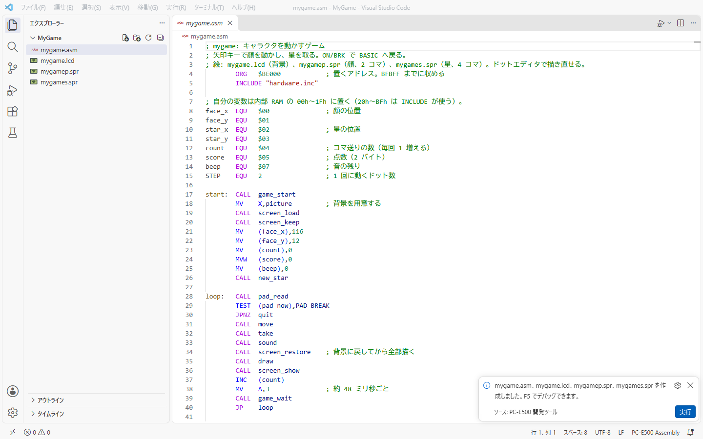
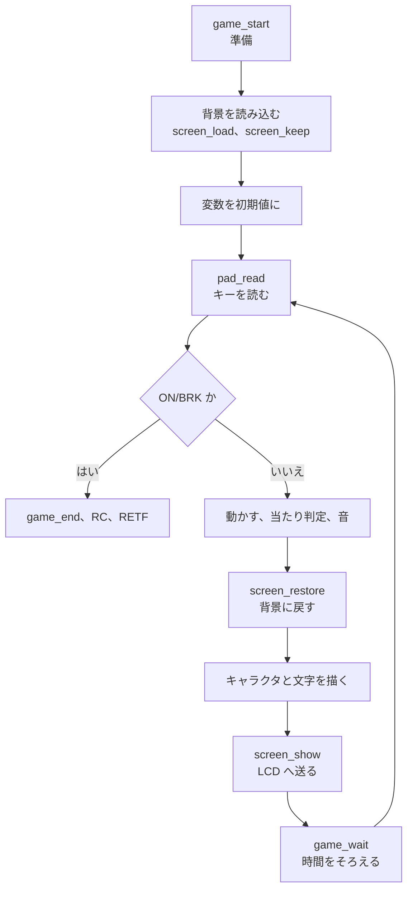
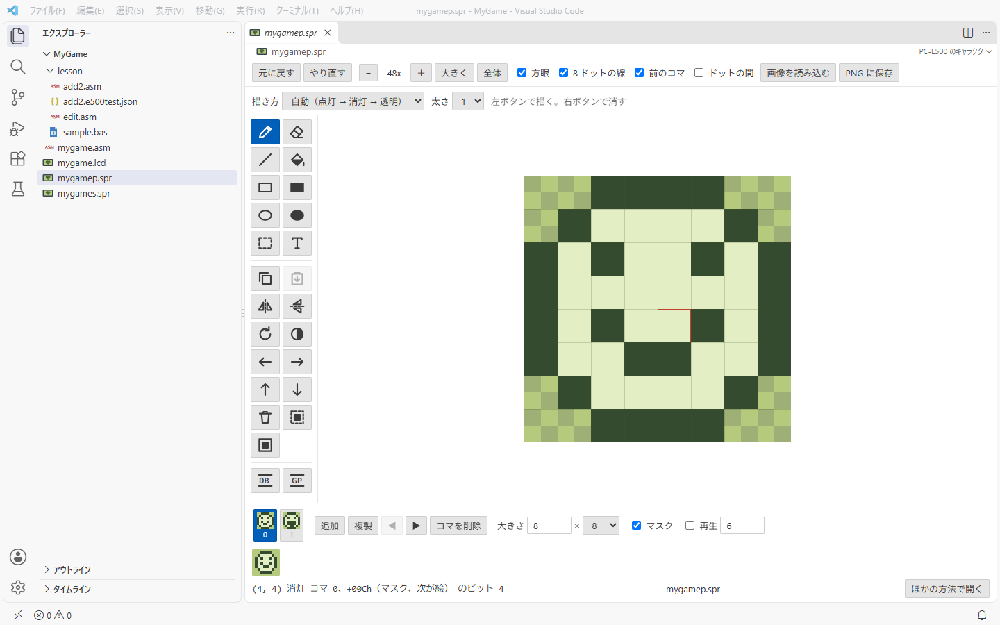
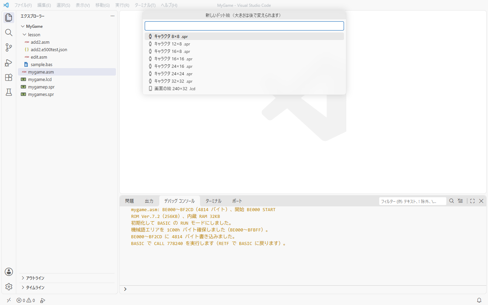
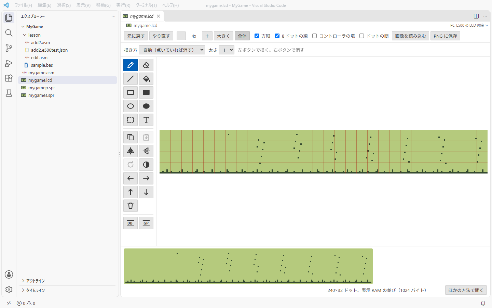
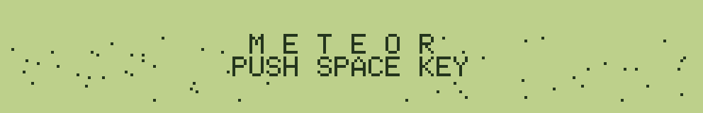
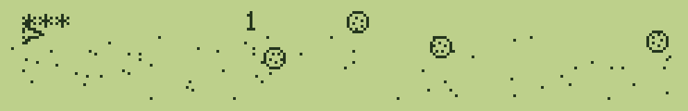
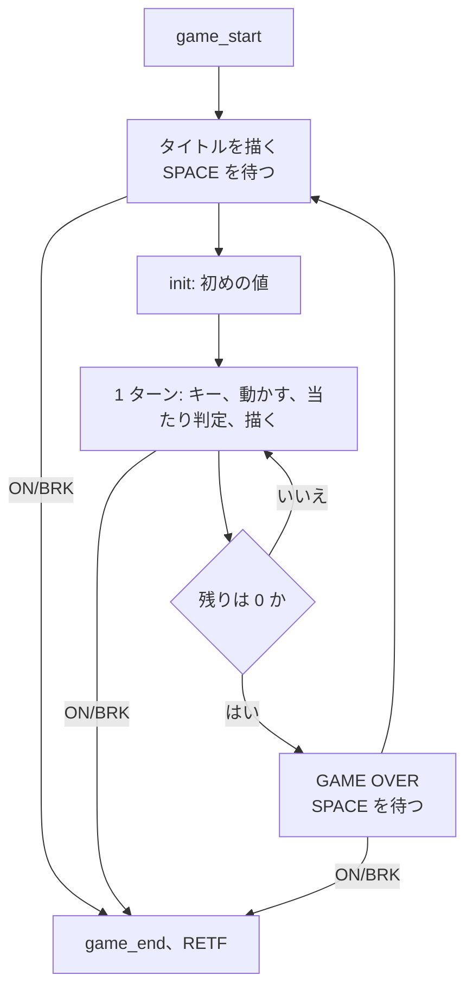
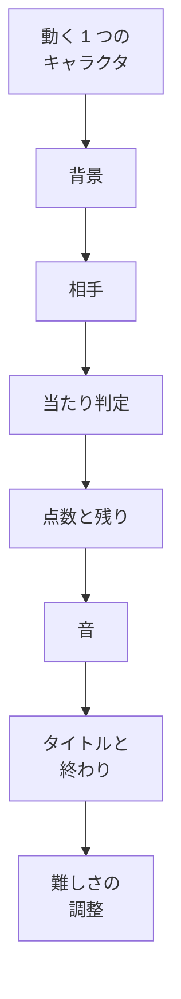

# 7. ゲームを作る

この章は、テンプレート「キャラクタを動かすゲーム」を読み解き、敵とゲームオーバーを足して、自分のゲームにするまでの実習です。できあがりは [starcatch.asm](../../Samples/Assembler/StarCatch/starcatch.asm)、続けてもう 1 本、弾を撃つ[メテオ](../../Samples/Assembler/Meteor/meteor.asm)も作ります。

ゲームは「入力を読む、動かす、描く、待つ」を繰り返すプログラムです。この形が分かると、時計、お絵かき、グラフの表示など、画面が動くものは何でも同じように作れます。アセンブラの基本は[入門](03_ASSEMBLER_TUTORIAL.md)の例題 8（内部 RAM）まで済ませておくと、楽に読めます。

[目次へ戻る](README.md)

## 7.1 始める

1. フォルダを右クリックして「新しいプログラムを作成」→「キャラクタを動かすゲーム」。
2. 名前（例: `mygame`）を入れる。
3. `F5` で動かす。



| ファイル | 内容 | 編集 |
|---|---|---|
| `mygame.asm` | プログラム | エディタ |
| `mygame.lcd` | 背景（240 × 32 ドット） | ドットエディタ |
| `mygamep.spr` | 顔（8 × 8 ドット、2 コマ） | ドットエディタ |
| `mygames.spr` | 星（8 × 8 ドット、4 コマ） | ドットエディタ |

## 7.2 ゲームの流れ

映画のフィルムのように、少しずつ違う絵を続けて見せると、動いて見えます。ゲームでは、キーの状態に応じて次の絵をその場で作ります。1 枚の絵を作る作業をいつも同じ順番で行うのが、ゲームの流れです。



1 周を 1 **ターン**と呼びます。毎ターン「背景に戻す → 全部描く → LCD に送る」ので、前に描いたものを消す処理は要りません。

### 1 ターンの時間

| 処理 | 時間の目安 |
|---|---|
| `screen_restore` | 約 5 ミリ秒 |
| `screen_show` | 約 22 ミリ秒 |
| `sprite_draw`（9 × 16 ドット、マスクあり） | 約 6 ミリ秒 |
| `game_wait` | 残りを待って約 48 ミリ秒にそろえる（`A` = 3） |

時間のほとんどは LCD への転送です。テンプレートは 1 秒に約 16 ターンです。

## 7.3 プログラムを読む

### 変数

```asm
face_x  EQU   $00               ; 顔の位置
face_y  EQU   $01
score   EQU   $05               ; 点数（2 バイト）
```

内部 RAM の 00h〜1Fh に置きます。`(face_x)` と書けば、内部 RAM の アドレス 00hの値です。内部 RAM は `ADD (face_x),2` や `CMP (face_x),240` のように直接計算できるので、変数に向いています。

### メインループ

```asm
loop:   CALL  pad_read
        TEST  (pad_now),PAD_BREAK
        JPNZ  quit
        CALL  move
        CALL  take
        CALL  sound
        CALL  screen_restore
        CALL  draw
        CALL  screen_show
        INC   (count)
        MV    A,3
        CALL  game_wait
        JP    loop
```

処理ごとにサブルーチンに分けてあります。`count` は毎ターン 1 増えるので、アニメーションのコマを選ぶのに使えます。

### 動かす

```asm
move:   TEST  (pad_now),PAD_LEFT
        JRZ   move_1            ; 押されていない
        CMP   (face_x),STEP
        JRC   move_1            ; 左端
        SUB   (face_x),STEP
move_1: …
```

「押されているか」「端か」「動かす」の順です。

### 当たり判定

```asm
take:   MV    (hit_ax),(face_x)
        MV    (hit_ay),(face_y)
        MV    (hit_aw),8
        MV    (hit_ah),8
        …
        CALL  box_hit
        JRNC  take_1            ; 重なっていない
```

2 つの四角の位置と大きさを入れて `box_hit` を呼ぶと、重なっていれば `C` が 1 になります。

### 描く

```asm
        MV    (sprite_x),(star_x)
        MV    (sprite_x+1),0
        MV    (sprite_y),(star_y)
        MV    X,star
        MV    A,(count)
        RC
        SHR   A                 ; 2 で割る
        AND   A,3               ; 0〜3 を繰り返す
        CALL  sprite_draw
```

`sprite_x` は 2 バイトなので、上位も入れます。後から描いたものが手前になります。

## 7.4 絵を変える

プログラムを 1 行も変えずに、絵だけを差し替えられます。絵のファイルは `INCBIN` で取り込まれているので、保存して `F5` を押せば、次の実行から新しい絵になります。

### キャラクタ

`mygamep.spr` をクリックすると、ドットエディタで開きます。



- 左ボタンで 1 ドットずつ「点灯 → 消灯 → 透明」と変わります。市松模様が透明（背景が見える所）です。
- 大きさ、コマ数は下の欄で変えられます。大きさを変えたら、プログラムの当たり判定（`hit_aw` など）と端の判定（`240-8-STEP+1` など）も合わせます。
- コマ数を変えたら、コマの選び方（`AND A,3` など）を合わせます。

新しいキャラクタは、フォルダを右クリック →「新しいドット絵を作成」で作ります。



### 背景

`mygame.lcd` をクリックして描きます。図形、文字、画像の読み込みが使えます（[ドットエディタ](12_DOT_EDITOR.md)）。



## 7.5 敵を足す

1 つのものを増やす作業は、いつも 4 つに分かれます。**場所を表す変数を作る、始めの値を決める、毎ターン動かす、描く**。それに、ぶつかったときの処理が加わります。敵でも弾でも、この順に書けば抜けが出ません。

左へ動き続ける敵を 1 つ足します。

**1. 絵を作る。** 「新しいドット絵を作成」→「キャラクタ 8×8」→ `mygamee`。

**2. 変数を足す。** `beep EQU $07` の後に書きます。

```asm
enemy_x EQU   $08               ; 敵の位置
enemy_y EQU   $09
```

**3. 初期値を入れる。** `CALL new_star` の前に書きます。

```asm
        MV    (enemy_x),232
        MV    (enemy_y),12
```

**4. 動かす。** `CALL take` の後に `CALL enemy` を足し、サブルーチンを書きます。

```asm
; 敵を左へ動かす。端まで来たら、右端の別の高さから出す。
enemy:  CMP   (enemy_x),3
        JRC   enemy_1
        SUB   (enemy_x),3
        RET
enemy_1:
        MV    (enemy_x),232
        MV    IL,24
        CALL  random_below      ; 0〜23
        MV    (enemy_y),A
        RET
```

**5. 描く。** `draw` の、顔を描く前に足します。

```asm
        MV    (sprite_x),(enemy_x)
        MV    (sprite_x+1),0
        MV    (sprite_y),(enemy_y)
        MV    X,foe
        MV    A,0
        CALL  sprite_draw
```

**6. 絵を入れる。** `star: INCBIN …` の後に書きます。

```asm
foe:    INCBIN "mygamee.spr"
```

`F5` で動かすと、敵が右から左へ飛んできます。

## 7.6 ゲームオーバー

**1. 当たり判定を書く。** 周りの 1 ドットは見逃すと、遊びやすくなります。

```asm
; 顔と敵が重なっていれば C = 1（周りの 1 ドットは見逃す）。
crash:  MV    (hit_ax),(face_x)
        INC   (hit_ax)
        MV    (hit_ay),(face_y)
        INC   (hit_ay)
        MV    (hit_aw),6
        MV    (hit_ah),6
        MV    (hit_bx),(enemy_x)
        MV    (hit_by),(enemy_y)
        MV    (hit_bw),8
        MV    (hit_bh),8
        JP    box_hit           ; box_hit の RET で、そのまま戻る
```

**2. ループに足す。** `CALL screen_show` の後に書きます。

```asm
        CALL  crash             ; 敵に当たったか
        JPC   over
```

**3. 終わりの処理を書く。** 初期値を入れる最初の行には `begin:` というラベルを付けておきます。

```asm
; 敵に当たった: 文字を出し、SPACE で最初から、ON/BRK で終わり。
over:   CALL  sound_off
        MV    (text_x),90
        MV    (text_row),1
        MV    X,message
        CALL  text_draw
        CALL  screen_show
over_1: CALL  pad_read
        TEST  (pad_now),PAD_BREAK
        JPNZ  quit
        TEST  (pad_new),PAD_A
        JRZ   over_1
        JP    begin

message:
        DB    "GAME OVER",0
```

SPACE は `pad_now` ではなく `pad_new` で調べます。押しっぱなしだった SPACE で、すぐに始まらないようにするためです。

## 7.7 さらに足す

| 足したいもの | 考え方 |
|---|---|
| 敵を増やす | 位置を並べて持つ（`enemy_x` から 4 バイト、`enemy_y` から 4 バイト）。`PX` を進めながら繰り返す |
| だんだん速くする | `game_wait` の `A` を、点数に応じて 3 → 2 → 1 と減らす |
| ジャンプ | 縦の速さの変数を持ち、毎ターン「速さを足す」「速さを 1 増やす（重力）」 |
| 弾 | 撃っているかどうかの変数を持ち、撃っている間だけ動かして描く |
| タイトル画面 | 別の `.lcd` を `screen_load` → `screen_show`、`pad_new` を待つ |
| 効果音 | 鳴らす長さの変数を持ち、毎ターン減らして 0 で `sound_off` |
| 得点の記録 | 終わりに `[アドレス]` へ書き、BASIC から `PEEK` して保存する |
| マップ | 8 × 8 ドットの部品を並べて `screen` に描き、`screen_keep` で背景にする |

プログラムが大きくなったら、`ORG` を下げます。`BFBFFh` までに収まっているかは、`F5` のときのデバッグコンソールか「BIN を作成」の出力で分かります。

```text
mygame.asm: BE000〜BF2CD（4814 バイト）、開始 BE000 START
機械語エリアを 1C00h バイト確保しました（BE000〜BFBFF）。
```

## 7.8 確かめる

- 途中の値を見る: 行番号の左をクリックしてブレークポイントを置き、`F5`。パネルの「ウォッチ」に `(score):2` などを足します（[デバッグ](10_DEBUG.md)）。
- 自動で確かめる: [starcatch.e500test.json](../../Samples/Assembler/StarCatch/starcatch.e500test.json) は、敵に当たって「GAME OVER」が出ることと、ON/BRK で戻ることを調べます（[テスト](11_TESTS.md)）。
- 実機で遊ぶ: 「BIN を作成」（[実機へ送る](14_TRANSFER.md)）。

## 7.9 気をつけること

- `game_start` と `game_end` は必ず対にします。途中で `RETF` しないようにします。
- `game_start` の後は割り込みが止まっているので、IOCS のキー入力は使えません。キーは `pad_read` で読みます。
- 60h〜BFh の内部 RAM は、`screen_show` などを呼ぶたびに壊れます。
- `sprite_draw` は `A` `B` `I` `X` `Y` を変えます。残したい値は内部 RAM に置きます。
- 開発中に止まらなくなったら、`Shift+F5` で終わらせてやり直します。

## 7.10 もう 1 本: メテオ

2 本目の例は、隕石を撃つゲームです。**同じものをたくさん動かす**、**弾を撃つ**、**残りと無敵時間**、**タイトル画面**を加えました。ソースは [meteor.asm](../../Samples/Assembler/Meteor/meteor.asm) です。





### 全体の流れ



### 変数を並べて持つ

隕石 4 個の位置を、`x`、`y` の順に 2 バイトずつ並べます。

```text
内部 RAM   10h 11h   12h 13h   14h 15h   16h 17h
           x0  y0    x1  y1    x2  y2    x3  y3
```

`PX` に先頭のアドレスを入れ、2 ずつ進めながら繰り返します。`(PX)` が今の隕石の `x`、`(PX+1)` が `y` です。

```asm
fly:    MV    (PX_REG),table
        MV    (left),ROCKS
fly_1:  MV    A,(PX)
        MV    (temp),A
        MV    A,(speed)
        CMP   (temp),A
        JRC   fly_2             ; 左に抜けた
        SUB   (temp),A
        MV    A,(temp)
        MV    (PX),A
        JR    fly_3
fly_2:  CALL  reborn
fly_3:  PMDF  (PX_REG),2
        DEC   (left)
        JRNZ  fly_1
        RET
```

- `PMDF (PX_REG),2` は、フラグを変えずに `PX` に 2 を足します。
- 繰り返しの中で `CALL` するルーチンが `PX` を変えないことを確かめます（INCLUDE ファイルのルーチンは変えません）。
- 数を増やすには、`ROCKS` を変えるだけです（内部 RAM の 1Fh までなので 8 個まで）。

### 弾

弾は 1 発だけで、`(shot_x)` が 0 なら「撃っていない」とします。

```asm
fire:   CMP   (shot_x),0
        JRNZ  fire_1
        TEST  (pad_new),PAD_A
        JRZ   fire_2
        MV    (shot_x),16
        MV    (shot_y),(ship_y)
        MV    (beep),1
        MV    A,BZ_4K
        JP    sound_on
fire_1: ADD   (shot_x),8
        CMP   (shot_x),232
        JRC   fire_2
        MV    (shot_x),0        ; 画面の外
fire_2: RET
```

`pad_new` を見るので、SPACE を押しっぱなしにしても 1 発ずつです。`JP sound_on` は「呼んで戻る」の短い書き方です。

### 無敵時間と点滅

当たった直後は `flash` に 30 を入れ、毎ターン 1 減らします。0 でない間は当たり判定をせず、描くときに点滅させます。

```asm
draw_3: TEST  (flash),2         ; 点滅中は、消える回がある
        JRNZ  draw_4
```

`flash` のビット 1 は 2 ターンごとに変わるので、描く、描かないが交互になります。

### だんだん速く

```asm
gain:   MV    BA,(score)
        INC   BA
        MV    (score),BA
        AND   A,15
        JRNZ  gain_1
        CMP   (speed),5
        JRNC  gain_1
        INC   (speed)
gain_1: MV    (beep),2
        MV    A,BZ_2K
        JP    sound_on
```

点数の下位 4 ビットが 0 のとき（16 点ごと）に、速さを 1 増やします。`AND A,15` は「16 で割った余り」です。

### 乱数の種

タイトルで SPACE を待つ間、毎回 `random` を呼びます。押すまでの時間が人によって違うので、毎回違う並びになります。

### 収まっているかの確認

最後の `ASSERT` は、プログラムの終わりが `BFC00h` を超えたらアセンブルのエラーにします。大きくなったら `ORG` を下げます。

## 7.11 ゲームを作る順番



- 1 つ足すたびに `F5` で確かめます。一度にたくさん書くと、間違いの場所が分からなくなります。
- 数や速さは `EQU` にして、上にまとめます。あとで調整しやすくなります。
- 描くものが増えたら、1 ターンの時間を確かめます。遅くなったら、`game_wait` の待ちが減るだけでは追いつかなくなります。

### 速さの見積もり

| 項目 | 数 | 1 つの時間 | 合計 |
|---|---|---|---|
| 背景に戻す | 1 | 約 5 ミリ秒 | 5 |
| LCD へ送る | 1 | 約 22 ミリ秒 | 22 |
| キャラクタ 8 × 8（マスクあり） | 6 | 約 2 ミリ秒 | 12 |
| 5 桁の数 | 1 | 約 2 ミリ秒 | 2 |
| 文字 | 3 | 約 0.2 ミリ秒 | 1 |
| キー、当たり判定、乱数 | 1 | 1 ミリ秒以下 | 1 |
| 合計 | | | 約 43 ミリ秒（1 秒に約 23 回） |

これはエミュレータで測った値です。`game_wait` の `A` = 3（約 48 ミリ秒）に収まるので、一定の速さで動きます。

止めて測るには、デバッグ画面の「サイクル」を、処理の前後で比べます（768 サイクルで 1 ミリ秒）。
