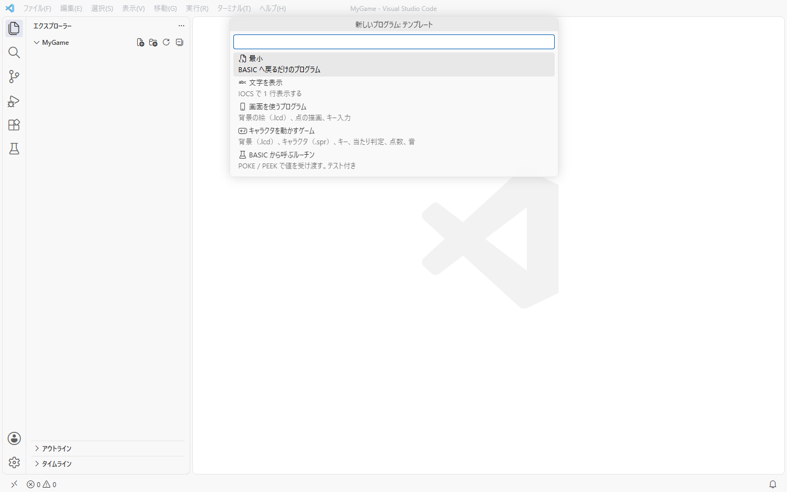
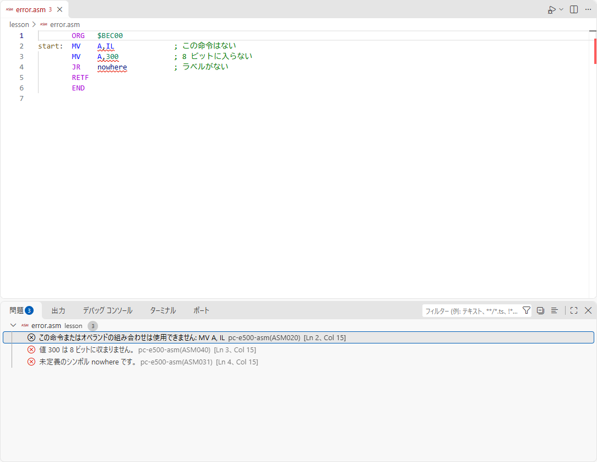
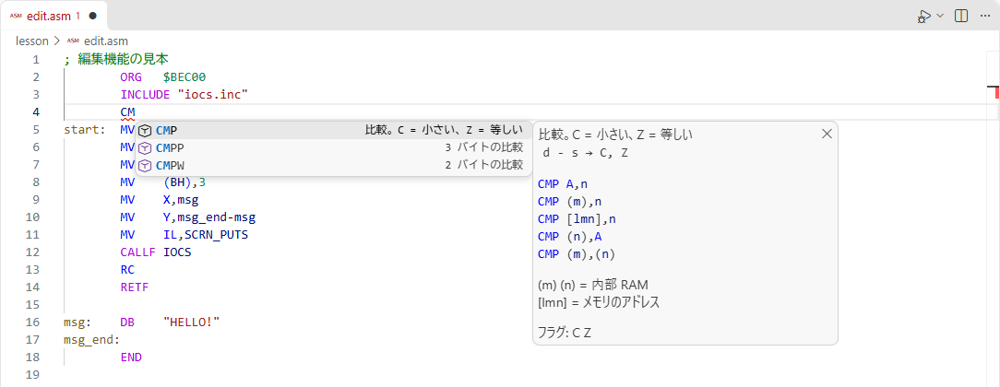
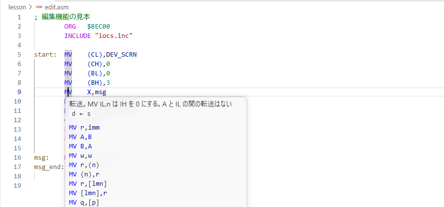
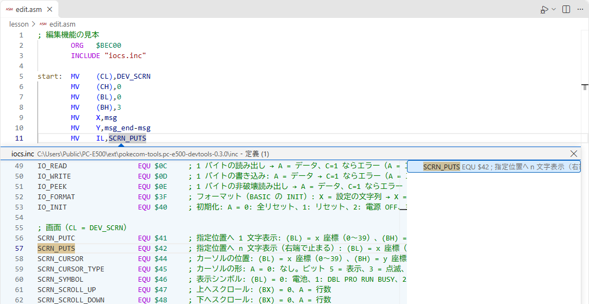
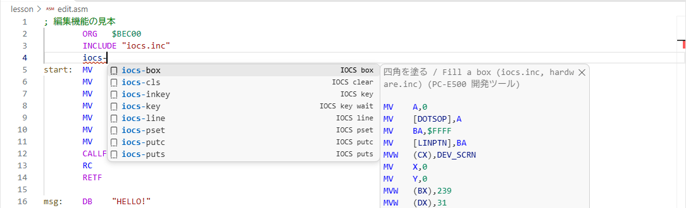
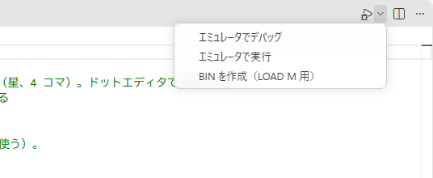
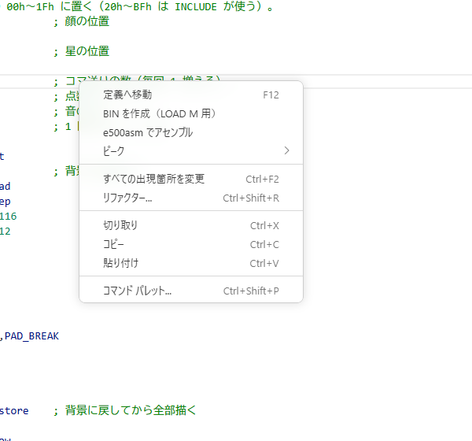
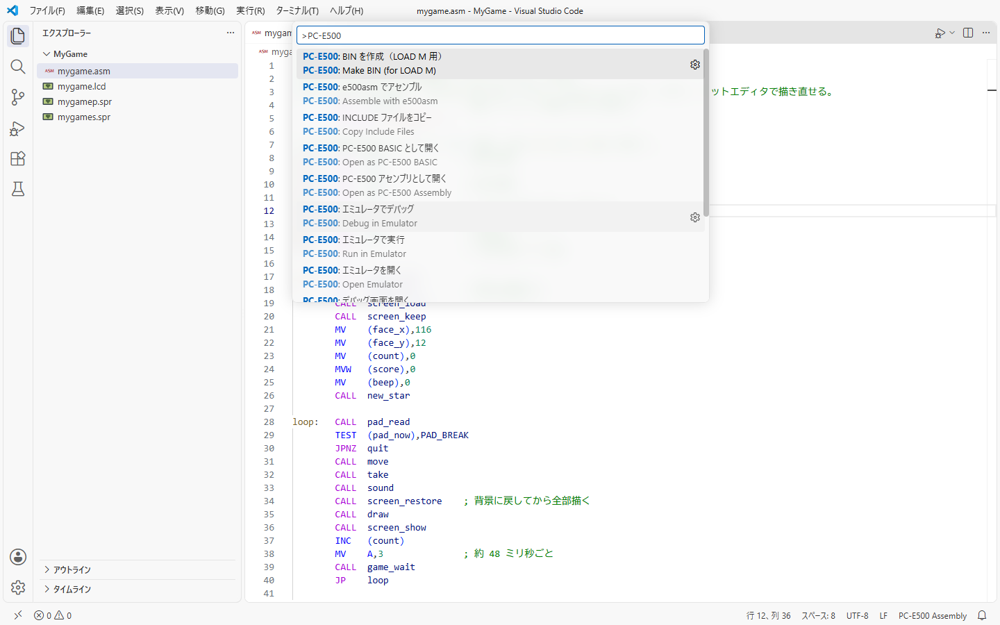
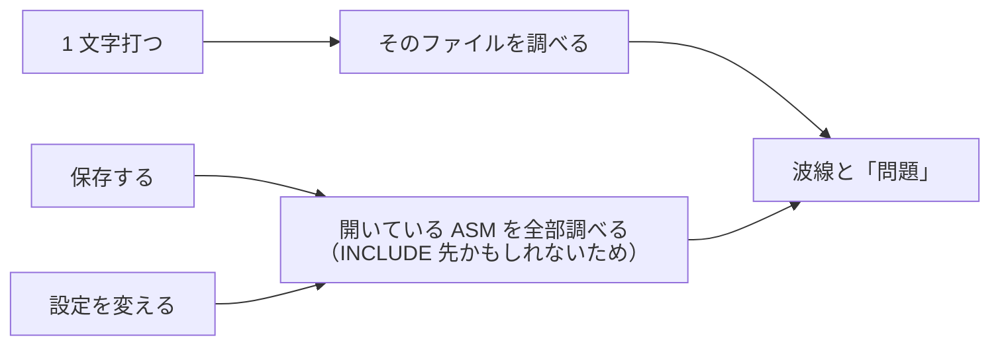

# 8. 編集

この章はプログラムを書いている間に VS Code が助けてくれることを説明します。間違いの赤い印、打ちかけの言葉の続き、マウスを乗せたときの説明、名前の定義への移動などです。どれもソースを書くだけで自動で働きます。実行やデバッグと違い、Windows でなくても使えます。

機械語は、1 文字の書き間違いが暴走につながります。実行する前に見つかる間違いは、書いている間に直してしまうのが、いちばんの近道です。

[目次へ戻る](README.md)

## 8.1 対象のファイル

| 拡張子 | 扱い |
|---|---|
| `.asm` `.inc` `.e500asm` | PC-E500 アセンブリ |
| `.bas` `.basic` `.e500` | PC-E500 BASIC |
| `.lcd` `.pixels` | 画面の絵（[ドットエディタ](12_DOT_EDITOR.md)） |
| `.spr` | キャラクタ（[ドットエディタ](12_DOT_EDITOR.md)） |
| `*.e500test.json` | テスト（[テスト](11_TESTS.md)） |

ほかの拡張子のファイルはエクスプローラーかタブの右クリックで「PC-E500 アセンブリとして開く」「PC-E500 BASIC として開く」を選びます。

BASIC だけの機能は [13 章](13_BASIC.md)にあります。

## 8.2 新しいプログラム

エクスプローラーのフォルダ（または何もない所）を右クリック →「新しいプログラムを作成」。「ファイル」→「新しいファイル…」からも選べます。



| テンプレート | 内容 | できるファイル |
|---|---|---|
| 最小 | BASIC へ戻るだけ | `.asm` |
| 文字を表示 | IOCS で 1 行表示する | `.asm` |
| アプリ | メニュー、1 行入力、計算、結果の表示。テスト付き | `.asm` `.e500test.json` |
| 画面を使うプログラム | 背景の絵の上で四角を動かす。INCLUDE を使わず、LCD とキーを直接扱う | `.asm` `.lcd` |
| キャラクタを動かすゲーム | 背景、キャラクタ、キー、当たり判定、点数、音 | `.asm` `.lcd` `.spr` 2 つ |
| BASIC から呼ぶルーチン | `POKE` / `PEEK` で値を受け渡す | `.asm` `.e500test.json` |
| BASIC のアプリ | メニュー、入力、一覧、合計、ファイルへの保存。テスト付き | `.bas` `.e500test.json` |
| BASIC のゲーム | `DATA` に書いたキャラクタ、キー、点数、音。テスト付き | `.bas` `.e500test.json` |

名前は英字で始まる 8 文字までの英数字と `_` です。`launch.json` を作らなくても `F5` で動きます。

## 8.3 間違いの表示

拡張機能には `e500asm` と同じ文法のアセンブラが入っていて、打つたびに裏でアセンブルしています。だから、ここで印が出なければ、ふつうは `e500asm` でも通ります。印は、波線（その場所）、「問題」の一覧（全部）、エクスプローラーの赤い数（ファイルごと）の 3 か所に出ます。

書いている間に調べ、波線と「問題」パネル（`Ctrl+Shift+M`）に出します。



- アセンブラが断るものと同じ内容です。ファイル全体を調べて、まとめて出します。
- 「問題」の行をクリックすると、その場所へ移ります。
- `INCLUDE` したファイルの中の間違いは `INCLUDE` の行に出ます。
- `INCLUDE` と `INCBIN` は保存したファイルでだけ調べます。

| コード | 内容 |
|---|---|
| `ASM001` | アドレス配置が収束しない |
| `ASM010` | 文字列、括弧、数の書き間違い |
| `ASM020` | ない命令、ないオペランドの組み合わせ |
| `ASM021` | オペランドの個数 |
| `ASM030`〜`ASM032` | 名前の重複、未定義、`EQU` の循環 |
| `ASM040` | 値の範囲 |
| `ASM041` | 分岐の届く範囲 |
| `ASM050` | 出力の重複 |
| `ASM060` | `INCLUDE` / `INCBIN` のファイル |
| `ASM070` | `ASSERT` |

メッセージの一覧は[アセンブラの文法](04_ASSEMBLER_REFERENCE.md#49-エラーメッセージ)にあります。

## 8.4 候補

命令の綴りや IOCS の番号を覚える必要はありません。最初の 1〜2 文字を打つと、その場所で書けるものだけが並びます。候補を選んでいる間は、右側に短い説明が出るので、調べる画面へ移らずに選べます。

打っている間に出ます。出ないときは `Ctrl+Space` を押します。



| 場所 | 候補 |
|---|---|
| 行の先頭 | 命令と疑似命令（説明、書ける形、フラグつき） |
| オペランド | その命令に使えるレジスタ、ラベル、定数 |
| `[` の後 | `X` `Y` `U` `S` |
| `(` の後 | `BP` `PX` `PY`、ラベル、定数 |
| `MV IL,` の後 | IOCS の番号（直前の `(CL)` のデバイスから） |
| `INCLUDE "` の後 | 読み込めるファイル |
| 名前だけの後 | `EQU` |

小文字で打ち始めると、小文字で入ります。`Enter` か `Tab` で決まります。

## 8.5 説明

マウスを乗せると出ます。



| 乗せるもの | 出るもの |
|---|---|
| 命令 | 働き、動作、書ける形、変わるフラグ |
| 疑似命令 | 働き、書き方 |
| レジスタ | 大きさ、用途 |
| ラベル、定数 | 定義の行、値 |
| IOCS の名前か番号 | 機能、渡すもの、返るもの |

## 8.6 定義へ移動

プログラムが長くなると、「この名前はどこで決めたのか」を探す時間が増えます。定義へ移動すると、別のファイルでも、INCLUDE ファイルの中でも、その行へ跳べます。戻るのは `Alt+←` です。

| 操作 | 働き |
|---|---|
| `Ctrl` + クリック、`F12` | 定義へ移る |
| `Alt` + `F12` | その場で覗く |
| `Alt` + `←` | 元の場所へ戻る |
| `INCLUDE` / `INCBIN` のファイル名を `Ctrl` + クリック | そのファイルを開く |



`INCLUDE` したファイルの定義にも移れます。読み込まれる側のファイルから、読み込む側の定義にも移れます。

## 8.7 スニペット

決まった数行をまとめて入れます。打って `Tab` を押すと、`Tab` で順に値を埋められます。



| 打つ文字 | 入るもの |
|---|---|
| `iocs` `iocs-puts` `iocs-putc` `iocs-cls` `iocs-pset` `iocs-line` `iocs-box` `iocs-key` `iocs-inkey` | IOCS の呼び出し |
| `sprite` | キャラクタを描く |
| `game-loop` | ゲームの骨組み |

## 8.8 実行ボタンと右クリック

エディタの右上に実行ボタンがあります。



| 項目 | 働き |
|---|---|
| エミュレータでデバッグ（`F5`） | 動かす。ブレークポイントで止まる |
| エミュレータで実行（`Ctrl+F5`） | 動かす。止まらない |
| BIN を作成（LOAD M 用） | 実機用のファイルを作る（[実機へ送る](14_TRANSFER.md)） |

エディタの右クリックには「BIN を作成」「e500asm でアセンブル」があります。



すべてのコマンドは `Ctrl+Shift+P` で「PC-E500」と打つと出ます。



## 8.9 e500asm でアセンブル

本物の `e500asm` で `.bin` を作ります。設定 `pcE500.asm.assemblerPath` か PATH の `e500asm` を使い、設定の INCLUDE の場所（`-I`）と定数（`-D`）を付けます。結果は「出力」の「PC-E500」に出ます。

リストやシンボル表も欲しいときは、コマンドラインで実行します（[アセンブラの文法](04_ASSEMBLER_REFERENCE.md#41-コマンドライン)）。

## 8.10 書き方をそろえる

| 列 | 内容 |
|---|---|
| 1 | ラベル |
| 9 | 命令 |
| 15 | オペランド |
| 33 | コメント |

`Tab` を空白にして幅を 8 にすると、そろえやすくなります。

```jsonc
// .vscode/settings.json
{
  "[pc-e500-asm]": {
    "editor.insertSpaces": true,
    "editor.tabSize": 8,
    "editor.rulers": [40, 80]
  },
  "files.encoding": "utf8",
  "files.associations": { "*.a62": "pc-e500-asm" }
}
```

`files.associations` を使うと、ほかの拡張子もいつも ASM として開きます。

## 8.11 知っていると便利な VS Code の操作

| 操作 | 働き |
|---|---|
| `Ctrl+/` | 選んだ行をコメントにする、戻す |
| `Alt+↑` / `Alt+↓` | 行を動かす |
| `Shift+Alt+↓` | 行をコピーする |
| `Alt` + クリック | カーソルを増やす（何か所も同時に打つ） |
| `Shift+Alt` + ドラッグ | 四角く選ぶ（コメントの列をそろえるのに便利） |
| `Ctrl+D` | 同じ言葉を次々に選ぶ |
| `Ctrl+Shift+F` | フォルダ全体から探す |
| `Ctrl+P` | ファイルを名前で開く |
| `Ctrl+G` | 行番号へ移る |
| `F8` | 次の問題へ移る |
| `Ctrl+K Z` | エディタだけにする |

## 8.12 ファイルを分けるとき

```text
game/
  main.asm         ORG、変数、メインの流れ
  draw.asm         描く部分
  sound.asm        音
  title.lcd        絵
  player.spr
  main.e500test.json
```

| 決めておくこと | 例 |
|---|---|
| `ORG` は 1 か所だけ | `main.asm` の先頭 |
| 変数のアドレスは 1 か所にまとめる | `main.asm` の `EQU` |
| 名前の頭にファイルの名前を付ける | `draw_title`、`sound_hit` |
| 部品のファイルに `END` を書かない | `END` でそこで終わってしまう |

部品のファイルを開いて `F5` を押すと、その部品だけをアセンブルしようとします。いつも `main.asm` を動かすには、`launch.json` の `program` に `${workspaceFolder}/main.asm` と書きます（[設定とコマンド](17_SETTINGS.md#174-launchjson)）。

## 8.13 何がいつ調べられるか



| 場面 | 使われる内容 |
|---|---|
| 波線、`F5`、テスト | 開いているエディタの内容（保存していなくてもよい） |
| `INCLUDE` / `INCBIN` 先 | 保存されたファイル |
| 「BIN を作成」「e500asm でアセンブル」 | 保存してから作る |
