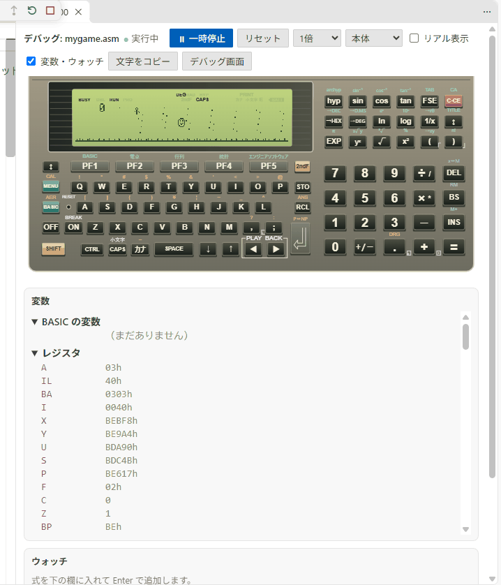
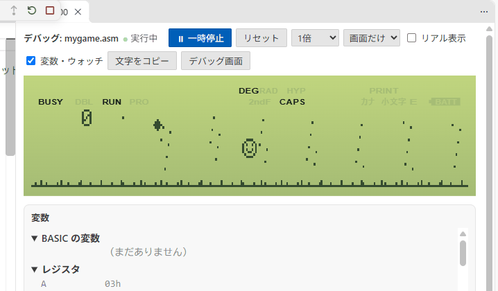
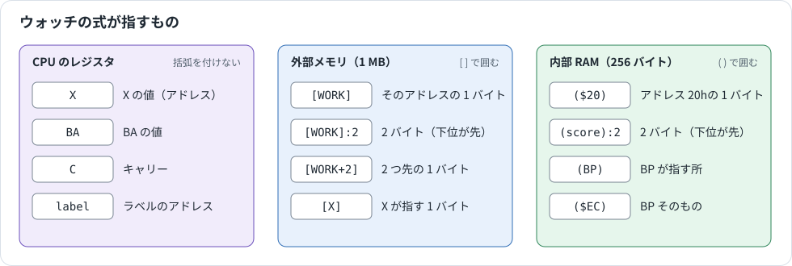
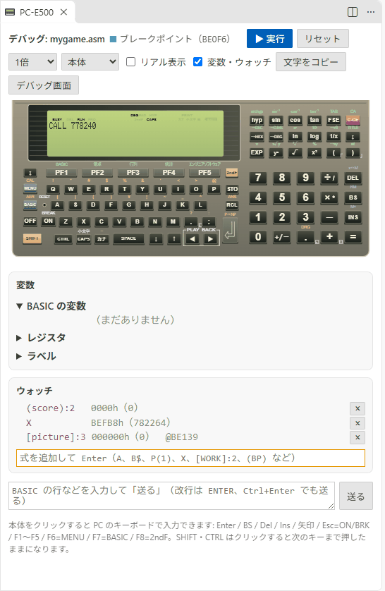
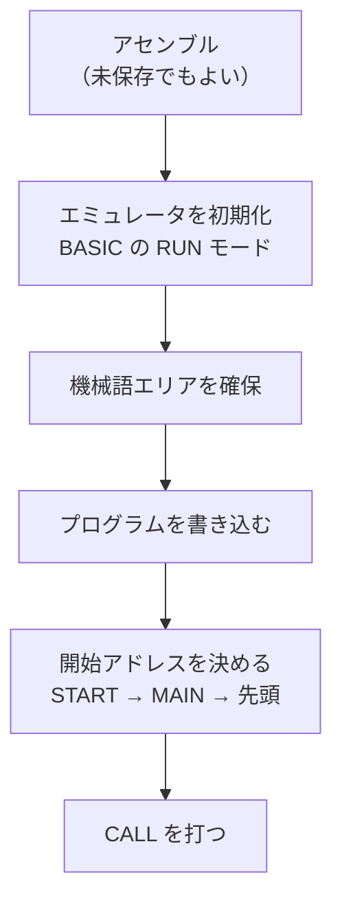
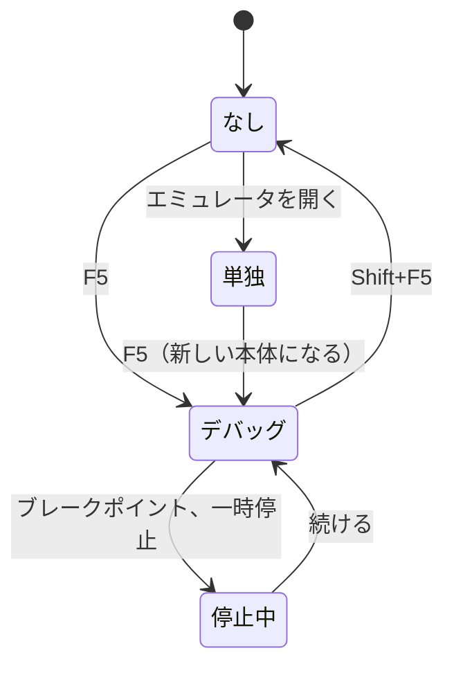

# 9. エミュレータのパネル

この章は VS Code の中に PC-E500 の本体を表示する「パネル」の使い方です（Windows 専用）。パネルには、本体の絵、液晶、キー、変数の一覧がまとまっていて、プログラムを動かしながら中の値を見られます。止めて細かく調べる方法は次の[デバッグ](10_DEBUG.md)の章にあるので、ここでは「動かす」「触る」「眺める」までを扱います。

中で動いているのは、自分で用意した ROM そのものです。BASIC の計算も、エラーの出方も、ROM が決めたとおりになります。

[目次へ戻る](README.md)

## 9.1 開く

| 操作 | 起きること |
|---|---|
| `.asm` / `.bas` で `F5` | パネルが開き、プログラムが動く |
| コマンド「PC-E500: エミュレータを開く」 | プログラムなしで起動し、BASIC のプロンプトになる |



1 つの VS Code で動く本体は 1 台です。`F5` のたびに初期化した本体から始まります。

## 9.2 上のボタン

| ボタン | 働き |
|---|---|
| ▶ 実行 / ⏸ 一時停止 | 動かす、止める |
| リセット | RESET ボタンを押す（RAM は残る） |
| 1倍 / 2倍 / 4倍 / 最高速 | 速さ |
| 本体 / 画面だけ | 表示。「画面だけ」は液晶と表示シンボルだけ |
| リアル表示 | ドットの間をあけて、実機の液晶のように見せる |
| 変数・ウォッチ | 下の一覧を出す、隠す |
| 文字をコピー | 液晶の文字をクリップボードへ |
| デバッグ画面 | レジスタとメモリの画面を開く（[デバッグ](10_DEBUG.md#107-デバッグ画面)） |

| 画面だけ | リアル表示 |
|---|---|
|  |  |

## 9.3 キー

本体のキーはマウスと PC のキーボードのどちらでも押せます。文字を打つときは PC のキーボードが速く、`BASIC` や `MENU` のように PC にないキーは、絵を押すか、決められた F キーを使います。

本体の絵のキーはクリックで押せます。本体を 1 回クリックすると、PC のキーボードでも打てます。

| PC | 本体 |
|---|---|
| 文字、数字、記号 | 同じ文字 |
| `Enter` `Backspace` `Delete` `Insert` | RETURN、BS、DEL、INS |
| 矢印 | ◀ ▶ ▲ ▼ |
| `Esc` | ON/BRK |
| `F1`〜`F5` | PF1〜PF5 |
| `F6` / `F7` / `F8` | MENU / BASIC / 2ndF |
| `Ctrl` | CTRL |

SHIFT と CTRL はクリックすると次のキーまで押したままになります。

### まとめて送る

下の欄に BASIC の行などを書いて「送る」を押すと、1 文字ずつ打ち込みます。改行は RETURN です。`Ctrl+Enter` でも送れます。キーで打てない文字は省かれ、通知が出ます。

## 9.4 変数とウォッチ

「変数」は、パネルが自分で見つけて並べるものです。「ウォッチ」は、見たいものを自分で式で書くものです。BASIC の変数を眺めるなら前者、ASM の作業域や計算したアドレスを見るなら後者を使います。

ウォッチの式では、`[ ]` と `( )` の意味が違います。ここを押さえると、あとは ASM と同じ感覚で書けます。



実行中も 0.5 秒ごとに読み直します。



| 欄 | 内容 |
|---|---|
| BASIC の変数 | 数値、文字列、配列（開くと要素） |
| レジスタ | `A`〜`S`、`C`、`Z` |
| ラベル | ASM のデバッグ中だけ。ラベルと中身 |
| ウォッチ | 自分で足した式 |

### ウォッチの書き方

| 式 | 意味 |
|---|---|
| `X`、`BA`、`C` | レジスタ、フラグ |
| `A`、`B$`、`P(1)`、`S(1,2)` | BASIC の変数 |
| `label`、`msg_end-msg` | ラベルのアドレス、式 |
| `[WORK]` | 外部メモリの 1 バイト |
| `[WORK]:2`、`[WORK]:3` | 2、3 バイト（下位が先） |
| `($20)`、`(score):2` | 内部 RAM |
| `(BP)`、`(BP+1)`、`(PX)` | `BP`、`PX`、`PY` が指す内部 RAM |
| `BP`、`PX`、`PY` | ポインタそのもの |

- ウォッチはワークスペースごとに覚えます。`x` で消します。
- `A` など、レジスタと BASIC の変数で同じ名前のものは、BASIC のデバッグ中は変数、ASM ではレジスタです。

### 書き換える

止めているときに、値をダブルクリックして書き換えます。

| 対象 | 書き方 |
|---|---|
| レジスタ、フラグ | `&H1234`、`1234h`、`$BED00`、`msg+1`、10 進 |
| ラベルの中身、`[WORK]` | `03 04 FF`（16 進の並び）か `"ABC"` |
| `[WORK]:2` など | 数 |
| 内部 RAM | 00h〜EEh だけ |
| BASIC の変数 | 数、同じ長さの文字列（行の直前で止まっているとき） |

入らない大きさの値は断られます。

## 9.5 F5 で起きること



経過は「デバッグ コンソール」に出ます。

```text
mygame.asm: BE000〜BF2CD（4814 バイト）、開始 BE000 START
ROM Ver.7.2（256KB）、内蔵 RAM 32KB
初期化して BASIC の RUN モードにしました。
機械語エリアを 1C00h バイト確保しました（BE000〜BFBFF）。
BE000〜BF2CD に 4814 バイト書き込みました。
BASIC で CALL 778240 を実行します（RETF で BASIC に戻ります）。
```

- アセンブルに失敗したときは動かさず、エラーを表示します。
- 機械語エリアは、プログラムが `BFC00h` より下の内蔵 RAM にあるとき、そこまで確保します。確保できない大きさのときは、その旨を表示して、そのまま書き込みます。
- 開始アドレスは `launch.json` の `entry` で変えられます（[設定とコマンド](17_SETTINGS.md#174-launchjson)）。

## 9.6 できないこと

- 音は出ません。
- 外部機器（プリンタ、カセットなど）はありません。X: ドライブは BASIC の `F5` でプログラムを読み込むために使います。そこへ書いたファイルは、終わっても一時フォルダに残り、場所がデバッグコンソールに出ます。

エミュレータ本体のアプリでは音や X: ドライブなども使えます。「BIN を作成」→「X: フォルダにコピー」で渡せます。

## 9.7 使い方の例

### BASIC を試す

1. 「PC-E500: エミュレータを開く」を実行する。
2. 下の欄に行番号なしの命令を書いて「送る」を押す。

   ```basic
   PRINT SQR 2
   ```

3. 液晶に答えが出る。「文字をコピー」で液晶の文字を取り出せる。

### 機械語を作りながら BASIC で試す

`F5` で動かしたプログラムが `RETF` で BASIC に戻ると、そのままプロンプトになります。続けて、下の欄から何度でも呼べます。

```basic
POKE &HBEC00,200,100:CALL &HBEC04:PRINT PEEK &HBEC02
```

ラベルのアドレスはパネルの「変数」→「ラベル」で分かります。

### 遅い処理を見る、速く済ませる

| したいこと | 速さ |
|---|---|
| 実機と同じ速さで見る | 1倍 |
| タイトルなどを早く飛ばす | 4倍、最高速 |
| 長い計算を終わらせる | 最高速 |

速さは動いている途中でも変えられます。

## 9.8 表示シンボル

液晶のいちばん上には、文字や絵とは別に、決まった形の印が並んでいます。プログラムからも点けたり消したりできますが、ふつうは本体の状態を知らせるために ROM が使います。「キーが思ったとおりに入らない」ときは、まずここを見てください。2ndF やカナの印が点いていることがよくあります。

液晶の上の段に出る印です。

| 印 | 意味 |
|---|---|
| BUSY | プログラムの実行中 |
| RUN、PRO | RUN モード、PRO モード |
| CAPS | 大文字で入る |
| カナ、小文字 | カナ入力、小文字 |
| 2ndF、hyp | 2ndF キー、hyp キーを押した |
| DE G RAD | 角度の単位（DEG、RAD、GRAD） |
| PRINT | 印字する設定 |
| E | エラー |
| BATT | 電池 |

## 9.9 状態を残して始める

エミュレータのアプリで保存した状態（`*.e500state`）から始められます。長い準備（BASIC のプログラムを入れておく、変数を作っておく）を毎回しなくて済みます。

```jsonc
{
  "type": "pc-e500", "request": "launch", "name": "準備した状態から",
  "program": "${file}", "state": "${workspaceFolder}/ready.e500state"
}
```

状態の ROM と内蔵 RAM の大きさは設定と同じものにします。

## 9.10 パネルとデバッグの関係



パネルを閉じても、本体は動いたままです。もう一度開くには「PC-E500: エミュレータを開く」を実行します。
