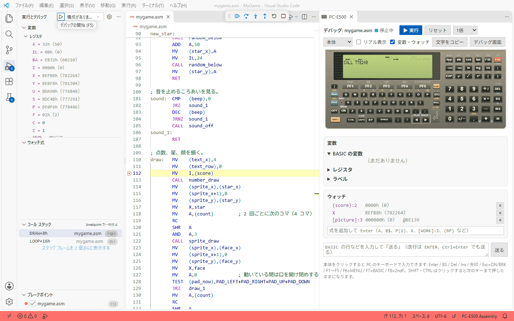
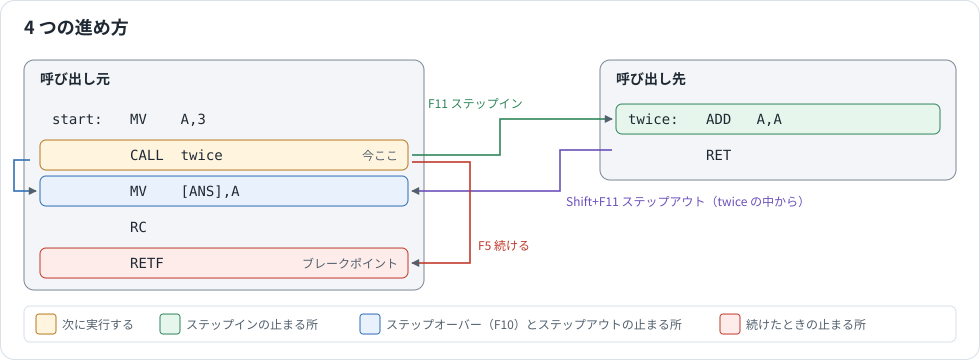
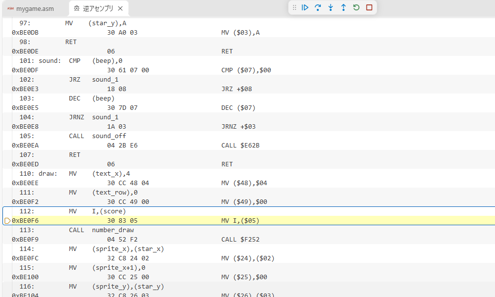
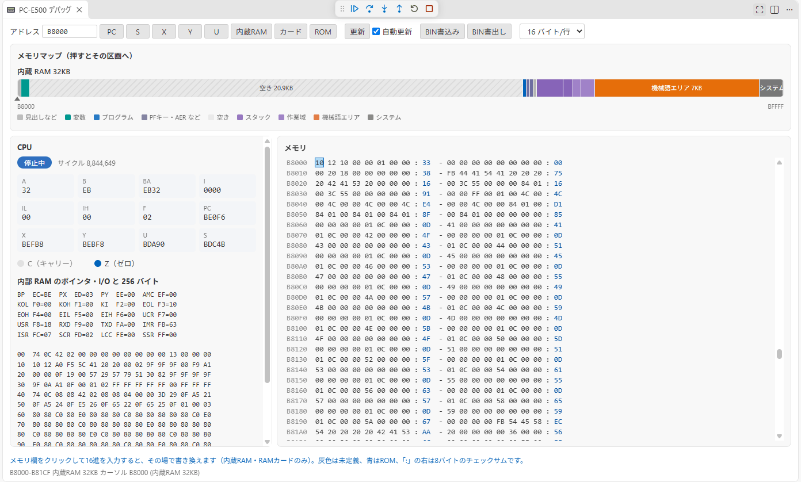
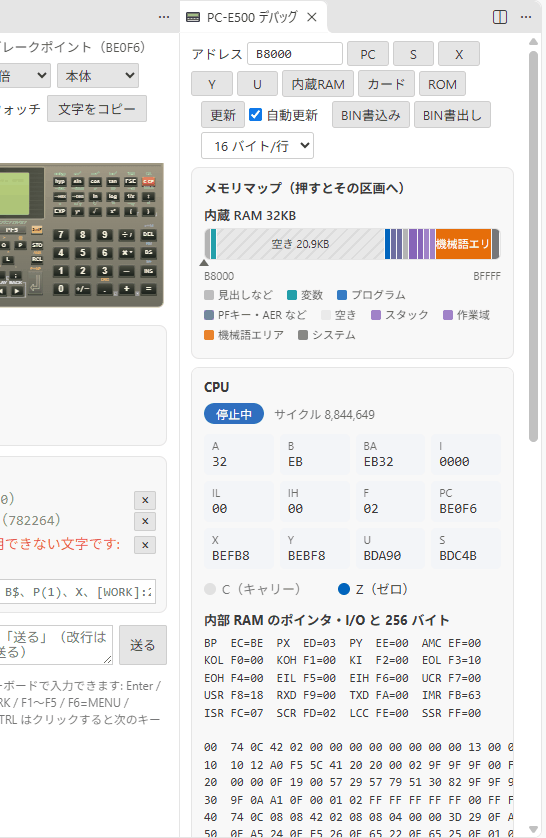
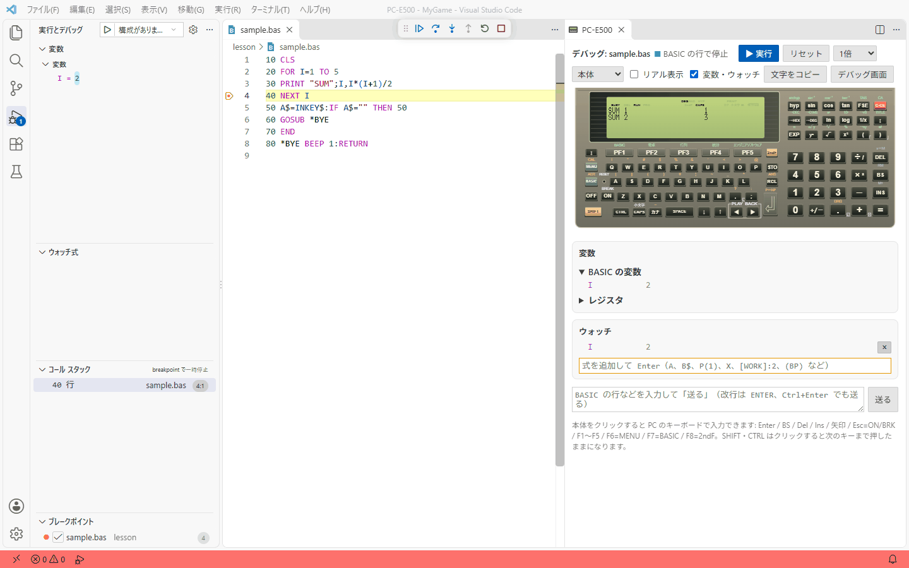

# 10. デバッグ

この章は、プログラムを途中で止めて、1 命令ずつ進め、中の値を見たり書き換えたりする方法を説明します（Windows 専用）。「動かない」「たまに変になる」の原因は、ソースを眺めるより、動いている現場を止めて見るほうが、ずっと早く見つかります。

実機では、機械語を途中で止めて中を見ることはほとんどできません。エミュレータなら、CPU の全レジスタ、内部 RAM、1 MB のメモリのすべてを、好きな命令の直前で見られます。後半の実例では、よくある 4 つの間違いを、実際の手順で追いかけます。

[目次へ戻る](README.md)

## 10.1 はじめの一歩

1. `.asm` を開き、止めたい行の番号の左をクリックする。赤い丸（ブレークポイント）が付く。
2. `F5` を押す。その行を実行する**直前**で止まる。
3. `F11` を押すたびに 1 命令ずつ進む。左の「変数」とパネルの「ウォッチ」で値を見る。
4. `F5` で続け、`Shift+F5` で終わる。



黄色の行が、次に実行する行です。

## 10.2 操作

止まったあとの進め方は 4 通りあります。どれを使うかは「呼び出し先の中を見たいか」で決まります。



- **ステップイン**は、次の 1 命令だけを実行します。`CALL` なら、呼び出し先の先頭で止まります。
- **ステップオーバー**は、`CALL` の先を全部済ませて、次の行で止まります。正しいと分かっているルーチンや IOCS は、これで飛ばします。
- **ステップアウト**は、今いるルーチンの残りを実行して、呼び出し元へ戻ったところで止まります。入りすぎたときに使います。
- **続ける**は、次のブレークポイントまで一気に進みます。

| キー | 働き |
|---|---|
| `F5` | 始める、続ける |
| `Ctrl+F5` | ブレークポイントを無視して動かす |
| `F6` | 一時停止 |
| `F9` | ブレークポイントを付ける、外す |
| `F10` | ステップオーバー（`CALL` は呼び出し先を実行し終えてから止まる） |
| `F11` | ステップイン（1 命令。`CALL` の先にも入る） |
| `Shift+F11` | ステップアウト（今のルーチンから戻るまで） |
| `Ctrl+Shift+F5` | 最初からやり直す |
| `Shift+F5` | 終わる |

- 命令のない行に付けたブレークポイントは、次の命令に移ります。
- ステップオーバーは、割り込みの処理も飛ばします。
- ブレークポイントは、実行中に付けたり外したりできます。

## 10.3 見るところ

止まったら、3 つの場所を順に見ます。**どこにいるか**（黄色の行とコール スタック）、**値はどうか**（変数とウォッチ）、**次に何が起きるか**（黄色の行の命令）です。フラグの `C` と `Z` は、条件分岐の向きを決めるので、いつも見る癖を付けると、分岐の間違いに早く気付きます。

| 場所 | 内容 |
|---|---|
| 変数 | レジスタ、シンボル（ラベルと `EQU`）、内部 RAM（I/O） |
| ウォッチ式 | 書き方は[パネルのウォッチ](09_EMULATOR.md#ウォッチの書き方)と同じ |
| コール スタック | `CALL`、`CALLF`、割り込みの呼び出し元。クリックでその行へ移る |
| ソースの名前にマウスを乗せる | その値 |
| デバッグ コンソール | 下の欄に式を打つと値が出る |

ROM の中で止まったときは `ROM C1234` のように出ます。逆アセンブリで中を見られます。

## 10.4 書き換える

値を書き換えると、プログラムを直さずに「もし違う値だったら」を試せます。たとえば残りの数を 1 にしてゲームオーバーの処理を確かめる、`C` を 0 にしてエラーの処理へ行かないようにする、`P` を書き換えて怪しい命令を飛ばす、といった使い方です。

止めているときに、「変数」の値をダブルクリックするか、パネルの値をダブルクリックします。書き方は[パネルの説明](09_EMULATOR.md#書き換える)と同じです。

内部 RAM は 00h〜EEh だけです。`AMC`（EFh）と F0h からの I/O は、書くと動作が変わるため断ります。

## 10.5 逆アセンブリ

コール スタックを右クリック →「逆アセンブリ ビューを開く」で、機械語と命令を並べて見られます。この画面でもブレークポイントとステップが使え、ROM の中も追えます。



## 10.6 メモリ

| 方法 | できること |
|---|---|
| [デバッグ画面](#107-デバッグ画面) | 1 MB 全体の表示と書き換え |
| 拡張機能「Hex Editor」（`ms-vscode.hexeditor`）を入れる | アドレスを持つ変数の横の 16 進のボタンから、VS Code のメモリの画面で表示と書き換え（RAM だけ） |

## 10.7 デバッグ画面

パネルの「デバッグ画面」か、コマンド「PC-E500: デバッグ画面を開く」で開きます。



### 上の欄

| 項目 | 働き |
|---|---|
| アドレス | 16 進で入れて `Enter`。そのアドレスへ移る |
| PC / S / X / Y / U | レジスタが指すアドレスへ移る |
| 内蔵RAM / カード / ROM | その領域の先頭へ移る |
| 更新、自動更新 | 読み直す。自動更新は 0.25 秒ごと |
| BIN書込み | ファイルをメモリに書く。`SAVE M` のヘッダーがあれば、そのアドレスへ |
| BIN書出し | 範囲をファイルに書く（`B8000-B80FF` の形） |
| 16 / 8 バイト/行 | 1 行のバイト数 |

### メモリマップ

内蔵 RAM の使われ方を色で示します。押すと、その区画へ移ります。

| 区画 | 内容 |
|---|---|
| 変数 | BASIC の変数 |
| プログラム | BASIC のプログラム |
| 空き | 空いている所 |
| スタック | U と S のスタック |
| 作業域 | BASIC と IOCS の作業域 |
| 機械語エリア | 確保した所 |
| システム | `BFC00h` から |

### CPU

| 表示 | 書き換え（止めているとき） |
|---|---|
| 状態とサイクル数 | − |
| レジスタ、`C`、`Z` | ダブルクリック |
| 内部 RAM のポインタと I/O | − |
| 内部 RAM の 256 バイト | バイトをクリックして 16 進を打つ（00h〜EEh） |

### メモリ

- クリックして 16 進を打つと、その場で書き換わります（RAM だけ）。矢印で移ります。
- 青は ROM、灰色は未定義、`:` の右は 8 バイトのチェックサムです。
- ホイールとスクロールバーで 1 MB 全体を見られます。

画面が狭いときは、CPU とメモリが縦に並びます。



## 10.8 止まり方の種類

| 表示 | 意味 |
|---|---|
| ブレークポイント | 付けた所で止まった |
| ステップ | 1 命令進んだ |
| 一時停止 | `F6` かパネルの「一時停止」 |
| ルーチンから戻りました | `mode: direct` のルーチンが戻った |
| 未定義命令で停止 | CPU にない命令を実行しようとした。ジャンプ先の間違いや、データを実行していることが多い |

## 10.9 ルーチンを直接呼ぶ

画面やキーを使うプログラムの中の、小さな計算だけを調べたいことがあります。`mode: direct` にすると、BASIC の `CALL` を打つ代わりに、決めたレジスタの値でルーチンを始め、戻ったところで止めます。終わりを越えるステップも「戻った」として扱われるので、最後の `RET` / `RETF` まで 1 命令ずつ追えます。

BASIC を通さずに、ルーチンだけを呼べます。`launch.json` に書きます。

```jsonc
{
  "type": "pc-e500",
  "request": "launch",
  "name": "add を直接呼ぶ",
  "program": "${file}",
  "mode": "direct",
  "entry": "add",
  "return": "near",                        // RET で戻るルーチン
  "registers": { "A": 3, "IL": 4 },        // 呼ぶ前のレジスタ
  "memory": { "WORK": [1, 2, 3] },         // 呼ぶ前のメモリ
  "stopOnEntry": true,
  "stopOnReturn": true
}
```

戻ると、結果のレジスタがデバッグ コンソールに出て、CPU は呼ぶ前の状態に戻ります。同じことを自動で確かめるなら[テスト](11_TESTS.md)が便利です。

## 10.10 BASIC のデバッグ

`.bas` を開いて `F5` を押すと、エミュレータに読み込んで `RUN` します。



- 行番号のある行にブレークポイントを付けられます。行番号のない行に付けると、次の行に移ります。
- `F10` / `F11` は、次に始まる BASIC の行で止まります。`GOTO`、`GOSUB`、`FOR`〜`NEXT`、`IF` の先も追います。
- 一時停止は、次に始まる行の直前で止まります。長い `BEEP`、`WAIT`、`INPUT` は終わるまで待ちます。待っている間にもう一度押すと、その場で止まります。
- 変数は、プログラムで使っているものと、0 でない `A`〜`Z` が出ます。
- 変数の書き換えは、行の直前で止まっているときにできます。数値、配列の要素、同じ長さの文字列です。

読み込みは CE-140F から `LOAD` するのと同じで、ROM 自身が中間コードにします。空の行と行番号のない行は送りません。

## 10.11 調べ方の例

| 知りたいこと | 方法 |
|---|---|
| そこを通っているか | ブレークポイントを置いて `F5` |
| 繰り返しの途中の値 | 繰り返しの中にブレークポイントを置き、`F5` を押すたびにウォッチを見る |
| どこから呼ばれたか | コール スタック |
| いつ壊れたか | 怪しいルーチンの前後で止めて、メモリを比べる |
| 配列や文字列の中身 | ウォッチ `[table]`、デバッグ画面でアドレスを開く |
| 固まった所 | `F6` で止めて、コール スタックと現在の行を見る |
| 画面に出ない | 「画面だけ」で拡大する。IOCS の後の `C` と `A` を見る |

## 10.12 実例 1: メインメニューに戻ってしまう

```asm
        ORG   $BEC00
start:  MV    A,1
        RET                     ; 間違い
        END
```

1. `F5` で動かすと、液晶がメインメニューになる。
2. `RET` の行にブレークポイントを付けて、もう一度 `F5`。止まる。
3. `F11` を押す。ふつうなら BASIC の ROM に戻るはずが、見当違いのアドレスになる。
4. BASIC の `CALL` は 3 バイトのリターンアドレスを積んでいる。`RET` は 2 バイトしか取り出さないので、アドレスがずれる。`RETF` なら 3 バイトを取り出す。

直し方は、`RET` を `RC` と `RETF` にすることです。

## 10.13 実例 2: BASIC のエラーになる

```asm
start:  MV    A,[DATA]
        MV    IL,[DATA+1]
        ADD   A,IL
        MV    [SUM],A
        RETF                    ; C が残ったまま
```

`POKE` した数が 200 と 100 のときだけ、BASIC のエラーになります。

1. `RETF` の行にブレークポイントを付ける。
2. パネルのウォッチに `C` を足す。
3. 200 + 100 で止めると、`C` = 1 になっている。3 + 4 では 0。
4. `C` = 1 で戻るとエラーになるので、`RETF` の前に `RC` を置く。

**条件によって起きる間違いは、起きる値で止めて、フラグを見る**のがこつです。

## 10.14 実例 3: 繰り返しが終わらない

```asm
        MV    IL,[COUNT]
loop:   …
        DEC   IL
        JRNZ  loop
```

`COUNT` が 0 だと、256 回繰り返します。

1. 動かして、止まらないと思ったら `F6`（一時停止）。
2. 黄色の行とコール スタックで、どの繰り返しにいるかを見る。
3. `IL` の値を見る。`FFh` などの大きな値なら、0 から始まっている。
4. 繰り返しの前に `CMP` で 0 を調べて、飛ばす。

## 10.15 実例 4: 関係のない変数が変わる

1. 変わる変数のアドレスをウォッチに入れる（例: `(score):2`）。
2. 怪しい所の前後にブレークポイントを付け、`F5` で順に進む。
3. 値が変わった区間を、`F10` で 1 行ずつ進める。
4. 変えていた命令が分かる。多いのは次のもの。

| 原因 | 例 |
|---|---|
| `MVL` の長さ | `I` が大きすぎる。0 で 65536 バイト |
| アドレスの重なり | `EQU` で同じアドレスを 2 回使った |
| INCLUDE の作業域 | 60h〜BFh に変数を置いた |
| `PX` がずれている | 繰り返しの後に `PX` を戻していない |
| スタックの食い違い | `PUSHU` と `POPU` の数 |

## 10.16 ROM の中を追う

IOCS を呼ぶ行で `F11` を押すと、ROM の中へ入ります。ソースはないので、逆アセンブリの画面になります。

| したいこと | 操作 |
|---|---|
| IOCS を飛ばす | その行で `F10` |
| ROM の中から戻る | `Shift+F11` |
| ROM の決まったアドレスで止める | 逆アセンブリの画面で、そのアドレスにブレークポイント |
| IOCS の結果を見る | 次の行で `A`、`C`、`(BL)` などを見る |

ROM のアドレスの意味は[解析資料](../analysis/README.md)で調べられます。

## 10.17 見るものの早見表

| 見たいもの | 式 |
|---|---|
| 8 ビットの変数（内部 RAM） | `(count)` |
| 16 ビットの変数 | `(score):2` |
| 配列の 3 番目 | `[table+2]`、`(table+2)` |
| 文字列の先頭 | デバッグ画面でラベルのアドレスを開く |
| `X` が指す所 | `[X]` |
| スタックの先頭 | `[S]:2`、`[S]:3`、`[U]` |
| 計算の途中 | `finish-start`、`$BFC00-finish` |
| BASIC の変数 | `A`、`B$`、`P(1)` |
