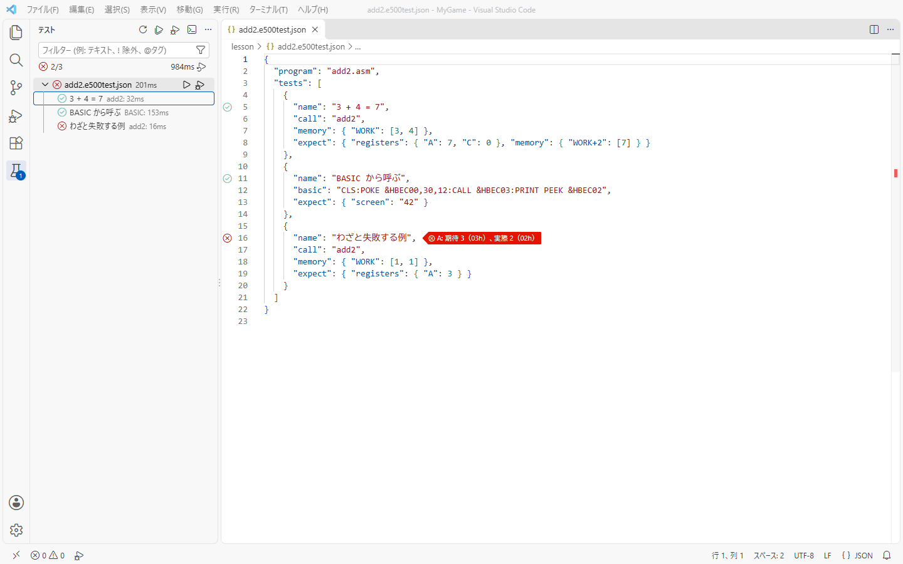
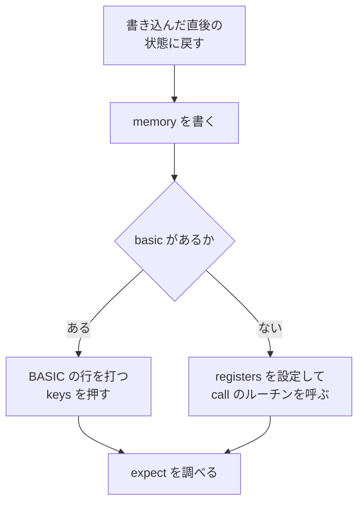
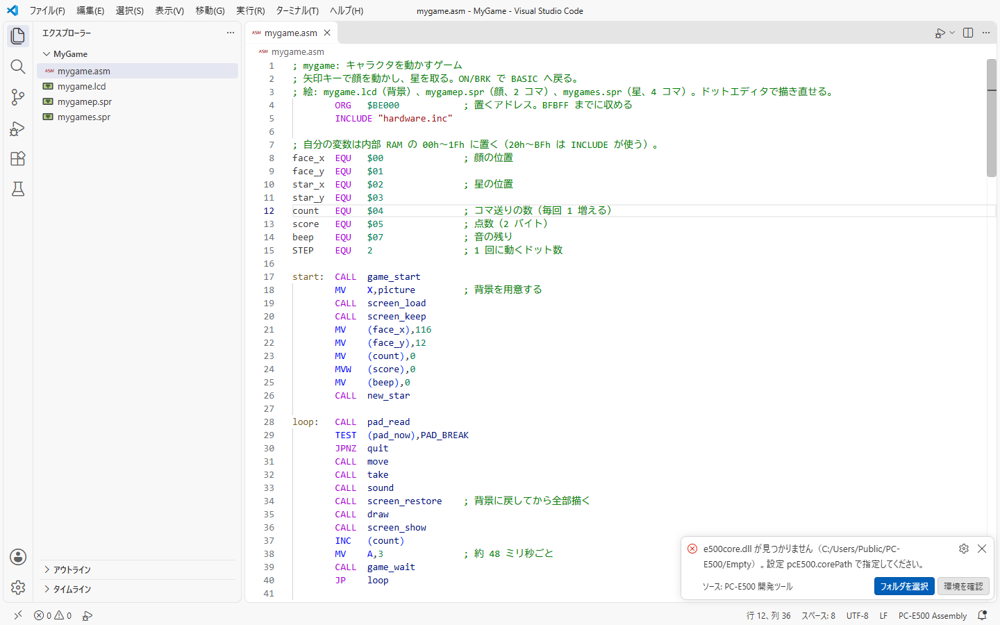
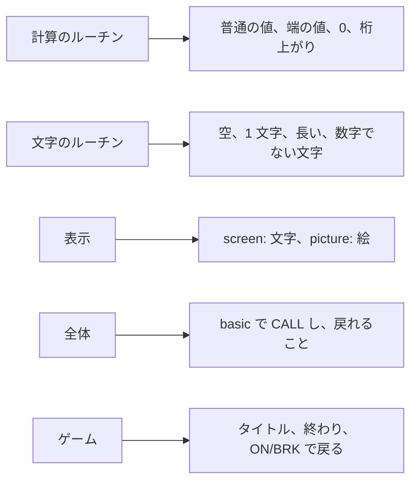
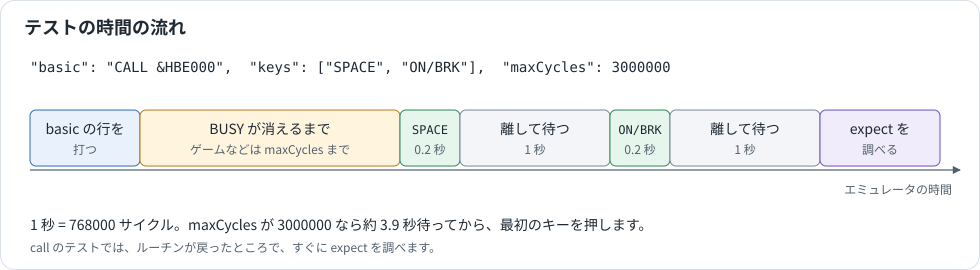

# 11. テスト

この章は、プログラムが正しく動くかを、エミュレータで**自動で**確かめる方法を説明します（Windows 専用）。「この値を渡して呼んだら、この答えになるはず」を JSON のファイルに書いておくと、ボタン 1 つで全部を調べ、違っていた所を教えてくれます。

機械語は、1 か所を直すと、離れた所が壊れることがよくあります。テストがあれば、直すたびに全部を調べ直せるので、安心して書き換えられます。画面の文字や絵、キー操作まで確かめられるので、ゲームのテストも書けます。

[目次へ戻る](README.md)

## 11.1 はじめの一歩

`add.asm`

```asm
        ORG   $BEC00
WORK:   DB    0,0,0
add2:   MV    A,[WORK]
        MV    IL,[WORK+1]
        ADD   A,IL
        MV    [WORK+2],A
        RETF
        END
```

`add.e500test.json`

```jsonc
{
  "program": "add.asm",
  "tests": [
    {
      "name": "3 + 4 = 7",
      "call": "add2",
      "memory": { "WORK": [3, 4] },
      "expect": { "registers": { "A": 7, "C": 0 }, "memory": { "WORK+2": [7] } }
    },
    {
      "name": "BASIC から呼ぶ",
      "basic": "CLS:POKE &HBEC00,30,12:CALL &HBEC03:PRINT PEEK &HBEC02",
      "expect": { "screen": "42" }
    }
  ]
}
```

左端のフラスコのアイコンを押し、▶ で実行します。



| 印 | 意味 |
|---|---|
| ✓ | 成功 |
| ✕ | 失敗。テストの行に「期待」と「実際」が出る |

行番号の横の印からも、1 件ずつ実行できます。

## 11.2 1 件のテストの流れ

1 件のテストは、料理の試食に似ています。**材料をそろえ（`memory`、`registers`）、作り（`call` か `basic`）、味を見る（`expect`）**。毎回、台所を最初の状態に片付けてから始めるので、順番を変えても、1 件だけ動かしても、同じ結果になります。



テストは 1 件ずつ、プログラムを書き込んだ直後の状態から始まります。前のテストの結果は残りません。

## 11.3 書き方

JSON です。コメント（`//`）と、最後の余分な `,` が使えます。書いている間に候補と間違いが出ます。

### 全体

| 項目 | 必須 | 内容 |
|---|---|---|
| `program` | はい | テストする `.asm`（このファイルからの相対パス） |
| `tests` | はい | テストの配列 |

### テスト 1 件

| 項目 | 内容 | 省いたとき |
|---|---|---|
| `name` | 名前（重ならないもの。必須） | − |
| `call` | 呼ぶルーチン（ラベル、アドレス、式） | `START` → `MAIN` → 先頭 |
| `return` | 戻り方。`far` = `RETF`、`near` = `RET` | `far` |
| `registers` | 呼ぶ前のレジスタ | そのまま |
| `memory` | 始める前に書くメモリ | 書かない |
| `basic` | ルーチンを呼ぶ代わりに、BASIC のプロンプトで打つ行。`\n` で複数行 | ルーチンを呼ぶ |
| `keys` | `basic` の後に 1 つずつ押すキー | 押さない |
| `expect` | 終わったときに確かめること | 戻ってくることだけ確かめる |
| `maxCycles` | 使ってよいサイクル（768000 で 1 秒）。`basic` の行を打つ時間は含まない | 3840000（5 秒） |

### expect

| 項目 | 内容 |
|---|---|
| `registers` | レジスタとフラグ。`A` `IL` `BA` `I` `X` `Y` `U` `S` `P` `F` `C` `Z` |
| `memory` | メモリの中身 |
| `screen` | 液晶に出ている文字（部分一致）。配列なら全部。打った行の文字にも一致するので、`PRINT "N=";…` のように目印を付ける |
| `picture` | 液晶の全ドットが同じはずの `.lcd` か `.pixels`（このファイルからの相対パス） |

### 値とメモリの書き方

| 対象 | 書き方 |
|---|---|
| 値 | `12`、`"&HBEC00"`、`"$BEC00"`、`"0xBEC00"`、`"0BEC00h"`、`"label"`、`"label+2"` |
| メモリのアドレス（キー） | `"WORK"`、`"WORK+2"`、`"&HBED00"`。`"(score)"` のように括弧を付けると内部 RAM（00h〜EEh） |
| メモリの中身 | `[1, 2, 255]`（バイトの並び）か `"ABC"`（文字コード） |

### キーの名前

`SPACE` `ENTER` `UP` `DOWN` `LEFT` `RIGHT` `ON/BRK` `BS` `DEL` `INS` `C-CE` `MENU` `BASIC` `F1`〜`F5`、英字と数字（`A`、`7`）です。1 つのキーは 0.2 秒押して、離した後に 1 秒待ちます。

## 11.4 例

### 戻り値を確かめる

```jsonc
{ "name": "0 で割る", "call": "divide", "return": "near",
  "registers": { "A": 10, "IL": 0 },
  "expect": { "registers": { "C": 1 } } }
```

### 表をまるごと確かめる

```jsonc
{ "name": "並べ替え", "call": "sort",
  "memory": { "DATA": [3, 1, 2] },
  "expect": { "memory": { "DATA": [1, 2, 3] } } }
```

### 画面の文字

```jsonc
{ "name": "表示", "basic": "CLS:CALL &HBEC00", "expect": { "screen": ["SCORE", "HELLO"] } }
```

### 画面の絵

```jsonc
{ "name": "タイトル", "basic": "CALL &HBE000", "expect": { "picture": "title.lcd" } }
```

`title.lcd` はドットエディタで描くか、プログラムの `INCBIN` に使っているものを指定します。

### キーを押す

```jsonc
{ "name": "ON/BRK で戻る", "basic": "CALL &HBE000", "keys": ["SPACE", "ON/BRK"],
  "expect": { "screen": ">" }, "maxCycles": 3000000 }
```

プログラムがキーを待つときは、`maxCycles` まで待ってから `keys` を押します。短くすると早く終わります。

### 割り込みを使うもの、時間のかかるもの

```jsonc
{ "name": "長い計算", "call": "start", "maxCycles": 38400000 }   // 50 秒ぶんまで
```

エミュレータは最高速で動くので、実際の時間はもっと短くなります。

## 11.5 失敗したとき

| 表示 | 意味 |
|---|---|
| `A: 期待 7（07h）、実際 8（08h）` | レジスタが違う |
| `WORK+2（BEC02）: 期待 07、実際 08` | メモリが違う |
| `画面に「42」がありません。画面: …` | 文字がない。今の画面も出る |
| `title.lcd と 12 ドット違います（最初は x=3, y=8。…）` | 絵が違う |
| `3840000 サイクル以内に戻りませんでした（PC=…）` | 戻ってこない。止まっているアドレスも出る |
| `未定義命令で止まりました（PC=…）` | 暴走している。`RET` と `RETF` の間違いなど |
| `アセンブルのエラー: …` | プログラムがアセンブルできない |
| `e500core.dll が見つかりません` | エミュレータの場所が決まっていない。ボタンから直せる |



テストの虫のアイコン（デバッグ）を押すと、そのテストのレジスタとメモリを設定し、ルーチンの先頭で止まります。`basic` のテストはデバッグできないので、ブレークポイントを置いて `F5` で動かします。

### コマンドで実行する

`e500 test フォルダ` で、VS Code を開かずに実行できます（[e500 test](22_COMMAND_LINE_AI.md#e500-test)）。

## 11.6 書き方のこつ

- 計算のルーチンは `RET`（`near`）にしておくと、1 つずつ調べられます。
- 端の値（0、255、桁上がり、空の文字列、画面の端）を入れます。
- 直した間違いは、そのたびにテストを 1 件足します。
- エントリのテストは `basic` で 1 件置きます。`RETF` で正しく戻れるかも確かめられます。

[アセンブラ入門](03_ASSEMBLER_TUTORIAL.md)の例題には、すべてテストが付いています（[Samples/Assembler/Tutorial](../../Samples/Assembler/Tutorial/)）。

## 11.7 ルーチンを 1 つずつ確かめる

[レシピ集](../../Samples/Assembler/Recipes/recipes.e500test.json)は、1 つのファイルの 25 個のルーチンを 28 件のテストで確かめています。書き方の見本になります。

```jsonc
{ "name": "mul8 12 × 34", "call": "mul8", "return": "near",
  "registers": { "A": 12, "I": 34 }, "expect": { "registers": { "BA": 408 } } },
{ "name": "to_dec", "call": "to_dec", "return": "near",
  "registers": { "I": 60209, "X": "buffer" }, "expect": { "memory": { "buffer": "60209" } } }
```

| 工夫 | 理由 |
|---|---|
| ルーチンは `RET` で終える（`"return": "near"`） | 1 つずつ直接呼べる |
| 領域のラベル（`buffer`）を作る | アドレスを数で書かずに済む |
| アドレスのレジスタはラベルで渡す（`"X": "buffer"`） | 置く場所が変わってもよい |
| 同じルーチンを 2〜3 件で調べる | 小さい、同じ、大きい |

## 11.8 何をテストするか



## 11.9 ゲームのテストの例

[メテオ](../../Samples/Assembler/Meteor/meteor.e500test.json)のテストです。

| テスト | 調べること |
|---|---|
| タイトル | 起動した画面に題名が出る |
| 動かさなければ終わる | SPACE で始めて、関係のないキーを押し続けて時間を進めると、GAME OVER になる |
| ON/BRK で戻る | BASIC のプロンプト `>` が出る |

キーは 1 つ押すごとに約 1.2 秒進むので、`keys` に関係のないキーを並べると、時間を進められます。

## 11.10 時間の決まり

エミュレータの中の時間は、CPU のサイクルで数えます。PC の速さとは関係がないので、どの PC で動かしても、同じところで同じキーが押されます。



| 場面 | 時間 |
|---|---|
| `call` | 戻るまで。`maxCycles` を超えたら失敗 |
| `basic` を打った後 | BUSY が消えるまで。消えなければ `maxCycles` まで |
| `keys` の 1 つ | 0.2 秒押して、離して 1 秒 |

プログラムが終わらない `basic` のテスト（ゲームなど）は、`maxCycles` を短くすると速く済みます。1 秒は 768000 です。

## 11.11 JSON の間違い

| 症状 | 直し方 |
|---|---|
| テスト エクスプローラーに出ない | ファイル名が `.e500test.json` で終わっているか。`program` の綴り |
| `tests[0] に "name" がありません` | すべてのテストに `name` が要る |
| `シンボル … はプログラムにありません` | ラベルの綴り |
| 波線が出る | 候補（`Ctrl+Space`）で使える項目を見る |
