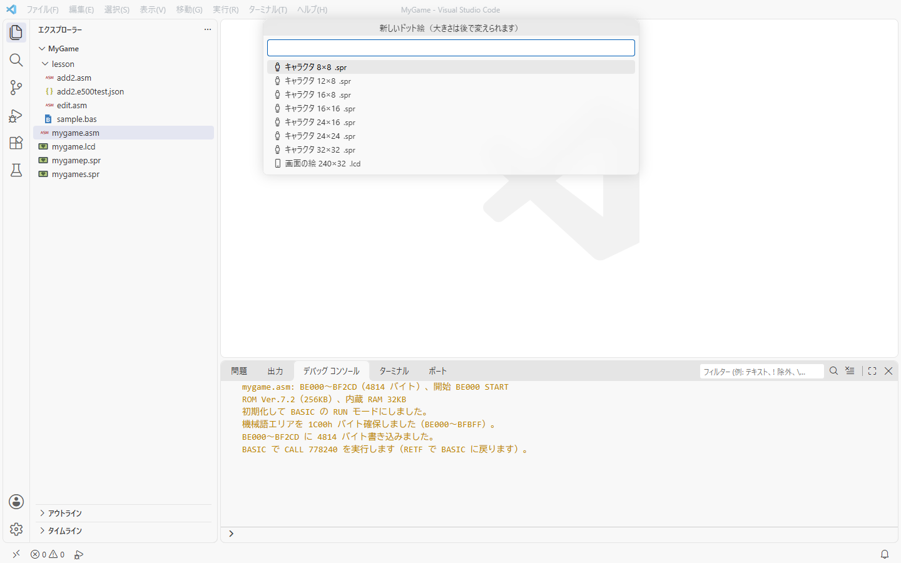
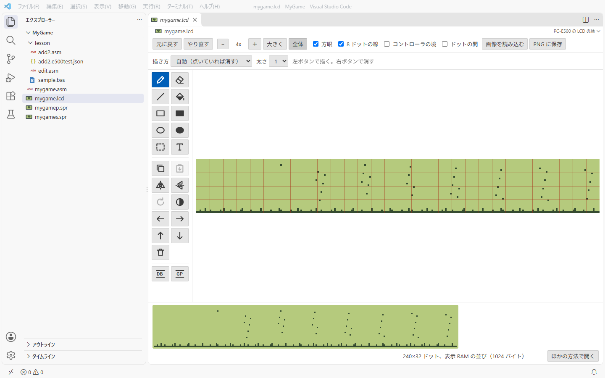
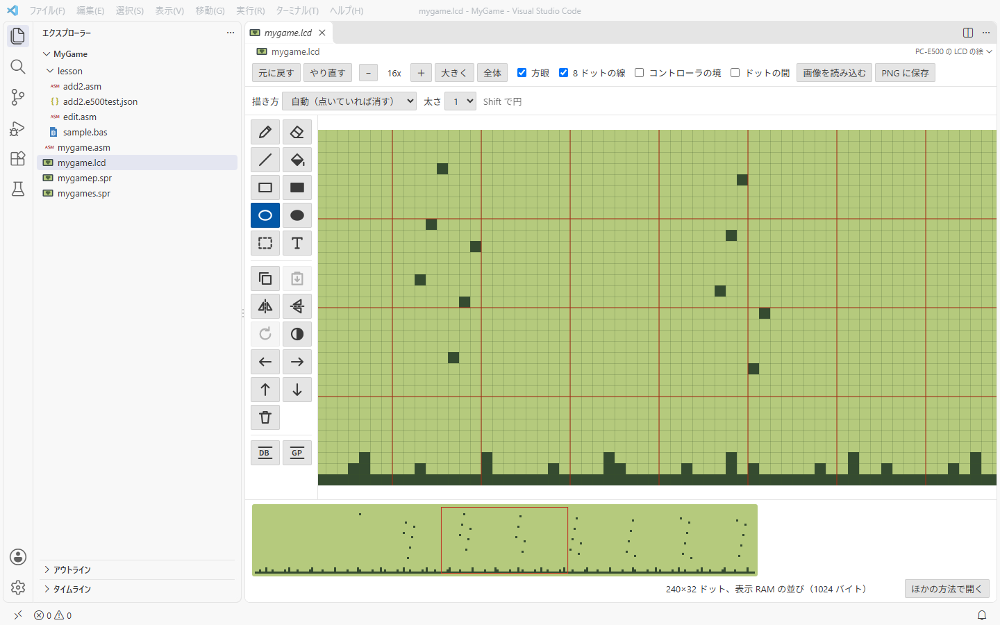
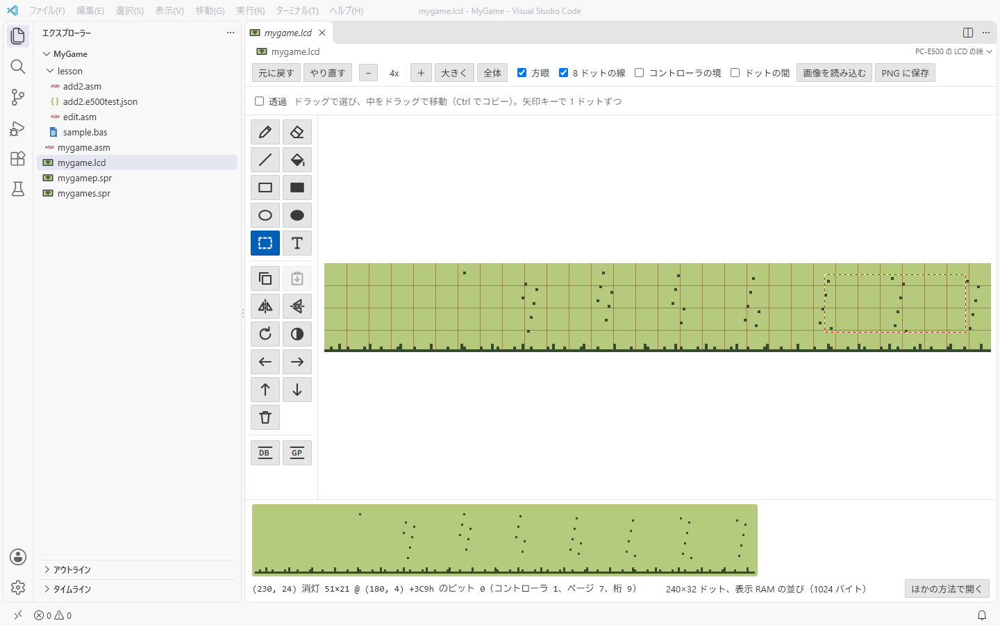
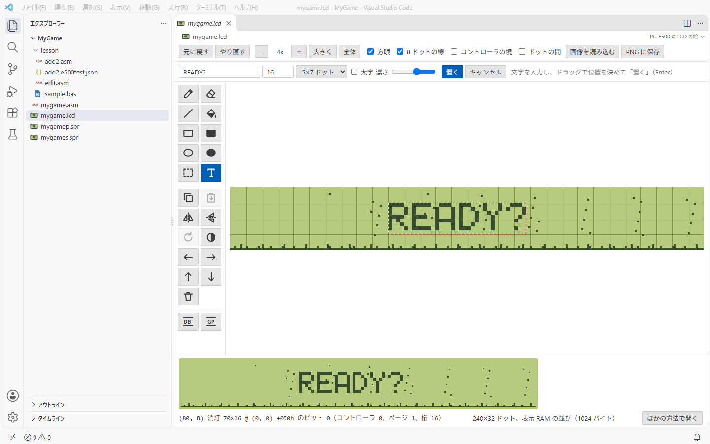
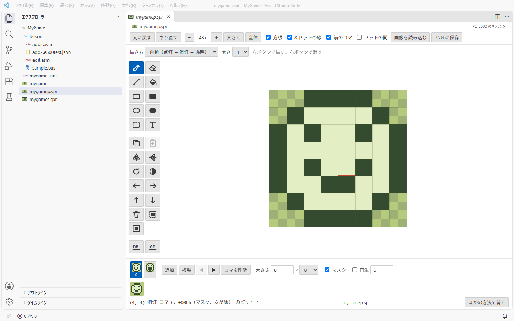
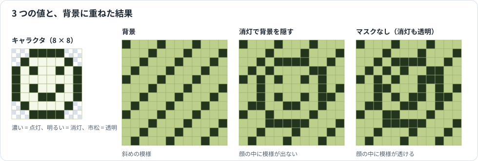

# 12. ドットエディタ

この章は VS Code の中で画面の絵（`.lcd`）とキャラクタ（`.spr`）を描く方法を説明します。どの OS でも使えます。前半はツールの説明、後半（12.11 から）は、タイトル画面、歩くキャラクタ、写真の取り込みなどの実習です。早く描いてみたい人は 12.1 で開き方だけ見て、実習へ進んでください。

PC-E500 の画面は 240 × 32 ドット、色は「点く」「消える」の 2 つだけです。だから、1 ドットをどこに置くかで印象が大きく変わります。このエディタは 1 ドットずつ置く作業と、実機の液晶での見え方の確認が楽になるように作られています。

[目次へ戻る](README.md)

| 種類 | 大きさ | 1 ドットの値 | プログラムでの使い方 |
|---|---|---|---|
| `.lcd` | 240 × 32 | 点灯、消灯 | `INCBIN` して `screen_load`、または LCD へ直接転送 |
| `.pixels` | 240 × 32 | 点灯、消灯 | PC のツール用（1 ドット 1 バイト） |
| `.spr` | 幅 1〜64、高さ 8 / 16 / 24 / 32、255 コマまで | 点灯、消灯、透明 | `INCBIN` して `sprite_draw` |

## 12.1 作る、開く

作る: フォルダを右クリック →「新しいドット絵を作成」→ 種類と大きさ → 名前。



開く: エクスプローラーでクリックします。ASM の `INCBIN "title.lcd"` のファイル名を `Ctrl` + クリックしても開きます。空（0 バイト）のファイルは白紙として開きます。

保存: `Ctrl+S`。元に戻すのは `Ctrl+Z`、やり直すのは `Ctrl+Y` です。

## 12.2 画面の見方（.lcd）



| 場所 | 内容 |
|---|---|
| 上の 1 段目 | 元に戻す、拡大、表示の切り替え、画像、PNG |
| 上の 2 段目 | 選んでいるツールの設定と、使い方のひとこと |
| 左 | ツールと、加工のボタン |
| 中央 | 絵 |
| 下 | 全体図。赤い枠が見えている範囲。ドラッグで移動 |
| 一番下 | カーソルの座標、点灯か消灯か、ファイルの何バイト目のどのビットか |

### 拡大と移動

| 操作 | 働き |
|---|---|
| ホイール、`+` `-` | 拡大、縮小 |
| 「大きく」、`9` | 高さいっぱいに拡大（最初はこの表示） |
| 「全体」、`0` | 全体を表示 |
| `Shift` + ホイール | 横へ移動 |
| `Space` + ドラッグ、中ボタンのドラッグ | 移動 |
| 下の全体図をドラッグ | 移動 |



### 表示の切り替え

| 項目 | 働き |
|---|---|
| 方眼（`G`） | 1 ドットごとの線 |
| 8 ドットの線 | 文字の行と同じ間隔の線 |
| コントローラの境 | 表示 RAM の区切り（x = 64、120、176） |
| ドットの間 | ドットをあけて、実機の液晶のように見せる |

## 12.3 描く

| ツール | キー | 使い方 |
|---|---|---|
| 鉛筆 | `P` | ドラッグで描く |
| 消しゴム | `E` | ドラッグで消す |
| 直線 | `L` | `Shift` で縦、横、45 度 |
| 塗りつぶし | `F` | つながった同じ色の範囲を塗る |
| 四角、塗り四角 | `R`、`B` | `Shift` で正方形 |
| 円、塗り円 | `O`、`D` | `Shift` で正円 |
| 選択 | `S` | 範囲を選ぶ |
| 文字 | `T` | 文字を置く |

どのツールでも、**右ボタンは消す**です。

| 設定 | 内容 |
|---|---|
| 描き方 | 自動（点いていれば消す）、点灯、消灯、反転 |
| 太さ（`[` `]`） | 1〜8 ドット |

## 12.4 選んで動かす



| 操作 | 働き |
|---|---|
| 選択のツールでドラッグ | 範囲を選ぶ |
| `Ctrl+A` | 全体を選ぶ |
| 中をドラッグ、矢印キー | 動かす（`Shift` + 矢印で 8 ドット） |
| `Ctrl` + ドラッグ、`Ctrl+D` | 複製 |
| `Ctrl+C` `Ctrl+X` `Ctrl+V` | コピー、切り取り、貼り付け（ほかの絵へも） |
| `H`、`V` | 左右反転、上下反転 |
| 回転のボタン | 右に 90 度 |
| `I` | 点灯と消灯を反転 |
| `Del` | 消す |
| 透過 | 動かす範囲の消えているドットで、下の絵を消さない |
| `Esc` | 選択をやめる |

動かしている間、下の絵は残っています。選択がないときは、反転や消去は全体に効き、矢印のボタンは全体を 1 ドットずつ回します（端から出た分は反対側に入ります）。

## 12.5 文字



1. 文字のツール（`T`）を選び、上の欄に文字を入れる。
2. 大きさと書体を選ぶ。「5×7 ドット」は英数字と記号、ほかは PC の書体で、日本語も使える。
3. 絵の上をドラッグして位置を決める。
4. 「置く」か `Enter` で決まる。「キャンセル」か `Esc` で取り消す。

PC の書体は「濃さ」で太さの見え方を変えられます。小さい文字は「太字」や濃さを調整すると読みやすくなります。

## 12.6 画像を読み込む

「画像を読み込む」で PNG や JPEG などを選ぶと、白黒にして置けます。

| 設定 | 内容 |
|---|---|
| 画面に合わせる | 画面の大きさに縮める |
| 網点 | 濃淡を点の密度で表す（写真向き） |
| 反転 | 白と黒を入れ替える |
| 濃さ | どこから黒にするか |

位置をドラッグで決めて「置く」を押します。

## 12.7 書き出す

描いた絵はファイルのまま `INCBIN` で使うのがいちばん簡単です。小さな模様をソースの中に書きたいとき、BASIC で使いたいとき、PC の文書に貼りたいときは、次の形に書き出せます。

| ボタン | 働き |
|---|---|
| PNG に保存 | 今の拡大率の PNG を作る |
| DB | 選んだ範囲（なければ全体）を、縦 8 ドットずつの `DB` の行としてコピー |
| GP | 〃 `GPRINT "…"` の行としてコピー（BASIC 用）。2 段以上のときは、段ごとに `GCURSOR` が付く |
| ほかの方法で開く | バイナリとして開くなど |

## 12.8 ファイルとの関係

- 同じ名前の `.lcd` と `.pixels` が並んでいて、同じ絵だったときは、片方を保存するともう片方も書き換えます。違う絵だったときは変えず、知らせます。
- 画面のドットにならないビット（`.lcd` の余り）は、そのまま残します。
- ビルドなどで外からファイルが変わると、表示も変わります。編集中なら、保存のときに上書きするか確かめます。

## 12.9 キャラクタ（.spr）



操作は `.lcd` と同じで、次の点が違います。

### 3 つの値

キャラクタは背景の上に重ねて描きます。絵が「点く・消える」の 2 つだけだと、顔の中の白い所に背景の模様が透けてしまいます。そこで、背景をそのまま見せる「透明」と、背景を隠して消す「消灯」を分けています。



| 値 | 見え方 | ゲームの画面で |
|---|---|---|
| 点灯 | 濃い | 点く |
| 消灯 | 明るい | 消す（背景を隠す） |
| 透明 | 市松模様 | 背景がそのまま見える |

「自動」の描き方では左ボタンのたびに「点灯 → 消灯 → 透明」と変わります。右ボタンは透明にします。

### 加工

| ボタン | 働き |
|---|---|
| 縁取り | 点灯の周り 1 ドットを消灯にする。背景に埋もれなくなる |
| 透明をすべて消灯にする | 背景を透かさない四角いキャラクタにする |

### コマ

| 操作 | 働き |
|---|---|
| 下のコマをクリック、`,` `.` | コマを選ぶ |
| 追加、複製 | 今のコマの後に、空のコマ、コピーを入れる |
| ◀ ▶ | 順番を入れ替える |
| コマを削除 | 今のコマを削除 |
| 再生 | 動かして見る。右の数は 1 秒のコマ数（1〜30） |
| 前のコマ | 1 つ前のコマを薄く重ねる |

### 大きさとマスク

| 項目 | 内容 |
|---|---|
| 大きさ | 幅 1〜64、高さ 8 / 16 / 24 / 32。左上を基準に変わる |
| マスク | 外すとファイルが半分になり、消灯のドットは透明になる |

`.spr` の大きさはマスクありで「4 + 幅 × 高さ ÷ 8 × 2 × コマ数」バイトです。

## 12.10 ファイルの中身

[ファイル形式](19_FILE_FORMATS.md#193-lcd)にあります。

## 12.11 実習 1: タイトル画面を作る

1. 「新しいドット絵を作成」→「画面の絵 240×32」→ `title`。
2. `0` を押して全体を出す。
3. 四角（`R`）で、端から端まで枠を描く（左上から右下へドラッグ）。
4. 文字（`T`）で題名を入れる。大きさ 16、5×7 ドット。ドラッグで真ん中に置き、`Enter`。
5. もう一度 `T` で、大きさ 8 の「PUSH SPACE KEY」を下に置く。
6. 選択（`S`）で題名を囲み、`I` で反転すると、白抜きの題名になる。
7. `Ctrl+S`。

プログラムで出すには、次のようにします。

```asm
        MV    X,picture
        CALL  screen_load
        CALL  screen_show
        …
picture:
        INCBIN "title.lcd"
```

## 12.12 実習 2: 歩くキャラクタ

1. 「新しいドット絵を作成」→「キャラクタ 8×8」→ `walk`。
2. 1 コマ目に、立った姿を描く。
3. 「複製」で 2 コマ目を作り、足を動かす。「前のコマ」を入れておくと、動きの差が見える。
4. 「再生」で確かめる。速さは右の数。
5. 「縁取り」を押すと、周りに 1 ドットの消灯が付き、背景の上でも見やすくなる。

```asm
        MV    A,(count)         ; 2 ターンごとに次のコマ
        RC
        SHR   A
        AND   A,1
        CALL  sprite_draw
```

### 左右の向き

左向きの絵は右向きの絵を複製して `H`（左右反転）で作れます。コマの番号を「向き × コマ数 + 今のコマ」で選びます。

## 12.13 実習 3: 写真を画面にする

1. `.lcd` を開き、「画像を読み込む」で PNG や JPEG を選ぶ。
2. 「画面に合わせる」を入れると、240 × 32 に縮む。
3. 人物や風景は「網点」を入れる。線画は入れない。
4. 「濃さ」を動かして、見やすい所にする。
5. 「置く」。はみ出した線は消しゴムで整える。

横長の画面なので、元の画像を先に横長に切り抜いておくと、きれいになります。

## 12.14 実習 4: BASIC で使う

1. 絵を選んで（または全体のまま）「GP」を押す。
2. BASIC のプログラムに貼り付けて、行番号を付ける。縦 8 ドットが 1 段で、横が 100 ドットを超える段は `;` でつないだ 2〜3 行になる。
3. 位置は `GCURSOR` で決める。**Y は段の一番下のドットを指す**。1 段の小さな絵は `GPRINT` だけなので、前に `GCURSOR` を書く。2 段以上の絵には、`.lcd` では絵の中の位置、`.spr` では `X`、`Y`（左上）を使った `GCURSOR` が付いている。

```basic
100 GCURSOR (100,15)
110 GPRINT "183C7E7E3C18"
```

動く例は [Walker](../../Samples/BASIC/Walker/README.md) です。

## 12.15 実習 5: INCLUDE を使わずに表示する

`.lcd` は表示 RAM の並びなので、そのまま LCD に送れます。テンプレート「画面を使うプログラム」の `show` がその処理です。

```text
前半 512 バイト → 2008h のコントローラへ（8 ページ × 64 桁）
後半 512 バイト → 2004h のコントローラへ
```

## 12.16 ショートカット一覧

| キー | 働き | キー | 働き |
|---|---|---|---|
| `P` | 鉛筆 | `E` | 消しゴム |
| `L` | 直線 | `F` | 塗りつぶし |
| `R` | 四角 | `B` | 塗り四角 |
| `O` | 円 | `D` | 塗り円 |
| `S` | 選択 | `T` | 文字 |
| `[` `]` | 太さ | `G` | 方眼 |
| `H` | 左右反転 | `V` | 上下反転 |
| `I` | 反転 | `Del` | 消す |
| `+` `-` | 拡大、縮小 | `9` `0` | 大きく、全体 |
| `,` `.` | 前、次のコマ | `Space` | 移動 |
| `Ctrl+A` | 全部選ぶ | `Ctrl+D` | 複製 |
| `Ctrl+C` `Ctrl+X` `Ctrl+V` | コピー、切り取り、貼り付け | `Ctrl+Z` `Ctrl+Y` | 元に戻す、やり直す |
| `Enter` | 置く | `Esc` | やめる |
