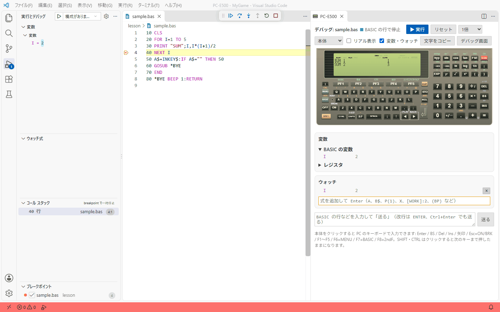
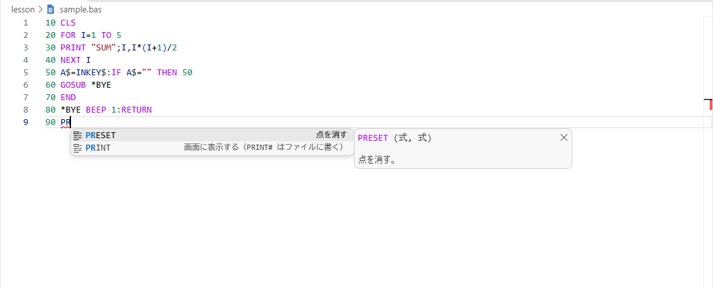
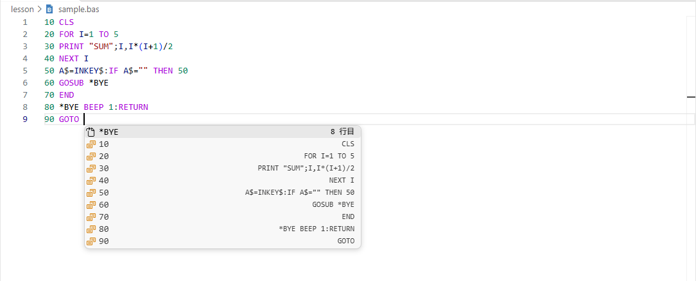
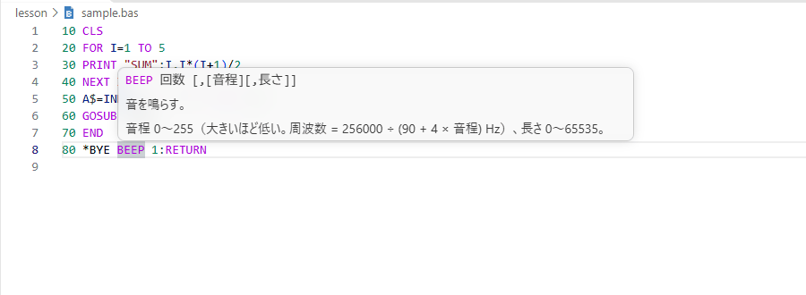
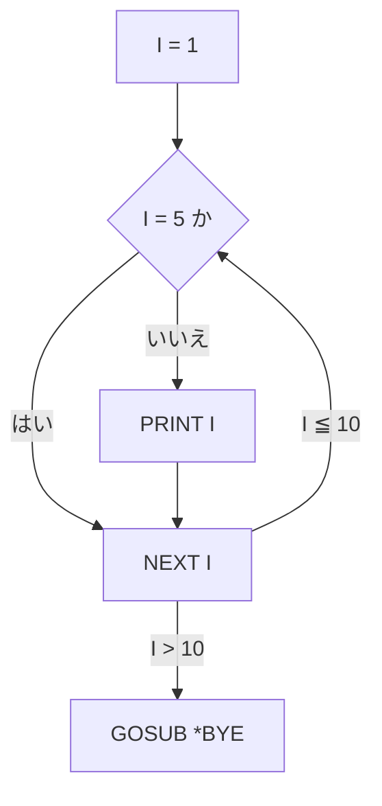

# 13. BASIC

この章は、PC-E500 の BASIC を VS Code で書いて、エミュレータと実機で動かす方法を説明します。本体の小さなキーで打つ代わりに、PC の大きな画面で書き、間違いをその場で見つけ、行ごとに止めて確かめられます。後半は、BASIC を初めて書く人のための短い入門と、デバッグの実例です。

本体だけでプログラムを打ち込んで使う方法は[ハンドブック](../handbook/12_PROGRAMMING.md)に、命令の全部は[BASIC の命令と関数](../analysis/14_BASIC_REFERENCE.md)にあります。

[目次へ戻る](README.md)

## 13.1 はじめの一歩

1. `hello.bas` を作る。

   ```basic
   10 CLS
   20 FOR I=1 TO 5
   30 PRINT "SUM";I,I*(I+1)/2
   40 NEXT I
   50 END
   ```

2. `F5` を押す。エミュレータに読み込まれて `RUN` する。
3. 行番号（40 など）の左をクリックしてブレークポイントを付け、もう一度 `F5` を押すと、その行で止まる。



## 13.2 書き方

- 拡張子は `.bas`、`.basic`、`.e500` です。
- すべての行を行番号（1〜65279）で始め、1 行は 256 バイト以内にします。
- ラベルは `*NAME` です。`GOTO *NAME` のように飛べます。
- 文は `:` で区切ります。コメントは `REM` か `'` です。
- `IF 条件 THEN 文` のほか、`IF 条件 文` の形も使えます。

カナは半角カナで書きます。ほかの全角文字は、本体の文字にないので読み込むときに省かれます（デバッグ コンソールに通知が出ます）。

## 13.3 候補と説明



| 場所 | 候補 |
|---|---|
| 文の先頭 | 命令 |
| 式の中 | 関数、プログラムで使っている変数 |
| `GOTO` `GOSUB` `THEN` などの後 | 行番号、ラベル |



マウスを乗せると、命令の書き方と説明、行番号ならその行が出ます。



## 13.4 間違いの表示

| コード | 内容 |
|---|---|
| `E500001` | 行番号がない |
| `E500002` | 行番号の範囲 |
| `E500003`、`E500004` | 行番号の重複、順番 |
| `E500005` | ラベルの重複 |
| `E500010` | 文字列の `"` が閉じていない |
| `E500011`、`E500012` | 括弧の対応 |
| `E500020`〜`E500022` | 命令でない、ない命令、必要な語（`TO` など）がない |
| `E500030`、`E500031` | `FOR`〜`NEXT`、`WHILE`〜`WEND`、`REPEAT`〜`UNTIL`、`SWITCH`〜`ENDSWITCH` の対応 |
| `E500040`、`E500041` | 行番号、ラベルのジャンプ先がない |

行番号を付けずに書く人は、設定 `pcE500.basic.requireLineNumbers` を切れます（エミュレータと実機で動かすには行番号が要ります）。ジャンプ先の確認は `pcE500.basic.checkMissingTargets` で切れます。

引数の個数や型、実行時の値までは調べません。

## 13.5 動かす

PC で書いたテキストは、そのままでは本体で動きません。本体は、命令を 1〜2 バイトの番号（中間コード）に置き換えて覚えるからです。拡張機能は、この置き換えを自分では行わず、本物の ROM に `LOAD` させます。

`F5`（デバッグ）と `Ctrl+F5`（止めずに実行）が使えます。止め方、進め方、変数の見方は[デバッグ](10_DEBUG.md#1010-basic-のデバッグ)にあります。

読み込みは、CE-140F から `LOAD` するのと同じ手順です。ROM が自分で中間コードにするので、実機と同じ結果になります。

## 13.6 機械語を呼ぶ

BASIC は書きやすく、機械語は速い、という違いがあります。画面をスクロールさせる、大量のデータを並べ替える、といった重い所だけを機械語にして、残りを BASIC で書くと、両方のよい所が使えます。値の受け渡しは、決めたアドレスを `POKE` と `PEEK` で読み書きするのが基本です。

```basic
10 POKE &HBEC00,200,100
20 CALL &HBEC04
30 PRINT PEEK &HBEC02+256*PEEK &HBEC03
```

機械語側の決まりは[アセンブラ入門](03_ASSEMBLER_TUTORIAL.md#36-例題-3-足し算)にあります。

## 13.7 実機へ送る、実機から読む

| 方向 | 手順 |
|---|---|
| PC → 実機 | `e500 bin prog.bas -o OUT.BAS` → X: に置く → `LOAD "X:OUT.BAS"` |
| 実機 → PC | `SAVE "X:PROG.BAS",A` → VS Code で開く（カナがあれば Shift JIS で） |

くわしくは[実機へ送る](14_TRANSFER.md#146-basic-のプログラム)にあります。

## 13.8 命令を調べる

全命令の書式と引数は [BASIC の命令と関数](../analysis/14_BASIC_REFERENCE.md)、機種と ROM バージョンによる違いは [ROM バージョンの違い: BASIC](../analysis/24_ROM_VERSIONS_BASIC.md) にあります。`WHILE`、`REPEAT`、`SWITCH` などの構造化の命令は、ROM 8.3 以降（PC-E500S、PC-U6000、PC-E650）のものです。

## 13.9 BASIC の基本

### 数と文字列

```basic
10 A=3
20 B$="PC-E500"
30 PRINT A;B$
40 DIM P(10):P(1)=A*2
50 PRINT P(1)
```

| 種類 | 名前の例 |
|---|---|
| 数 | `A`、`AB` |
| 倍精度の数 | `D#` |
| 文字列 | `B$` |
| 配列 | `P(1)`、`S(1,2)`、`R$(3)`（使う前に `DIM`） |

### 分岐と繰り返し

```basic
10 FOR I=1 TO 10
20 IF I=5 THEN 40
30 PRINT I;
40 NEXT I
50 GOSUB *BYE
60 END
100 *BYE PRINT "END"
110 RETURN
```



### キー

```basic
10 K$=INKEY$:IF K$="" THEN 10
20 PRINT "KEY:";K$;ASC K$
30 IF K$<>"Q" THEN 10
```

`INKEY$` は待ちません。待つには、空の間繰り返します。押しっぱなしで何度も反応させたくないときは、前のキーを覚えておきます（[StarRunner](../../Samples/BASIC/StarRunner/README.md) の 230〜235 行）。

### 画面

| 命令 | 働き | 例 |
|---|---|---|
| `LOCATE 桁,行` | 表示の場所 | `LOCATE 10,2:PRINT "HI";` |
| `PSET (x,y)` | 点を打つ | `PSET (120,16)` |
| `LINE` | 直線、四角 | `LINE (0,0)-(239,31),B` |
| `GCURSOR` と `GPRINT` | 絵を置く | `GCURSOR (0,7):GPRINT "FF8181FF"` |
| `POINT (x,y)` | 点いているか | `IF POINT (0,0)=1 THEN …` |

`LINE` の後ろの並びは、`S`（点灯）/ `R`（消灯）/ `X`（反転）、線の模様、`B`（枠）/ `BF`（塗る）の順です。省けるものは省けます。

```basic
10 LINE (0,0)-(239,31),S,&HFFFF,B
20 LINE (10,10)-(50,20),BF
30 LINE (20,12)-(40,18),R,BF
```

### 音

```basic
10 BEEP 1,10,100
20 FOR I=1 TO 5:BEEP 1,I*20,60:NEXT I
```

`BEEP 回数,音程,長さ` です。音程は大きいほど低い音です。

## 13.10 サンプルで学ぶ

| サンプル | 学べること |
|---|---|
| [HighLow](../../Samples/BASIC/HighLow/README.md) | 乱数、入力、条件 |
| [Reflex](../../Samples/BASIC/Reflex/README.md) | キーの待ち方、時間、音 |
| [Curves](../../Samples/BASIC/Curves/README.md) | 座標と関数 |
| [Walker](../../Samples/BASIC/Walker/README.md) | 絵を動かす |
| [StarRunner](../../Samples/BASIC/StarRunner/README.md) | ゲーム全体の組み立て |
| [MachineCode](../../Samples/BASIC/MachineCode/README.md) | 機械語との組み合わせ |

## 13.11 デバッグの実例

1 から 10 までの和（55）を求めるつもりが、45 になるプログラムを調べます。

```basic
10 S=0
20 FOR I=1 TO 10
30 IF I=10 THEN 60
40 S=S+I
50 NEXT I
60 PRINT S
```

1. 40 行にブレークポイントを付けて `F5`。
2. 「変数」の `I` と `S` を見ながら、`F5` で 1 周ずつ進める。
3. `I` が 9 の次は、40 行に来ないで終わる。10 が足されていない。
4. 30 行が、足す前に抜けているのが原因。30 行をなくせば 55 になる。

止めているときに `S` をダブルクリックして値を変えれば、途中から別の値で試せます。

## 13.12 書き方のこつ

| こつ | 理由 |
|---|---|
| 行番号は 10 ずつ | 間に足せる |
| サブルーチンは 100 の倍数から | 見つけやすい |
| ジャンプ先はラベル（`*NAME`）か、番号に `REM` | 何をする所か分かる |
| 長い行を避ける（256 バイトまで） | `LOAD` でエラーになる |
| 画面は文字列で作ってまとめて `PRINT` | 1 文字ずつ書くより速い |
| `FOR` の途中で `GOTO` で抜けない | 抜けるときは最後の値にしてから `NEXT` |
| 使う変数は始めに全部入れる | 前の値が残らない |
