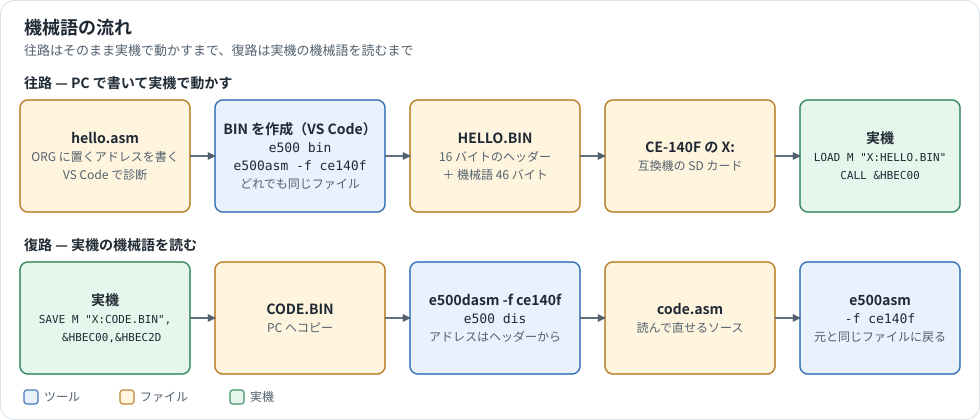
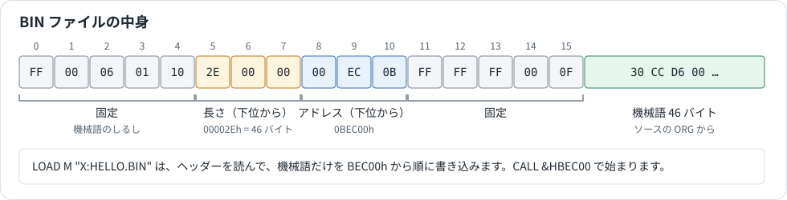
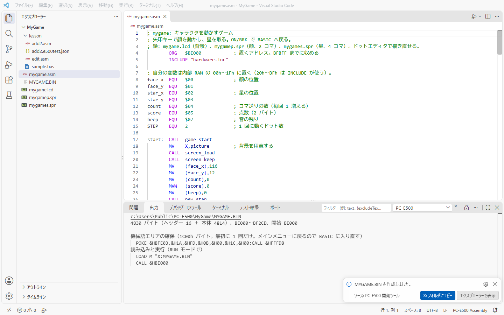
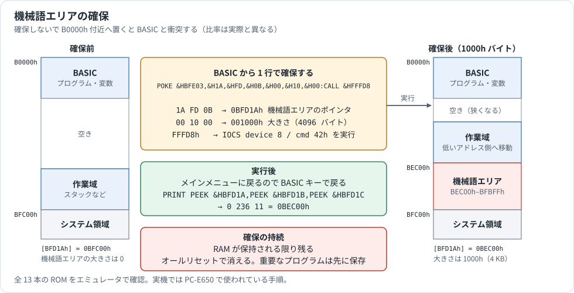
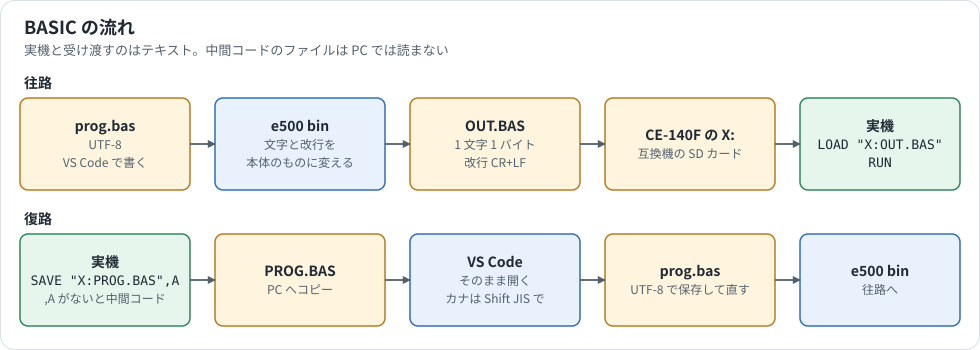
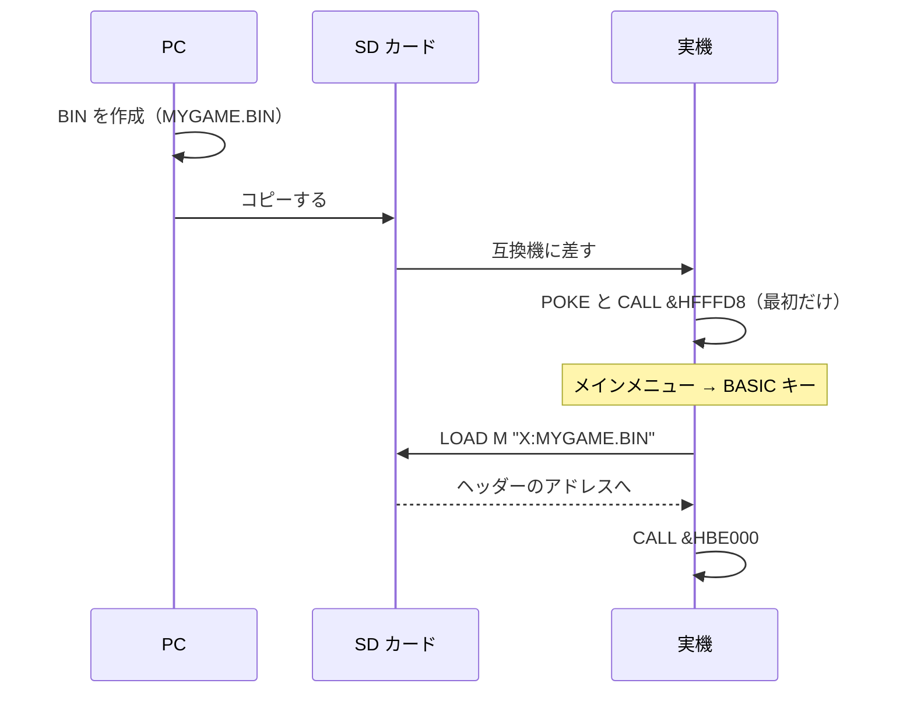
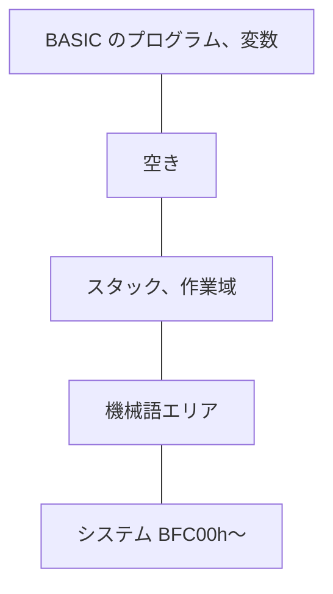

# 14. 実機へ送る

この章は PC で作ったプログラムを実機で動かす手順と、実機のデータを PC で読む手順を説明します。エミュレータで動いたものを手のひらの本体で動かす、いちばん楽しい場面です。

やることは「送れる形のファイルにする」「実機に置き場所を作る」「読み込んで実行する」の 3 つです。2 つ目の「機械語エリアの確保」は BASIC のプログラムには要りません。機器がないときに備えて、短いプログラムを手で打ち込む方法も載せました。カセットの録音を使う方法は[カセットインターフェース](../analysis/20_CASSETTE.md)にあります。

[目次へ戻る](README.md)

## 14.1 全体の流れ



| 方法 | 向いている場面 |
|---|---|
| CE-140F（互換機の SD カードなど）と `LOAD M` / `LOAD` | ふつうはこれ |
| `POKE` で打ち込む | 数十バイトまで |

CE-140F 互換機には [Sharp_ce140f_emul](https://github.com/ffxx68/Sharp_ce140f_emul) などがあります。

## 14.2 BIN を作成

機械語のバイト列だけでは、実機はどのアドレスに置けばよいのか分かりません。そこで、先頭に 16 バイトのヘッダーを付けます。ヘッダーには長さと置くアドレスが書いてあります。



`.asm` を開き、右上の実行ボタンの「∨」か右クリックから「BIN を作成（LOAD M 用）」を選びます。



- ソースの隣に `名前.BIN` ができます。名前は大文字の英数字と `_`、8 文字までです。
- 「出力」に、実機で打つ行が出ます。
- 「X: フォルダにコピー」を押すと、設定 `pcE500.diskFolder` のフォルダ（空ならエミュレータの `drive-x`）にコピーします。
- 別の形式や別のアドレスの同じ名前のファイルがあるときは、上書きするかを尋ねます。

### コマンドラインで作る

`e500` があれば `e500 bin prog.asm` の 1 行で、BIN と実機で打つ行ができます（どの OS でも同じ。[e500 bin](22_COMMAND_LINE_AI.md#e500-bin)）。Node.js も VS Code もないときは、`e500asm` に `-f ce140f` を付けます。リポジトリのフォルダで打ちます。

**Windows（PowerShell）**

```powershell
.\Assembler\e500asm.cmd prog.asm -f ce140f -o PROG.BIN
```

**Linux、macOS**

```sh
Assembler/app/e500asm prog.asm -f ce140f -o PROG.BIN
```

| 部分 | 何をするか |
|---|---|
| `e500asm prog.asm` | ソースを機械語にする |
| `-f ce140f` | 先頭に、アドレスと長さの入った 16 バイトのヘッダーを付ける。アドレスはソースの `ORG` から取る |
| `-o PROG.BIN` | 作るファイル |

どの方法でも同じファイルができます。

## 14.3 機械語エリアを確保する

BASIC はプログラムと変数のために、空いている RAM を自由に使います。機械語を置く場所を決めておかないと、あとから BASIC に上書きされてしまいます。そこで「ここから上は使わないで」と本体に伝えるのが、機械語エリアの確保です。



実機の BASIC（RUN モード）で最初の 1 回だけ打ちます。

```basic
POKE &HBFE03,&H1A,&HFD,&H0B,&H00,&H10,&H00:CALL &HFFFD8
```

- 後ろの 3 つが大きさ（下位から）です。`&H00,&H10,&H00` は 1000h = 4096 バイトです。
- 実行するとメインメニューに戻るので、`BASIC` キーで入り直します。
- 大きさは「足す量」ではなく、確保した後の大きさです。大きくし直すことも、0 にして戻すこともできます。
- オールリセットすると消えます。大事なプログラムは先に保存しておきます。

| 大きさ | `POKE` の後ろ 3 つ | 先頭のアドレス（`ORG`） |
|---|---|---|
| 400h（1 KB） | `&H00,&H04,&H00` | `$BF800` |
| 1000h（4 KB） | `&H00,&H10,&H00` | `$BEC00` |
| 1C00h（7 KB） | `&H00,&H1C,&H00` | `$BE000` |
| 2000h（8 KB） | `&H00,&H20,&H00` | `$BDC00` |
| 3000h（12 KB） | `&H00,&H30,&H00` | `$BCC00` |

先頭のアドレスは「BFC00h − 大きさ」です。実機で確かめるには次のように打ちます。

```basic
PRINT HEX$(PEEK &HBFD1A+256*PEEK &HBFD1B+65536*PEEK &HBFD1C)
```

## 14.4 読み込んで実行する

```basic
LOAD M "X:MYGAME.BIN"
CALL &HBE000
```

`LOAD M` はファイルのヘッダーにあるアドレスへ読み込みます。次からは `CALL` だけで動きます。

### BASIC から自動で読み込む

```basic
10 LOAD M "X:MYGAME.BIN"
20 CALL &HBE000
```

## 14.5 POKE で打ち込む

短いものはリスト（`-l`）のバイト列をそのまま打てます。

```basic
POKE &HBEC00,&H08,&H7B,&HA8,&H08,&HEC,&H0B,&H9F,&H07,&H00
```

## 14.6 BASIC のプログラム



### PC → 実機

```text
e500 bin prog.bas -o OUT.BAS
```

`e500 bin` に BASIC のソース（UTF-8）を渡すと、文字と改行を本体のものに変えて、`LOAD` で読める `OUT.BAS` を作ります。出力は入力と別の名前にします（Windows と macOS では、大文字と小文字だけ違う名前は同じファイルです）。

`e500` を使わずに、VS Code で「Shift JIS」「CRLF」にして保存する方法もあります。この方法と文字の決まりは [16 章](16_BASIC_FILES.md#164-pc-から実機へ)にあります。

できたファイルを X: に置き、実機で読み込みます。

```basic
LOAD "X:OUT.BAS"
RUN
```

`LOAD "X:OUT.BAS",R` なら、読み込んですぐに実行します。

### 実機 → PC

```basic
SAVE "X:PROG.BAS",A
```

**`,A` を付けます。** 付けないと中間コードで保存され、PC のエディタでは読めません。

できた `PROG.BAS` を VS Code で開きます。カナが化けるときは、画面右下の「UTF-8」→「エンコード付きで再度開く」→「Japanese (Shift JIS)」を選びます。

## 14.7 実機の機械語を読む

実機でメモリを保存します。アドレスは最初と最後を書きます。

```basic
SAVE M "X:CODE.BIN",&HBEC00,&HBEC2D
```

PC で ASM に戻します。

**Windows（PowerShell）**

```powershell
.\DisAssembler\e500dasm.cmd CODE.BIN --format ce140f -o code.asm
```

**Linux、macOS**

```sh
DisAssembler/app/e500dasm CODE.BIN --format ce140f -o code.asm
```

機械語 `CODE.BIN` を読んで、ASM のソース `code.asm` を作るコマンドです。`--format ce140f` は「`SAVE M` で保存したファイル」という意味です。アドレスはヘッダーから読むので、`--org` は要りません。くわしくは[逆アセンブラ](15_DISASSEMBLER.md)にあります。

## 14.8 アドレスの書き方

同じアドレスでも、場所によって書き方が違います。

| 場所 | `BEC00h` の書き方 |
|---|---|
| ASM のソース | `$BEC00`、`&BEC00`、`0xBEC00`、`0BEC00h`（何も付けないと 10 進） |
| `e500asm --org`、`e500dasm --org` | `BEC00`、`0xBEC00` など（いつも 16 進） |
| 実機の BASIC | `&HBEC00`、`781312` |
| `launch.json`、`e500test.json` | `"&HBEC00"`、`"$BEC00"`、`"0xBEC00"`、`"0BEC00h"`、ラベル |

## 14.9 コマンドの早見表

PATH に入れてあれば、どの OS でも同じです。入れ方は [2 章](02_INSTALL.md)にあります。

| やりたいこと | コマンド |
|---|---|
| アセンブル | `e500asm prog.asm -o prog_raw.bin` |
| リストとシンボルも | `e500asm prog.asm -o prog_raw.bin -l prog.lst -s prog.sym` |
| `LOAD M` 用の BIN | `e500asm prog.asm -f ce140f -o PROG.BIN`、`e500 bin prog.asm` |
| BASIC のソース → `LOAD` 用 | `e500 bin prog.bas -o OUT.BAS` |
| 逆アセンブル（`SAVE M`） | `e500dasm CODE.BIN -f ce140f -o code.asm` |
| 逆アセンブル（生） | `e500dasm code.bin -f raw --org BEC00 -o code.asm` |

## 14.10 通しの手順（機械語）



### 確かめながら進める

| 段 | 打つもの | 正しいとき |
|---|---|---|
| 1 | `PRINT PEEK &HBFD1A,PEEK &HBFD1B,PEEK &HBFD1C` | 確保した先頭（`BE000h` なら `0 224 11`） |
| 2 | `FILES "X:"` など、デバイスの中身を見る命令 | ファイルの名前が出る |
| 3 | `LOAD M "X:MYGAME.BIN"` | エラーが出ない |
| 4 | `PRINT PEEK &HBE000` | ソースの最初のバイト（リストで分かる） |
| 5 | `CALL &HBE000` | 動く |

## 14.11 大きさを決める

| 考えること | 目安 |
|---|---|
| プログラムの大きさ | アセンブルの結果に出る |
| 画面と背景の仮想画面（`screen.inc`） | 1920 バイト |
| 内部 RAM の退避（`game.inc`） | 192 バイト |
| `.lcd` 1 枚 | 1024 バイト |
| 8 × 8 ドット、4 コマの `.spr` | 68 バイト |

`F5` と「BIN を作成」は、プログラムの先頭から `BFBFFh` までの大きさで、機械語エリアを確保する行を作ります。BASIC のプログラムと一緒に使うときは、残りの RAM（32 KB の本体で 20 KB ほど）も考えます。



## 14.12 複数の機械語を入れる

1 つの機械語エリアに、アドレスをずらして何本でも置けます。

| プログラム | `ORG` | 大きさ |
|---|---|---|
| 音のルーチン | `$BEC00` | 400h |
| 描くルーチン | `$BF000` | 800h |
| 表 | `$BF800` | 400h |

```basic
10 LOAD M "X:SOUND.BIN"
20 LOAD M "X:DRAW.BIN"
30 LOAD M "X:TABLE.BIN"
```

ほかのプログラムのルーチンを呼ぶときは、シンボル表（`e500asm -s`）を `INCLUDE` すると、アドレスを手で書かずに済みます。

```text
e500asm sound.asm -o sound_raw.bin -s sound.sym
```

`sound.asm` を機械語にし、あわせてラベルとアドレスの表 `sound.sym` を作るコマンドです。

```asm
        INCLUDE "sound.sym"     ; sound_on EQU $BEC12 など
        CALL  sound_on
```

## 14.13 実機で確かめること

| 項目 | 理由 |
|---|---|
| 電池を換えた後、確保し直したか | オールリセットで消える |
| 音 | パネルでは鳴らない |
| 速さ | パネルの「1倍」と同じか |
| キーの同時押し | 実機の行列では、組み合わせによって読めないことがある |
| 機種 | ROM バージョン、内蔵 RAM の大きさ |
