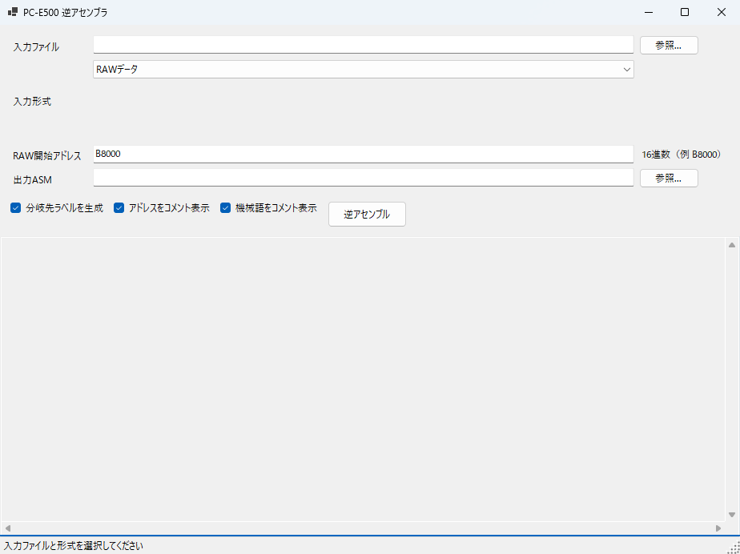
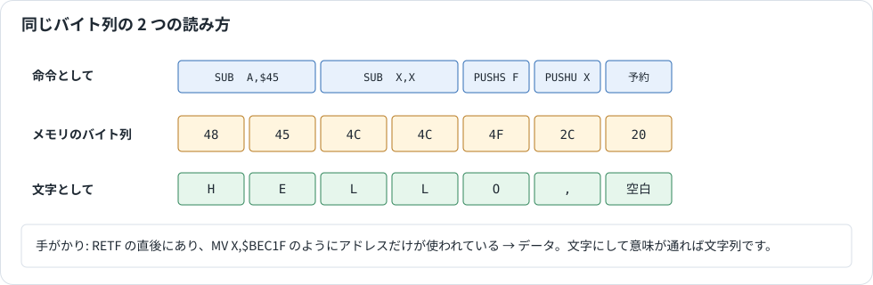
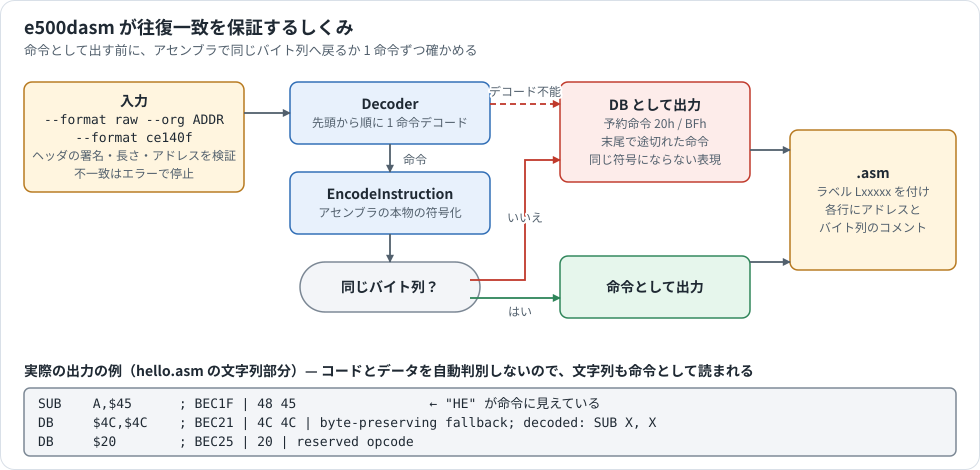

# 15. 逆アセンブラ

この章は、機械語を、人が読める ASM に戻すツールの使い方です。雑誌の古いプログラムを読む、ソースをなくした自分のプログラムを取り戻す、ROM の中でどう処理しているのかを調べる、といった場面で使います。コマンドの `e500dasm` と、画面で使う `E500Disassembler`（Windows 専用）があります。

機械語には、変数の名前も説明も残っていません。出てくるのはアドレスと命令だけです。15.10 では、46 バイトの小さなプログラムを、名前の付いた読めるソースに戻すまでを、順を追って見ます。

[目次へ戻る](README.md)

## 15.1 どちらを使うか

| | e500dasm | E500Disassembler |
|---|---|---|
| 使い方 | コマンドライン | 画面 |
| OS | Windows、Linux、macOS | Windows |
| 向いている場面 | 続けて何本も、自動化 | 1 本ずつ見ながら |

## 15.2 入力の種類

| 種類 | 見分け方 | 開始アドレス |
|---|---|---|
| CE-140F（`SAVE M` のファイル） | 先頭が `FF 00 06 01 10` | ヘッダーから読む |
| RAW（機械語だけ） | それ以外 | 自分で指定する |

分からないときは `e500 dis ファイル` と打ちます。ヘッダーがあれば読んで逆アセンブルし、なければ `RAW input requires a start address` と出ます。

## 15.3 画面で使う

Windows 専用です。エクスプローラーで `DisAssembler\E500Disassembler.cmd` をダブルクリックするか、PowerShell で次を打ちます。ウィンドウを開くだけのコマンドです。

```powershell
.\DisAssembler\E500Disassembler.cmd
```



1. 入力ファイルを「参照…」で選ぶか、ウィンドウにドロップする。
2. 入力形式を選ぶ（`SAVE M` のファイルなら自動で切り替わる）。
3. RAW のときは、開始アドレスを 16 進で入れる。
4. 出力 ASM の場所を決める。
5. 「逆アセンブル」を押す。結果は ASM に保存され、下にも表示される。

| 項目 | 働き |
|---|---|
| 分岐先ラベルを生成 | ジャンプ先に `Lxxxxx` のラベルを付ける |
| アドレスをコメント表示 | 各行のアドレスを出す |
| 機械語をコメント表示 | 各行のバイト列を出す |

## 15.4 コマンドで使う

```text
e500dasm 入力 --format raw|ce140f [オプション]
```

リポジトリのフォルダ（`pc-e500_tools`）で打つときの例です。

**Windows（PowerShell）**

```powershell
.\DisAssembler\e500dasm.cmd CODE.BIN --format ce140f -o code.asm
.\DisAssembler\e500dasm.cmd prog.bin --format raw --org BEC00 -o prog_dis.asm
```

**Linux、macOS**

```sh
DisAssembler/app/e500dasm CODE.BIN --format ce140f -o code.asm
DisAssembler/app/e500dasm prog.bin --format raw --org BEC00 -o prog_dis.asm
```

| コマンド | 何をするか |
|---|---|
| 1 行目 | 実機の `SAVE M` で保存したファイルを ASM に戻す。アドレスはヘッダーから読む |
| 2 行目 | ヘッダーのない、機械語だけのファイルを ASM に戻す。アドレスは `--org` で教える |

どちらも元のファイルは変えません。`-o` と同じ名前のファイルがあると、確かめずに置き換えます。自分で書いたソースを上書きしないように、`_dis` などを付けておくと安全です。

```text
OK: 46 bytes, origin=BEC00h, 14 instructions, 5 DB bytes -> ...\code.asm
```

| オプション | 必須 | 内容 |
|---|---|---|
| `-f`、`--format` | はい | `raw` か `ce140f`（`save-m` も同じ） |
| `--org アドレス` | RAW だけ | 先頭のアドレス（いつも 16 進）。`ce140f` では使わない |
| `-o`、`--output` | いいえ | 出力。省くと、拡張子を `.asm` に変えたもの |
| `--no-labels` | いいえ | ラベルを作らず、アドレスのまま書く |
| `--no-addresses` | いいえ | コメントのアドレスを出さない |
| `--no-bytes` | いいえ | コメントのバイト列を出さない |
| `-h`、`--help` | − | 使い方 |
| `--version` | − | バージョン |

終了コードは、成功が 0、エラーが 1 です。エラーのときは前の出力を変えません。

## 15.5 出力の読み方

CPU は、命令とデータを区別しません。`P`（次に実行するアドレス）が指しているバイトを、命令として読むだけです。逆アセンブラも、先頭から順に命令として読んでいくので、文字列や表の所では、意味のない命令が並びます。



```asm
; Generated by e500dasm for SHARP PC-E500 series / SC62015
        ORG $BEC00

        MV     ($D6),$00                  ; BEC00 | 30 CC D6 00
        MV     ($D7),$00                  ; BEC04 | 30 CC D7 00
        MV     IL,$42                     ; BEC10 | 09 42
        CALLF  $FFFE8                     ; BEC1A | 05 E8 FF 0F
        RETF                              ; BEC1E | 07
        SUB    A,$45                      ; BEC1F | 48 45
        DB     $4C,$4C                    ; BEC21 | 4C 4C | byte-preserving fallback; decoded: SUB X, X
        DB     $20                        ; BEC25 | 20 | reserved opcode
```

- 右のコメントは「アドレス \| 機械語 \| 注意」です。
- `RETF` の後の部分は、文字列 `HELLO, …` が命令として読まれたものです。**コードとデータは自動では見分けません**。
- `DB` は、予約された命令や、アセンブルし直すと別のバイトになる書き方の部分です。データが失われないように、そのまま出しています。
- ROM のコードは `(BP+n)` の形が多く出ます。BIOS が `BP` を基準に内部 RAM を使うためです。

| 注意 | 意味 |
|---|---|
| `byte-preserving fallback; decoded: …` | 読める命令だが、`e500asm` では別のバイト列になる |
| `reserved opcode` | CPU にない命令 |
| `explicit PRE` | 単独の PRE バイト |

## 15.6 読みやすくする

1. ジャンプ先や呼び出し先のラベルに、意味のある名前を付ける（置き換え）。
2. データの部分を `DB "…"` や `DS` に書き直す。
3. アドレスの数字を `iocs.inc` や `hardware.inc` の名前に置き換える（`$FFFE8` → `IOCS`、`($D6)` → `(CL)`）。
4. ときどきアセンブルし直して、元と同じか確かめる。

VS Code で開けば、色分け、定義へ移動、命令の説明が使えます。

## 15.7 往復を確かめる

逆アセンブルした ASM をもう一度アセンブルして、元と 1 バイトも違わないかを見ます。一致していれば、途中で名前を付けたり、データを書き直したりしても、プログラムの意味を変えていないことが保証されます。書き直すたびに確かめると、どこで間違えたかがすぐに分かります。

**Windows（PowerShell）**

```powershell
.\DisAssembler\e500dasm.cmd PROG.BIN -f ce140f -o prog_dis.asm
.\Assembler\e500asm.cmd prog_dis.asm -f ce140f -o REBUILT.BIN
fc.exe /b PROG.BIN REBUILT.BIN
```

**Linux、macOS**

```sh
DisAssembler/app/e500dasm PROG.BIN -f ce140f -o prog_dis.asm
Assembler/app/e500asm prog_dis.asm -f ce140f -o REBUILT.BIN
cmp PROG.BIN REBUILT.BIN
```

| 行 | 何をするか |
|---|---|
| 1 | `PROG.BIN` を ASM に戻す |
| 2 | その ASM を、もう一度 `LOAD M` で読める形にする |
| 3 | 2 つのファイルを 1 バイトずつ比べる。Windows は `fc.exe`（`/b` はバイナリとして比べる。PowerShell の `fc` は別のコマンドなので、`.exe` まで書く）、Linux と macOS は `cmp` |

Windows では「相違点は検出されませんでした」と出れば、Linux と macOS では何も表示されなければ、1 バイトも違いません。逆アセンブラの出力は、いつも元と同じバイト列に戻ります。



`REBUILT.BIN` は、そのまま実機の `LOAD M` で読めます。

## 15.8 エラー

| メッセージ | 原因と対処 |
|---|---|
| `RAW input requires a start address (--org)` | `--org` を付ける |
| `CE-140F file is shorter than its 16-byte header` | ヘッダーのないファイル。`--format raw` にする |
| `CE-140F input uses the header address; --org is for RAW only` | `--org` を外す |
| `Not a CE-140F SAVE M machine-code header …` | `SAVE M` のファイルではない。`--format raw` にする |
| `Unsupported CE-140F header tail …` | ヘッダーの終わりが `FF FF FF 00 0F` でない |
| `Header length … does not match payload length …` | 途中で切れている、または余分なデータがある |
| `Image must fit in addresses 00000h..FFFFFh` | 開始アドレスと長さを合わせると 1 MB を超える |

## 15.9 動いているものを見る

VS Code でデバッグしているときは、逆アセンブリ ビューで ROM の中も含めて見られます（[デバッグ](10_DEBUG.md#105-逆アセンブリ)）。

## 15.10 実例: hello を読む

`SAVE M` で保存した 46 バイトのプログラムを、読めるソースにします。

### 1. 逆アセンブルする

**Windows（PowerShell）**

```powershell
.\DisAssembler\e500dasm.cmd HELLO.BIN -f ce140f -o hello_dis.asm
```

**Linux、macOS**

```sh
DisAssembler/app/e500dasm HELLO.BIN -f ce140f -o hello_dis.asm
```

`HELLO.BIN` を読んで、`hello_dis.asm` を作ります。

### 2. 終わりを探す

`RETF` の次の `SUB A,$45` から後ろは、つじつまの合わない命令が並んでいます。`MV X,$BEC1F` が、その場所のアドレスを使っているので、データだと分かります。

### 3. データを書き直す

`BEC1Fh` から 15 バイト（`MV Y,$0000F`）が文字列です。バイト列を文字にすると `HELLO, PC-E500!` です。

```asm
msg:    DB    "HELLO, PC-E500!"
msg_end:
```

### 4. 名前を付ける

| 元 | 意味 | 書き直し |
|---|---|---|
| `($D6)` | IOCS のデバイス | `(CL)` |
| `($D7)` | ドライブ | `(CH)` |
| `($D4)`、`($D5)` | x、y | `(BL)`、`(BH)` |
| `$42` | 文字列の表示 | `SCRN_PUTS` |
| `$FFFE8` | IOCS のエントリ | `IOCS` |
| `$BEC1F` | 文字列のアドレス | `msg` |
| `$0000F` | 長さ | `msg_end-msg` |

### 5. できあがり

```asm
        ORG   $BEC00
        INCLUDE "iocs.inc"
start:  MV    (CL),DEV_SCRN
        MV    (CH),0
        MV    (BL),0
        MV    (BH),3
        MV    IL,SCRN_PUTS
        MV    X,msg
        MV    Y,msg_end-msg
        CALLF IOCS
        RETF
msg:    DB    "HELLO, PC-E500!"
msg_end:
        END
```

### 6. 同じか確かめる

アセンブルして、元のバイナリと比べます。1 バイトも違わなければ、読み方は正しいことになります。

## 15.11 よく出る形

| 形 | 意味 |
|---|---|
| `CALLF $FFFE8` の前に `MV ($D6),n` と `MV IL,n` | IOCS の呼び出し |
| `CALLF $FFFE4` | ファイル制御 |
| `MV [--S],X` … `MV X,[S++]` | S スタックへ預ける、戻す |
| `PUSHU IMR` … `POPU IMR` | 割り込みを止める区間 |
| `MV IL,n` … `DEC IL`、`JRNZ` | n 回の繰り返し |
| `SUB BA,BA` | 0 にする |
| `RC`、`RETF` | エラーなしで BASIC へ |
| `MV A,n`、`SC`、`RETF` | エラー番号を付けて BASIC へ |
| `AND ($FD),$8F` | ブザーを止める |
| `MV [$2008],A`、`MV [$200A],A` | LCD への命令、データ |
| `PMDF ($EC),$FC` … | `BP` を動かして、作業域を取る（ROM に多い） |

## 15.12 ROM を読む

自分の ROM のファイルを逆アセンブルできます。256 KB の ROM は `C0000h` からです。

**Windows（PowerShell）**

```powershell
.\DisAssembler\e500dasm.cmd PC-E500.ROM -f raw --org C0000 -o rom.asm
```

**Linux、macOS**

```sh
DisAssembler/app/e500dasm PC-E500.ROM -f raw --org C0000 -o rom.asm
```

`PC-E500.ROM` を「ヘッダーのない、`C0000h` から始まる機械語」として読み、`rom.asm` を作ります。

- 出力は大きいので、必要な範囲を切り出してからの方が扱いやすくなります。
- 公開エントリ（`FFFE8h` など）のジャンプ先から読み始めると、意味がつかみやすくなります。
- 領域の説明は [ROM マップ](../analysis/21_ROM_MAP.md)、エントリの一覧は [IOCS と FCS](../analysis/11_IOCS.md) にあります。
- ROM と、その逆アセンブル結果は公開しないでください。
