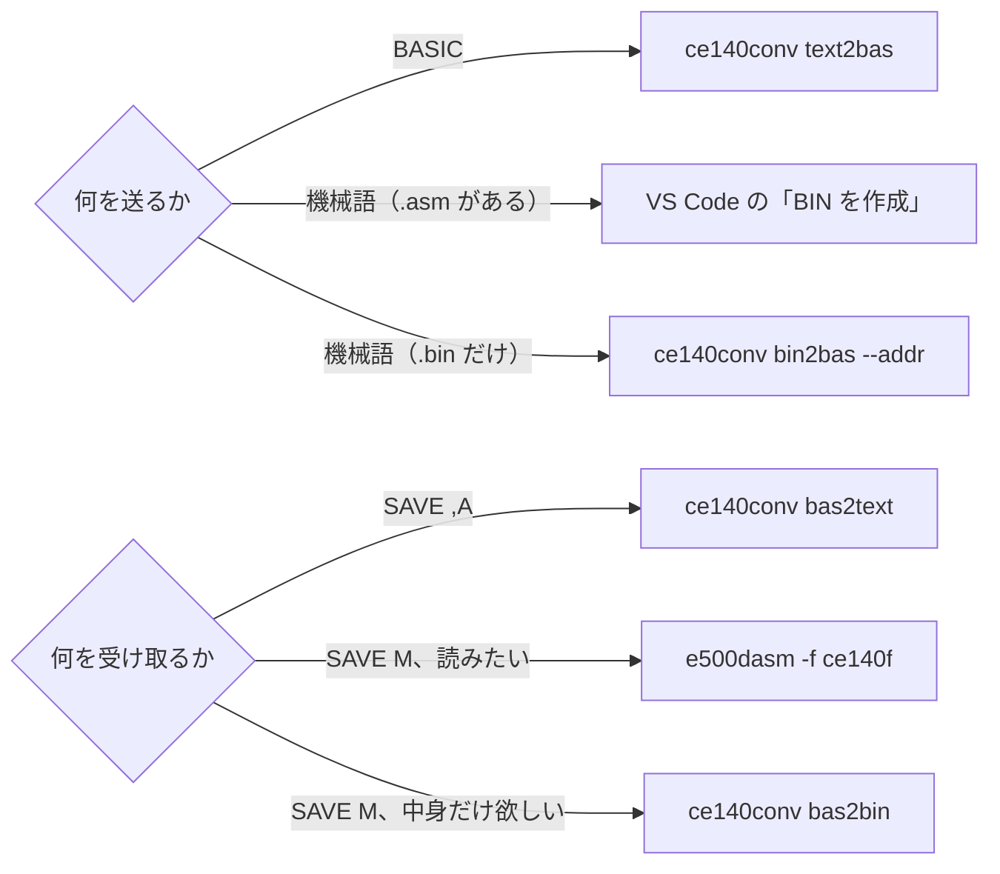

# 16. ファイル変換 ce140conv

この章は、CE-140F（または互換機の SD カード）に置くファイルと、PC のファイルを変換する `ce140conv` の説明です。PC と本体では、文字コードも、改行も、機械語のヘッダーの付け方も違います。その間に立って訳すのが、このツールです。

VS Code だけで作業しているなら、機械語は「BIN を作成」で足ります。BASIC のプログラムを実機とやり取りするとき、コマンドで続けて処理したいとき、ファイルの正体が分からないときに使ってください。どれを使うか迷ったら、[16.11 の図](#1611-どのツールを使うか)から選べます。

[目次へ戻る](README.md)

## 16.1 モード

| モード | 変換 | 実機の操作 |
|---|---|---|
| `text2bas` | PC のテキスト → ASCII の BASIC | `LOAD` |
| `bas2text` | ASCII の BASIC → PC のテキスト | `SAVE ,A` の後 |
| `bin2bas` | 機械語 → `LOAD M` のファイル | `LOAD M` |
| `bas2bin` | `LOAD M` のファイル → 機械語 | `SAVE M` の後 |
| `info` | 中身を調べる | − |

```text
ce140conv text2bas 入力 出力 [オプション]
ce140conv bas2text 入力 出力 [オプション]
ce140conv bin2bas  入力 出力 [オプション]
ce140conv bas2bin  入力 出力 [オプション]
ce140conv info     ファイル
```

`.BIN` と `.BAS` の拡張子に決まりはありません。中身で見分けます。

| 部分 | 意味 |
|---|---|
| `text2bas` など | 何をするか（上の表のモード） |
| `入力` | 読むファイル。変わらない |
| `出力` | 作るファイル。同じ名前のファイルがあれば置き換える。入力と同じ名前にはできない |

この章の例は、`ce140conv` を PATH に入れた書き方で、どの OS でも同じです。入れていないときは、`ce140conv` の所を次のように打ちます（リポジトリのフォルダで）。

| OS | 打ち方 |
|---|---|
| Windows | `.\FileConverter\ce140conv.exe` |
| Linux、macOS | `FileConverter/ce140conv` |

Windows と macOS では、`prog.bin` と `PROG.BIN` のように大文字小文字だけが違う名前は、同じファイルです。この章の例では `_raw` や `.txt` を付けて分けています。

## 16.2 テキストの変換

変換は、どちらの向きも「文字を 1 つずつ置き換える」作業です。`text2bas` は PC の文字を本体のバイトに、`bas2text` は本体のバイトを PC の文字にします。本体の文字のうち PC にないもの、PC の文字のうち本体にないものの扱いが、オプションの違いになります。

| オプション | 使えるモード | 内容 |
|---|---|---|
| `--sjis` | 両方 | PC のテキストを Shift-JIS として扱う（ふつうは UTF-8） |
| `--cr` | `text2bas` | 改行を CR だけにする（ふつうは CR+LF） |
| `--eof` | `text2bas` | 末尾に `1Ah` を付ける |
| `--no-eof` | `text2bas` | 付けない（ふつうと同じ） |
| `--lf` | `bas2text` | 改行を LF にする（ふつうは CR+LF） |
| `--ascii` | 両方 | 文字コード表を使わず、ASCII だけ変換する |
| `--charset 表` | 両方 | 使う文字コード表 |

```text
ce140conv text2bas prog.txt PROG.BAS
ce140conv text2bas --sjis kana.txt KANA.BAS
ce140conv bas2text PROG.BAS prog.txt
```

| 行 | 何をするか |
|---|---|
| 1 | UTF-8 のテキストから、実機の `LOAD` で読める BASIC を作る |
| 2 | Shift-JIS のカナ入りのテキストから作る |
| 3 | 実機の `SAVE ,A` で保存したファイルから、PC で読めるテキストを作る |

1 行目がうまくいくと、次のように出ます。1 行目は使った文字コード表、2 行目は書いたバイト数です。

```text
ce140conv: using charset table …charset_e500.tab
text2bas: wrote 50 bytes to PROG.BAS
```

- すべての行を行番号で始め、1 行は 256 バイト以内にします。守られていないと、実機の `LOAD` がエラーになります。
- 最後の行に改行がなければ補います。入力の末尾の `1Ah` は捨てます。
- 末尾の `1Ah` は付けないのがふつうです。互換機が自分で送るので、2 つになると I/O エラーになります。

## 16.3 機械語の変換

| オプション | 使えるモード | 内容 |
|---|---|---|
| `--addr アドレス` | `bin2bas` | 読み込むアドレス（いつも 16 進） |
| `--header ファイル` | `bin2bas` | 16 バイトのヘッダーをそのまま使う |
| `--save-header ファイル` | `bas2bin` | 外したヘッダーを保存する |

```text
ce140conv bin2bas --addr 0xBEC00 prog_raw.bin PROG.BIN
ce140conv bas2bin PROG.BIN prog_raw.bin
ce140conv bas2bin CODE.BIN code_raw.bin --save-header code.hdr
ce140conv bin2bas code_raw.bin CODE2.BIN --header code.hdr
```

| 行 | 何をするか |
|---|---|
| 1 | 機械語の先頭に 16 バイトのヘッダーを付けて、`BEC00h` に読み込まれる `LOAD M` 用のファイルを作る |
| 2 | `LOAD M` 用のファイルからヘッダーを外して、機械語だけを取り出す |
| 3 | 2 と同じ。外したヘッダーを `code.hdr` に取っておく |
| 4 | 取っておいたヘッダーを、そのまま付けて戻す |

1 行目がうまくいくと、次のように出ます（46 バイトの機械語のとき）。

```text
bin2bas: wrote 62 bytes (16-byte header + 46 payload) to PROG.BIN
```

`--addr` は `BEC00`、`0xBEC00`、`$BEC00`、`&HBEC00`、`0BEC00h` と書けます。付け忘れるとアドレス 0 になります（警告が出ます）。ファイル全体が `FFFFF` を超えるとエラーです。

## 16.4 中身を調べる

`info` は、ファイルの種類と、アドレス、大きさを表示するだけのモードです。ファイルは変えません。

機械語（`LOAD M` 用）のとき

```text
ce140conv info PROG.BIN
```

```text
file       : PROG.BIN
size       : 62 bytes
first byte : 0xff
type       : BINARY (LOAD M) - has 16-byte header
payload    : 46 bytes (after 16-byte header)
header hex :
0000  ff 00 06 01 10 2e 00 00 00 ec 0b ff ff ff 00 0f  ................
length     : 0x00002E (46 bytes)
address    : 0xBEC00-0xBEC2D
```

BASIC（`LOAD` 用）のとき

```text
ce140conv info PROG.BAS
```

```text
file       : PROG.BAS
size       : 50 bytes
first byte : 0x31
type       : ASCII  (LOAD)
eof marker : no
```

| 行 | 意味 |
|---|---|
| `size` | ファイル全体の大きさ |
| `first byte` | 先頭の 1 バイト。機械語のヘッダーは `0xff` で始まる |
| `type` | 種類。`BINARY (LOAD M)` は機械語、`ASCII  (LOAD)` はテキストの BASIC |
| `payload` | ヘッダーを除いた機械語の大きさ |
| `length`、`address` | ヘッダーに書いてある長さとアドレス |
| `eof marker` | 末尾に `1Ah` が付いているか |

## 16.5 文字コード表

`charset_e500.tab` は、本体の文字コードと Unicode の対応表です。実行ファイルと同じ場所、またはカレントのフォルダから読みます。書き換えれば、ビルドし直さずに変わります。

```text
HH   U+XXXX      # 本体のバイト HH を Unicode の XXXX に対応させる
HH   =           # 未定義と明示する
```

| 範囲 | 内容 |
|---|---|
| `20h`〜`7Eh` | ASCII |
| `A1h`〜`DFh` | 半角カナ（JIS X 0201 の並び） |
| その他 | 判明したもの |

表にないバイトは、Unicode の私用領域（`U+E000` + バイト）に移します。読めない文字があっても、往復で失われません。

## 16.6 困ったとき

| 症状・メッセージ | 対処 |
|---|---|
| `warning: no --addr given, using 0.` | `--addr` を付ける |
| `--addr must be 00000h..FFFFFh` | 16 進で書く。`781312` は 16 進として読まれる |
| `output would overwrite …; choose another output file` | 出力先が、入力のファイルか、使っている文字コード表と同じ。別の名前にする |
| `error: input is shorter than a 16-byte header` | `bas2bin` にヘッダーのないファイルを渡した。`info` で調べる |
| `note: no charset_e500.tab found` | 表を実行ファイルと同じ場所に置く |
| `bas2text` の結果が読めない | 実機で `SAVE "X:…",A` をやり直す |
| カナが違う | `charset_e500.tab` を直す |
| 日本語が化ける | Shift-JIS なら `--sjis` を付ける |

## 16.7 ビルド

作り方は OS ごとに、[Windows](02_INSTALL_WINDOWS.md#4-ce140conv-を作る)、[Linux](02_INSTALL_LINUX.md#25-e500asme500dasmce140conv-を作る)、[macOS](02_INSTALL_MACOS.md#25-e500asme500dasmce140conv-を作る) にあります。C++17 のコンパイラ（Windows は MSVC、g++、clang++ のどれか、Linux は g++ か clang++、macOS は clang++）が要ります。

## 16.8 まとめて変換する

### Windows（PowerShell）

今いるフォルダの `.txt` を全部、`LOAD` 用の `.BAS` にします。

```powershell
Get-ChildItem *.txt | ForEach-Object {
    ce140conv text2bas $_.FullName ($_.BaseName.ToUpper() + '.BAS')
}
```

| 部分 | 何をするか |
|---|---|
| `Get-ChildItem *.txt` | `.txt` のファイルを全部探す |
| `\| ForEach-Object { … }` | 見つけた 1 つずつについて、`{ }` の中を実行する |
| `$_.FullName` | そのファイルの、先頭からの完全な名前（入力） |
| `$_.BaseName.ToUpper() + '.BAS'` | 拡張子を除いた名前を大文字にして `.BAS` を付ける（出力） |

SD カード（`E:` の例）の `.BAS` を全部、今いるフォルダにテキストで取り出すときは次のとおりです。

```powershell
Get-ChildItem E:\*.BAS | ForEach-Object {
    ce140conv bas2text $_.FullName ($_.BaseName + '.txt')
}
```

### Linux、macOS

今いるフォルダの `.txt` を全部、`LOAD` 用の `.BAS` にします。

```sh
for f in *.txt; do
  ce140conv text2bas "$f" "$(basename "$f" .txt).BAS"
done
```

| 部分 | 何をするか |
|---|---|
| `for f in *.txt; do` 〜 `done` | `.txt` のファイルを 1 つずつ `f` に入れて、間を繰り返す |
| `"$f"` | そのファイルの名前（入力）。`" "` は、空白のある名前でも 1 つとして渡すため |
| `$(basename "$f" .txt).BAS` | 名前から `.txt` を取って、`.BAS` を付ける（出力） |

`bas2text` に機械語のファイルを渡さないように、先に `info` で種類を調べると安全です。

## 16.9 実例: 変換の前と後

### BASIC

PC のテキスト（UTF-8、改行は何でもよい）

```basic
10 PRINT "HELLO"
20 END
```

できた `PROG.BAS` のバイト列

```text
0000  31 30 20 50 52 49 4e 54 20 22 48 45 4c 4c 4f 22  10 PRINT "HELLO"
0010  0d 0a 32 30 20 45 4e 44 0d 0a                    ..20 END..
```

### 機械語

46 バイトの `hello.bin` に `--addr 0xBEC00` を付けたもの

```text
0000  ff 00 06 01 10 | 2e 00 00 | 00 ec 0b | ff ff ff 00 0f
      固定             長さ 46    BEC00h     固定
0010  30 cc d6 00 30 cc d7 00 …（本体）
```

## 16.10 カナと記号

本体の文字と PC の文字は、表（`charset_e500.tab`）で対応させます。

| 本体のバイト | PC での文字 |
|---|---|
| `41h` | `A` |
| `B1h` | 半角の `ｱ` |
| 表にないもの（例 `F5h`） | 私用領域の `U+E0F5` |

私用領域の文字は、ふつうの書体では四角などに見えますが、そのまま `text2bas` に渡せば元のバイトに戻ります。読めるようにしたいときは、表に行を足します。

```text
F5   U+25A0      # 例: F5h を ■ として扱う
```

## 16.11 どのツールを使うか


