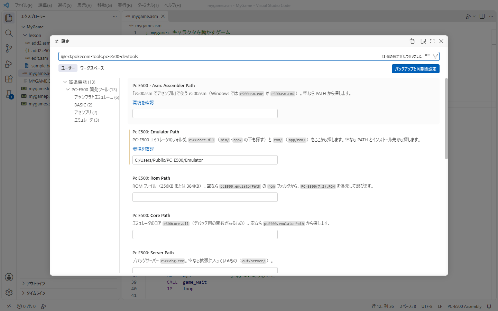

# 17. 設定とコマンド

この章は VS Code 拡張のすべての設定、コマンド、キー、`launch.json` の項目を並べた一覧です。ふつうに使うだけなら、決めるのはエミュレータのフォルダ（`pcE500.emulatorPath`）の 1 つだけで、ほかは初めの値のままでかまいません。機種を切り替える、複数人で同じ設定を使う、実行の仕方を細かく決める、といったときに引いてください。

[目次へ戻る](README.md)

## 17.1 設定

`Ctrl+,` で設定画面を開き、「PC-E500」で探します。



### アセンブラとエミュレータの場所

| 設定 | 既定 | 内容 |
|---|---|---|
| `pcE500.emulatorPath` | 空 | エミュレータのフォルダ。空なら PATH とインストール先から探す |
| `pcE500.corePath` | 空 | `e500core.dll`。空なら `emulatorPath` の中から |
| `pcE500.romPath` | 空 | ROM（256 KB か 384 KB）。空なら `emulatorPath` の `rom` から（`PC-E500(7.2).ROM` を優先） |
| `pcE500.diskFolder` | 空 | 「BIN を作成」のコピー先（CE-140F の X: フォルダ）。空なら `emulatorPath` の `drive-x` |
| `pcE500.serverPath` | 空 | `e500dbg.exe`。空なら拡張機能の中のもの |
| `pcE500.asm.assemblerPath` | 空 | 「e500asm でアセンブル」で使う `e500asm`。空なら PATH から |

設定画面の「環境を確認」のリンクで、足りないものを調べて直せます（[インストールと設定](02_INSTALL_WINDOWS.md#26-環境の確認)）。

### エミュレータ

| 設定 | 既定 | 内容 |
|---|---|---|
| `pcE500.ramKB` | 32 | 内蔵 RAM（KB）。PC-E500、PC-E500S は 32、PC-E550、PC-E650、PC-U6000 は 64 |
| `pcE500.speed` | 1 | 速さ（1 = 実機、2 = 2 倍、0 = 最高速） |
| `pcE500.openPanelOnDebug` | オン | デバッグを始めたときにパネルを開く |

### アセンブリ

| 設定 | 既定 | 内容 |
|---|---|---|
| `pcE500.asm.includeDirectories` | なし | `INCLUDE` / `INCBIN` を探す場所（`e500asm -I` と同じ）。相対パスはワークスペースから |
| `pcE500.asm.defines` | なし | 先に定義する定数（`e500asm -D` と同じ） |

```jsonc
// .vscode/settings.json
{
  "pcE500.asm.includeDirectories": ["inc", "../common"],
  "pcE500.asm.defines": { "MODEL": 500, "DEBUG": 1 }
}
```

### BASIC

| 設定 | 既定 | 内容 |
|---|---|---|
| `pcE500.basic.requireLineNumbers` | オン | 行番号のない行を知らせる |
| `pcE500.basic.checkMissingTargets` | オン | ジャンプ先の行番号とラベルがあるか調べる |

### 優先順位

設定が空のものは、`emulatorPath` の中 → PATH → インストール先（`%ProgramFiles%\PockeComE500` など）の順に探します。`launch.json` に書いた `rom`、`ram`、`speed` は、設定より優先されます。

## 17.2 コマンド

ターミナルで使うコマンド `e500` は [22 章](22_COMMAND_LINE_AI.md)と、OS ごとの章（[Windows](23_COMMAND_LINE_WINDOWS.md)、[Linux](24_COMMAND_LINE_LINUX.md)、[macOS](25_COMMAND_LINE_MACOS.md)）にあります。

`Ctrl+Shift+P` で「PC-E500」と打ちます。

| コマンド | 働き | ほかの出し方 |
|---|---|---|
| 環境を確認 | 必要なものを調べて直す | 設定画面のリンク |
| 新しいプログラムを作成 | テンプレートから作る | フォルダの右クリック、「ファイル」→「新しいファイル…」 |
| 新しいドット絵を作成 | `.spr` か `.lcd` を作る | 〃 |
| INCLUDE ファイルをコピー | `iocs.inc` などをコピーする | フォルダの右クリック |
| エミュレータでデバッグ | 動かす（ブレークポイントで止まる） | `F5`、右上のボタン |
| エミュレータで実行 | 動かす（止まらない） | `Ctrl+F5`、右上のボタン |
| BIN を作成（LOAD M 用） | 実機用のファイルを作る | 右上のボタン、右クリック |
| e500asm でアセンブル | 本物の `e500asm` を動かす | エディタの右クリック |
| エミュレータを開く | パネルを開く | − |
| デバッグ画面を開く | レジスタとメモリの画面 | パネルの「デバッグ画面」 |
| PC-E500 BASIC として開く | ファイルを BASIC として開く | エクスプローラー、タブの右クリック |
| PC-E500 アセンブリとして開く | ファイルを ASM として開く | 〃 |

## 17.3 キー

VS Code の標準のキーを使います。

| キー | 働き |
|---|---|
| `F5` / `Ctrl+F5` / `Shift+F5` | デバッグ / 実行 / 終わる |
| `F9` / `F10` / `F11` / `Shift+F11` / `F6` | ブレークポイント / ステップオーバー / イン / アウト / 一時停止 |
| `F12` / `Alt+F12` | 定義へ移動 / 覗く |
| `Ctrl+Space` | 候補 |
| `Ctrl+Shift+M` | 問題 |
| `Ctrl+Shift+U` | 出力 |

`F5` などは「キーボード ショートカット」（`Ctrl+K Ctrl+S`）で変えられます。コマンドの ID は `pcE500.debugFile`、`pcE500.runFile`、`pcE500.makeBin`、`pcE500.assemble`、`pcE500.newProgram`、`pcE500.newPicture`、`pcE500.copyIncludes`、`pcE500.placeSkill`、`pcE500.openEmulator`、`pcE500.openDebugger`、`pcE500.checkSetup`、`pcE500.openAsBasic`、`pcE500.openAsAsm` です。

## 17.4 launch.json

`F5` は `launch.json` がなくても、開いているファイルを動かします。決まったアドレスから始める、レジスタに値を入れて呼ぶ、決まった ROM で動かす、のように条件を変えたいときに `launch.json` を作ると、条件に名前を付けて選べるようになります。

なくても動きます。動かし方を変えたいときに作ります。「実行とデバッグ」の歯車から作るか、`.vscode/launch.json` を書きます。

```jsonc
{
  "version": "0.2.0",
  "configurations": [
    {
      "type": "pc-e500",
      "request": "launch",
      "name": "PC-E500: 実行",
      "program": "${file}"
    }
  ]
}
```

| 項目 | 対象 | 既定 | 内容 |
|---|---|---|---|
| `type` | 両方 | − | `"pc-e500"` |
| `request` | 両方 | − | `"launch"` |
| `name` | 両方 | − | 一覧に出る名前 |
| `program` | 両方 | − | 動かすファイル。`${file}` は開いているファイル |
| `stopOnEntry` | 両方 | `false` | 開始アドレス（BASIC は最初の行）で止まる |
| `rom` | 両方 | 設定 | ROM のファイル |
| `ram` | 両方 | 設定 | 内蔵 RAM（KB） |
| `speed` | 両方 | 設定 | 速さ |
| `state` | 両方 | なし | 初期化の代わりに読み込む、エミュレータの状態（`*.e500state`） |
| `entry` | ASM | `START` → `MAIN` → 先頭 | 開始するラベルかアドレス |
| `mode` | ASM | `basic` | `basic`: BASIC の `CALL` で動かす。`direct`: 直接呼ぶ |
| `return` | ASM | `far` | `direct` のときの戻り方。`far` = `RETF`、`near` = `RET` |
| `registers` | ASM | なし | `direct` のとき、呼ぶ前のレジスタ（`{"A": 3, "X": "&HBED00"}`） |
| `memory` | ASM | なし | 始める前に書くメモリ（アドレス → バイトの並びか文字列） |
| `stopOnReturn` | ASM | `false` | `direct` のルーチンが戻った所で止まる |

### 例: ほかの機種で動かす

```jsonc
{
  "type": "pc-e500", "request": "launch", "name": "PC-E650",
  "program": "${file}", "rom": "C:/PockeCom/rom/PC-E650(8.5).ROM", "ram": 64
},
{
  "type": "pc-e500", "request": "launch", "name": "PC-E500S",
  "program": "${file}", "rom": "C:/PockeCom/rom/PC-E500S(8.3).ROM", "ram": 32
}
```

### 例: いつも同じファイルを動かす

```jsonc
{
  "type": "pc-e500", "request": "launch", "name": "ゲーム",
  "program": "${workspaceFolder}/mygame.asm"
}
```

### 例: 用意した状態から始める

```jsonc
{
  "type": "pc-e500", "request": "launch", "name": "用意した状態から",
  "program": "${file}", "state": "${workspaceFolder}/ready.e500state"
}
```

ルーチンを直接呼ぶ例は[デバッグ](10_DEBUG.md#109-ルーチンを直接呼ぶ)にあります。

## 17.5 表示の言語

VS Code の表示言語が日本語なら日本語、それ以外は英語です。本体に印刷された文字（「カナ」など）は実機のままです。

## 17.6 覚えているもの

| もの | 場所 |
|---|---|
| ウォッチの式 | ワークスペースごと |
| 設定 | VS Code のユーザー設定かワークスペースの設定 |

古い名前（`pocketBasic.*`、`pocketAsm.*`、`pocketE500.*`）の設定は、最初に動いたときに新しい名前へコピーします。

## 17.7 タスクで e500asm を動かす

`Ctrl+Shift+B` で `e500asm` を動かし、間違いを「問題」に出す設定です。リストやシンボル表も作りたいときに便利です。

```jsonc
// .vscode/tasks.json
{
  "version": "2.0.0",
  "tasks": [
    {
      "label": "e500asm",
      "type": "process",
      "command": "e500asm",
      "args": ["${file}", "-o", "${fileDirname}/${fileBasenameNoExtension}.bin",
               "-l", "${fileDirname}/${fileBasenameNoExtension}.lst",
               "-s", "${fileDirname}/${fileBasenameNoExtension}.sym"],
      "group": { "kind": "build", "isDefault": true },
      "problemMatcher": {
        "owner": "e500asm",
        "fileLocation": "absolute",
        "pattern": { "regexp": "^(.*)\\((\\d+)\\): error: (.*)$", "file": 1, "line": 2, "message": 3 }
      }
    }
  ]
}
```

`e500asm` が PATH にないときは、`command` に実行ファイルのパスを書きます。

## 17.8 キーを割り当てる

```jsonc
// keybindings.json（Ctrl+K Ctrl+S の右上のボタンで開く）
[
  { "key": "ctrl+alt+b", "command": "pcE500.makeBin", "when": "editorLangId == pc-e500-asm" },
  { "key": "ctrl+alt+e", "command": "pcE500.openEmulator" },
  { "key": "ctrl+alt+d", "command": "pcE500.openDebugger" }
]
```

## 17.9 プロジェクトの設定の例

```jsonc
// .vscode/settings.json: このフォルダだけの設定
{
  "pcE500.ramKB": 64,
  "pcE500.speed": 1,
  "pcE500.asm.includeDirectories": ["lib"],
  "pcE500.asm.defines": { "DEBUG": 1 },
  "pcE500.diskFolder": "${workspaceFolder}/x",
  "[pc-e500-asm]": { "editor.tabSize": 8 }
}
```

| 書く場所 | 効く範囲 |
|---|---|
| ユーザー設定 | どのフォルダでも |
| ワークスペースの設定（`.vscode/settings.json`） | そのフォルダだけ（ユーザー設定より優先） |
| `launch.json` の `rom` `ram` `speed` `state` | その構成で動かすときだけ（一番優先） |

## 17.10 定数で作り分ける

条件付きアセンブルはありませんが、`defines` の定数と式で値を切り替えられます。

```asm
WAIT_T  EQU   3-DEBUG*2         ; DEBUG = 1 なら 1、0 なら 3
LIVES   EQU   3+DEBUG*96
```

`e500asm` では `-D DEBUG=0` のように渡します。
