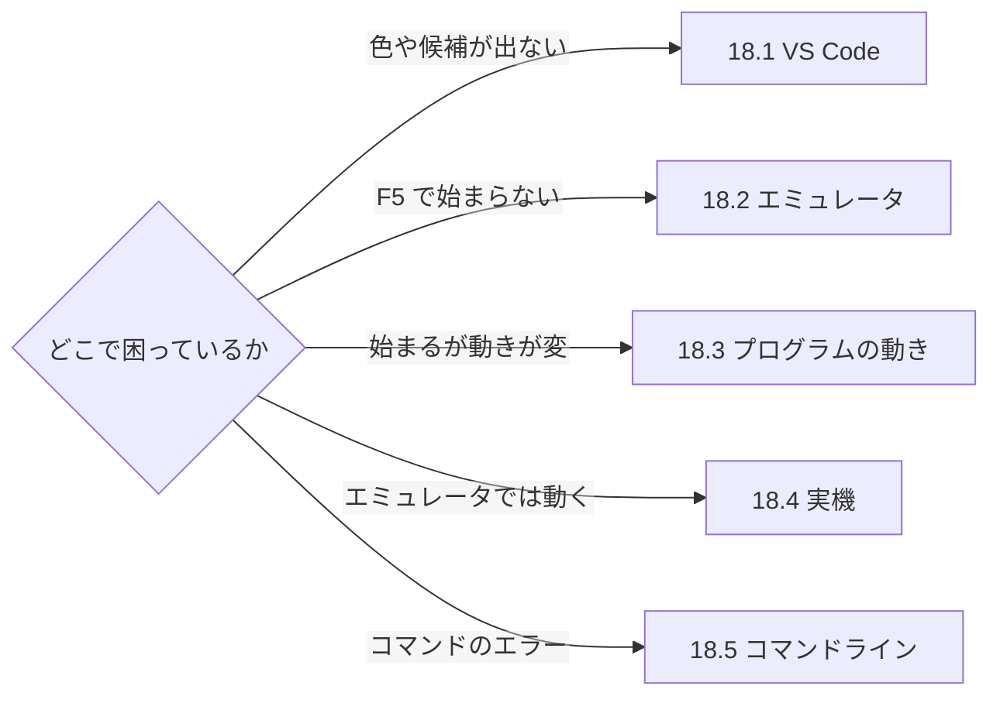
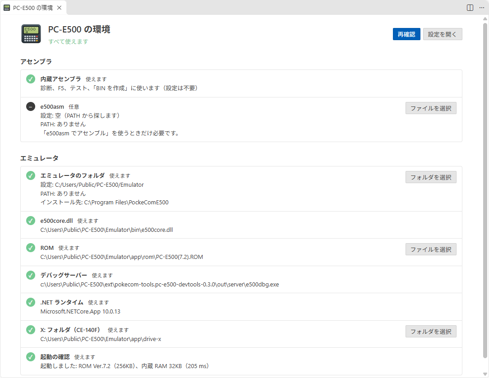

# 18. 困ったとき

この章はうまくいかないときに、症状から原因と対処を探すための一覧です。下の図で「どこで困っているか」を決めてから、その節の表を見てください。表にない症状は [18.8 原因を探す手順](#188-原因を探す手順)で、動く所と動かない所の境目を狭めていくと見つかります。

本体そのものの困りごと（電源が入らない、キーが効かないなど）は[ハンドブックの困ったとき](../handbook/19_TROUBLE.md)にあります。

[目次へ戻る](README.md)

- [VS Code](#181-vs-code)
- [エミュレータ](#182-エミュレータでの実行とデバッグ)
- [プログラムの動き](#183-プログラムの動き)
- [実機](#184-実機)
- [コマンドラインのツール](#185-コマンドラインのツール)
- [Linux](#186-linux)
- [macOS](#187-macos)

## 18.1 VS Code

| 症状 | 原因と対処 |
|---|---|
| 色も間違いの表示も出ない | 拡張子が対象外。右クリックの「PC-E500 アセンブリとして開く」などを使う |
| 右上に実行ボタンがない | 言語が「PC-E500 Assembly」か「PC-E500 BASIC」になっているか、右下の表示を確かめる |
| `F5` で別のデバッガーが出る | ほかの拡張機能が `.asm` を扱っている。右下の言語を「PC-E500 Assembly」にする |
| 候補が出ない | `Ctrl+Space` を押す。文字列とコメントの中では出ない |
| `INCLUDE` の警告が出る | ファイルを保存する |
| 「e500asm が見つかりません」 | 設定 `pcE500.asm.assemblerPath` か PATH。「BIN を作成」なら `e500asm` は要らない |
| メニューが英語 | VS Code の表示言語を日本語にする（拡張機能「Japanese Language Pack」） |
| 更新したのに変わらない | 「開発者: ウィンドウの再読み込み」を実行する |
| `launch.json` の `type` に波線 | 前の名前 `pocket-e500` は `pc-e500` に書き換える |

## 18.2 エミュレータでの実行とデバッグ

まず「PC-E500: 環境を確認」を実行してください。足りないものと直し方が出ます。

| 症状・メッセージ | 原因と対処 |
|---|---|
| `e500core.dll が見つかりません` | 「フォルダを選択」でエミュレータのフォルダを指定する |
| デバッグ用の関数がない古いものです | 新しいエミュレータの `e500core.dll` にする |
| `ROM が見つかりません` | `rom` フォルダに置くか、設定 `pcE500.romPath` で指定する |
| .NET 10 のランタイムが入っていません | [.NET 10 のランタイム](https://dotnet.microsoft.com/download/dotnet/10.0)を入れる |
| VS Code からのエミュレータとの連携は Windows だけ（コマンド `e500` は Linux と macOS でも使える） | Linux と macOS の VS Code では、編集とドットエディタを使う。動かすには `e500 run`（[Linux](24_COMMAND_LINE_LINUX.md)、[macOS](25_COMMAND_LINE_MACOS.md)） |
| 機械語エリアを確保できませんでした | プログラムが大きすぎるか、`ORG` が低すぎる。`ORG` を見直すか、`pcE500.ramKB` を増やす |
| 書き込めません | `ORG` が RAM の外。`BEC00h` など機械語エリアにする |
| BASIC の RUN モードではないため CALL を打てません | `state` で始めたとき。パネルで `BASIC` キーを押してから打つ |
| キーが効かない | パネルの本体を 1 回クリックする |
| 音が出ない | パネルは音に対応していない。エミュレータ本体のアプリで確かめる |
| ブレークポイントで止まらない | `Ctrl+F5`（実行）ではなく `F5` で始める。丸が白抜きなら、その行に命令がない |
| ほかの機種用のプログラムが動かない | ROM と `pcE500.ramKB` を合わせる（[機種に合わせる](02_INSTALL.md#23-機種に合わせる)） |
| `WHILE` や `SWITCH` で Syntax error | 構造化の命令は PC-E500S、PC-E650、PC-U6000（ROM 8.x）だけ |
| カナが別の文字になる | 英語の機種（PC-E500 の 5.3、6.3、7.3、PC-E500S）の文字は欧文 |
| `LOAD でエラーになりました`（BASIC） | 行番号、1 行の長さ（256 バイト）を確かめる |

## 18.3 プログラムの動き

| 症状 | 原因 | 対処 |
|---|---|---|
| `CALL` の後、メインメニューに戻る | `RET` で戻った。`PUSHU` と `POPU` の数が違う | `RETF` にする。数を合わせる |
| `CALL` の後、BASIC のエラーが出る | `C` = 1 のまま戻った | `RETF` の前に `RC` |
| メインメニューが出る、画面が消えて電源が切れる | 暴走した（データを実行した、ジャンプ先が違う、`RET` で戻った） | `RETF` の位置、`ORG`、ラベルを確かめる |
| BASIC のプログラムが壊れる | 機械語エリアの外に書いた、内部 RAM を戻していない | `ORG`、退避を確かめる |
| キーが効かなくなる、時計が止まる | `PUSHU IMR` を戻していない、長い `MVL` や `WAIT` | `POPU IMR` と対にする。`game_end` を必ず呼ぶ |
| `MVL` で別の場所が壊れる | `I` が 0（65536 バイトになる）、前の `MVL` で `I` が 0 になった | 使う前に毎回 `I` を入れる |
| 大きな数が変になる | `IL` に書いて `I` の上位が消えた | `MV I,…` を使う |
| `SHR` で上位に 1 が入る | `C` が入る | 先に `RC` |
| `ADCL` と `DADL` の結果が逆 | 進む向きが違う（2 進はアドレスが増える向き、10 進は減る向き） | [命令一覧](05_INSTRUCTIONS.md#adcl)を確かめる |
| `(BP)` の値が思ったものと違う | `(BP)` は「`BP` が指す所」 | `BP` 自身は `($EC)` |
| 2 回目から変になる | 変数が前の値のまま | 始めに初期値を入れる |
| LCD の表示がずれる | 表示開始ラインが 0 でない | `game_start` を呼ぶか、LCD に `C0h` を送る |

## 18.4 実機

| 症状 | 原因 | 対処 |
|---|---|---|
| `LOAD` の最後で I/O エラー | ファイルの末尾に `1Ah` がある | `e500 bin` で作り直す（[16 章](16_BASIC_FILES.md)） |
| `LOAD` でエラー | 行番号のない行、256 バイトを超える行 | ソースを直す |
| `LOAD M` が別のアドレスに読み込まれる | BIN を作ったときの `ORG` が違う | `e500 dis PROG.BIN -o check_dis.asm` で、表示される `origin` を確かめる |
| `CALL` で暴走する | `ORG` と読み込んだアドレスが違う | 同じにする。「BIN を作成」なら自動で合う |
| 機械語エリアが消えた | オールリセットした | もう一度確保する |
| エミュレータでは動くのに実機で動かない | 機械語エリアの確保、`CALL` のアドレス、内蔵 RAM の大きさ | 1 つずつ確かめる。`PRINT PEEK &HBFD1A,PEEK &HBFD1B,PEEK &HBFD1C` |
| ファイルが見つからない | 名前が 8 文字を超えている、小文字 | 大文字 8 文字までにする |

## 18.5 コマンドラインのツール

| ツール | 一覧 |
|---|---|
| `e500asm` | [アセンブラの文法 4.9](04_ASSEMBLER_REFERENCE.md#49-エラーメッセージ) |
| `e500dasm` | [逆アセンブラ 15.8](15_DISASSEMBLER.md#158-エラー) |
| BASIC のファイル | [BASIC のファイルと文字 16.7](16_BASIC_FILES.md#167-困ったとき) |

| 症状 | 対処 |
|---|---|
| `e500`（`run`、`test` など） | [Windows](23_COMMAND_LINE_WINDOWS.md#238-困ったとき)、[Linux](24_COMMAND_LINE_LINUX.md#249-困ったとき)、[macOS](25_COMMAND_LINE_MACOS.md#258-困ったとき) |

どの OS でも起きることです。

| 症状 | 対処 |
|---|---|
| `--org` のアドレスが違う | いつも 16 進。`8000` は 8000h |
| `$BEC00` と打つと、アドレスが違う、エラーになる | ターミナルが `$` を別の意味に取る。`BEC00` か `0xBEC00` と書く |

Windows で起きることです。

| 症状 | 対処 |
|---|---|
| `e500asm.cmd` が「見つかりません」 | `Assembler\app\` に `e500asm.exe` を置く（[手順](02_INSTALL_WINDOWS.md#3-exe-を置く)） |
| PowerShell で `fc` が別のコマンドになる | `fc.exe` と書く |

## 18.6 Linux

| 症状 | 対処 |
|---|---|
| `build.sh` が `Permission denied` | `sh build.sh` と打つ。または `chmod +x build.sh` で「実行してよい」という印を付ける |
| `INCLUDE` や `INCBIN` で `File not found` | 大文字と小文字をファイル名に合わせる |
| 出力の改行が Windows と違う | `.lst`、`.sym`、`.hex`、逆アセンブル結果は、その OS の改行。バイナリは同じ |
| `unzip: command not found` | `sudo apt install unzip` で入れる |

## 18.7 macOS

| 症状 | 対処 |
|---|---|
| `build.sh` が `permission denied` | `sh build.sh` と打つ。または `chmod +x build.sh` で「実行してよい」という印を付ける |
| `dotnet: command not found` | .NET 10 SDK を入れて、ターミナルを開き直す |
| 出力の改行が Windows と違う | `.lst`、`.sym`、`.hex`、逆アセンブル結果は、その OS の改行。バイナリは同じ |

## 18.8 原因を探す手順

### 動かない

1. 「問題」（`Ctrl+Shift+M`）に赤い印がないか。
2. 「デバッグ コンソール」の最後の行。どこまで進んだか。
3. 「環境を確認」の「起動の確認」。
4. テンプレート「最小」を作って動くか。動けば、環境は正しい。

### 動きが変

1. 開始アドレスにブレークポイントを付けて、そこに来るか。
2. 半分の所にブレークポイントを付けて、値が正しいか。
3. 正しければ後ろ半分、違えば前半分に、また半分の所で止める。
4. 1 つの命令まで狭める。

### 前は動いていた

1. 最後に変えた所を元に戻して、動くか確かめる。
2. 動けば、変えた所を少しずつ入れる。
3. テストがあれば、全部実行する。

## 18.9 報告するとき

[Issues](https://github.com/litchi-gh/pc-e500_tools/issues) に書くときは、次のことがあると早く分かります。

| 書くこと | 例 |
|---|---|
| 拡張機能、ツールのバージョン | 0.1.0、`e500asm --version` |
| 機種と ROM バージョン | PC-E500、7.2 |
| したこと | `F5` を押した |
| 起きたこと、期待したこと | メッセージの全文 |
| 短いソース | 起きる最小のもの |

ROM のファイルや、個人の名前が入ったパスは書かないでください。
