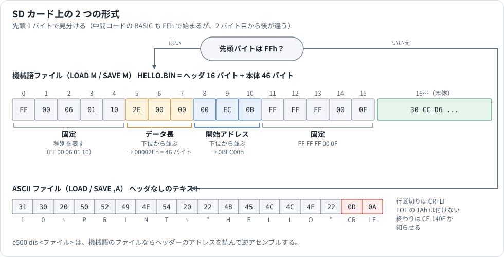
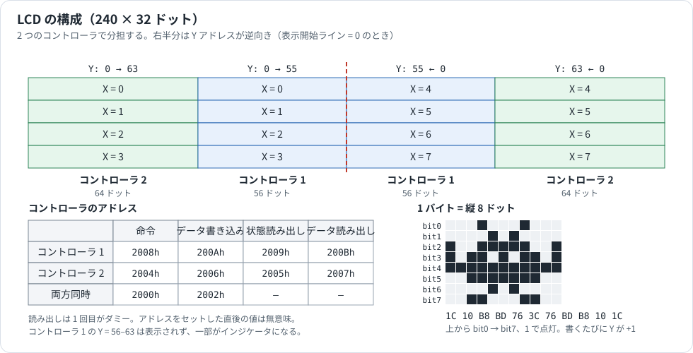
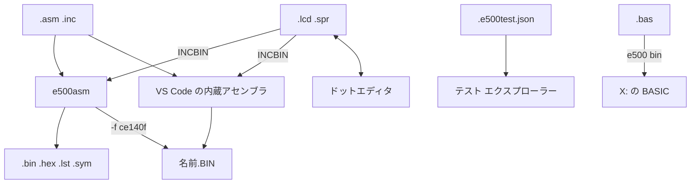

# 19. ファイル形式

この章は、ツールが読み書きするファイルの中身を、バイトの単位で説明します。自分で変換のツールを作る、壊れたファイルを直す、ほかのツールとデータをやり取りする、といったときの資料です。ふつうに使うだけなら、読まなくても困りません。

どの形式にも、実際のバイト列を使った計算の例を付けました。16 進のダンプと見比べながら読むと、形式の決まりが目で確かめられます。

[目次へ戻る](README.md)

| 拡張子 | 内容 | 節 |
|---|---|---|
| `.BIN`、`.BAS`（X: に置くもの） | `LOAD M` / `LOAD` のファイル | [19.1](#191-x-に置くファイル) |
| `.bin` `.hex` `.lst` `.sym` | `e500asm` の出力 | [19.2](#192-アセンブラの出力) |
| `.lcd` | 画面の絵 | [19.3](#193-lcd) |
| `.pixels` | 画面の絵（1 ドット 1 バイト） | [19.4](#194-pixels) |
| `.spr` | キャラクタ | [19.5](#195-spr) |
| `.e500test.json` | テスト | [11 章](11_TESTS.md#113-書き方) |

## 19.1 X: に置くファイル



先頭のバイトが `FFh` なら機械語か中間コードの BASIC、それ以外ならテキスト（ASCII の BASIC）です。機械語は `FF 00 06 01 10` で始まります。

### 機械語（`LOAD M` / `SAVE M`）

| オフセット | 長さ | 内容 |
|---|---|---|
| 0〜4 | 5 | `FF 00 06 01 10` |
| 5〜7 | 3 | 本体の長さ（下位から） |
| 8〜10 | 3 | 読み込むアドレス（下位から） |
| 11〜15 | 5 | `FF FF FF 00 0F` |
| 16〜 | − | 機械語 |

変わるのは長さとアドレスだけです。実機の `SAVE M` が作るヘッダーと同じです。

```text
ff 00 06 01 10   2e 00 00   00 ec 0b   ff ff ff 00 0f
               長さ 00002Eh  BEC00h
```

### BASIC（`LOAD` / `SAVE ,A`）

ヘッダーのないテキストです。文字は本体の文字コード、改行は CR+LF です。末尾に `1Ah` は付けません（終わりは CE-140F が知らせるため）。くわしくは [16 章](16_BASIC_FILES.md)にあります。

`SAVE` に `,A` を付けないと、中間コードの形式になります。ツールはこの形式を扱いません。

## 19.2 アセンブラの出力

### .bin

機械語だけです。アドレスの情報はありません。複数の `ORG` があるときは、最小から最大までを 1 つにまとめ、間を `--fill` の値で埋めます。

### .hex

Intel HEX です。アドレスの上位は、種別 04（拡張リニアアドレス）で表します。

```text
:02000004000BEF                         ← 上位のアドレス 000Bh
:0B8000000800090A46017C011B06066F       ← 8000h から 11 バイト
:00000001FF                             ← 終わり
```

### .lst

アドレス、機械語、`ファイル(行番号): ソース` です。

```text
Address  Machine code              Source
B8000    08 00                     sum.asm(6):         MV A,0
B8002    09 0A                     sum.asm(7):         MV IL,COUNT
```

### .sym

`EQU` の形です。別のソースから `INCLUDE` して使えます。

```text
COUNT EQU $A
loop EQU $B8004
start EQU $B8000
```

## 19.3 .lcd

240 × 32 ドットの絵です。1024 バイトで、LCD コントローラ 2 個の表示 RAM と同じ並びです。



| 画面の x | コントローラ | ページ（y = 0〜31） | 桁 |
|---|---|---|---|
| 0〜63 | 1 | y ÷ 8 | x |
| 64〜119 | 0 | y ÷ 8 | x − 64 |
| 120〜175 | 0 | y ÷ 8 + 4 | 175 − x（左右が逆） |
| 176〜239 | 1 | y ÷ 8 + 4 | 239 − x（左右が逆） |

```text
オフセット = コントローラ × 512 + ページ × 64 + 桁
ビット     = y を 8 で割った余り（0 が上）
```

- 前半 512 バイトがコントローラ 0、後半 512 バイトがコントローラ 1 です。
- コントローラ 0 は 2008h から、コントローラ 1 は 2004h から書きます。
- 画面に出ないビット（桁 56〜63 など）は、編集しても変わりません。
- `screen_load` は、この並びを仮想画面の並び（19.6）に直します。

## 19.4 .pixels

240 × 32 ドット、1 ドット 1 バイトで 7680 バイトです。左上から右へ、上の行から並びます。0 が消灯、それ以外が点灯です。

## 19.5 .spr

| オフセット | 内容 |
|---|---|
| 0 | 幅（1〜64） |
| 1 | 高さ ÷ 8（1〜4） |
| 2 | コマ数（1〜255） |
| 3 | 1 = マスクあり、0 = なし |
| 4〜 | コマ 0、コマ 1、… |

1 コマは、縦 8 ドットの行ごとに、左から 1 桁ずつです。ビット 0 が上です。

| | 1 桁のバイト | 1 コマの大きさ |
|---|---|---|
| マスクあり | マスク、絵の 2 バイト | 幅 × 高さ ÷ 8 × 2 |
| マスクなし | 絵の 1 バイト | 幅 × 高さ ÷ 8 |

| マスク | 絵 | ドット |
|---|---|---|
| 1 | 1 | 点灯 |
| 1 | 0 | 消灯 |
| 0 | 0 | 透明 |

8 × 8 ドット、2 コマ、マスクありの例です。

```text
08 01 02 01                     ← 幅 8、8 ドット × 1 行、2 コマ、マスクあり
mm bb mm bb …（16 バイト）       ← コマ 0: マスク、絵を 8 桁ぶん
mm bb mm bb …（16 バイト）       ← コマ 1
```

## 19.6 仮想画面（screen.inc）

`screen` は 960 バイトで、左から 240 桁、縦 8 ドットの行が 4 つです。

```text
アドレス   = screen + (y ÷ 8) × 240 + x
ビット = y を 8 で割った余り（0 が上）
```

## 19.7 計算の例: .lcd

| ドット (x, y) | コントローラ | ページ | 桁 | オフセット | ビット |
|---|---|---|---|---|---|
| (0, 0) | 1 | 0 | 0 | 512（200h） | 0 |
| (63, 31) | 1 | 3 | 63 | 767（2FFh） | 7 |
| (64, 0) | 0 | 0 | 0 | 0（000h） | 0 |
| (119, 15) | 0 | 1 | 55 | 119（077h） | 7 |
| (120, 0) | 0 | 4 | 55 | 311（137h） | 0 |
| (175, 8) | 0 | 5 | 0 | 320（140h） | 0 |
| (176, 0) | 1 | 4 | 63 | 831（33Fh） | 0 |
| (239, 31) | 1 | 7 | 0 | 960（3C0h） | 7 |

## 19.8 実例: .spr

[StarCatch](../../Samples/Assembler/StarCatch/README.md) の `face.spr` の始めです。

```text
08 01 02 01   ← 幅 8、8 ドット × 1 行、2 コマ、マスクあり
3C 3C 7E 42 FF 95 FF A1
FF A1 FF 95 7E 42 3C 3C   ← コマ 0（マスク、絵の順に 8 桁ぶん）
…
```

コマ 0 を絵にすると次のようになります（■ 点灯、□ 消灯、・ 透明）。

```text
・・■■■■・・
・■□□□□■・
■□■□□■□■
■□□□□□□■
■□■□□■□■
■□□■■□□■
・■□□□□■・
・・■■■■・・
```

1 桁目のバイトは、マスクが `3Ch`、絵が `3Ch` です。ビット 0 が一番上のドットです。

## 19.9 大きさの早見表

| ファイル | 大きさ |
|---|---|
| `.lcd` | 1024 バイト |
| `.pixels` | 7680 バイト |
| `.spr`（マスクあり） | 4 + 幅 × 高さ ÷ 8 × 2 × コマ数 |
| `.spr`（マスクなし） | 4 + 幅 × 高さ ÷ 8 × コマ数 |
| `LOAD M` のファイル | 16 + 本体 |
| `.hex` | 本体のおよそ 2.8 倍（16 バイトごとに 1 行） |

## 19.10 文字コードと改行

| ファイル | 文字コード | 改行 |
|---|---|---|
| `.asm`、`.inc` | UTF-8（`e500asm --encoding` で変えられる） | 何でもよい |
| `.bas`（PC で編集するもの） | UTF-8 | 何でもよい |
| X: に置く BASIC | 本体の文字コード | CR+LF |
| `.e500test.json` | UTF-8 | 何でもよい |
| `.lst`、`.sym`、`.hex` | UTF-8 | OS の改行 |

## 19.11 どのプログラムが何を読むか


