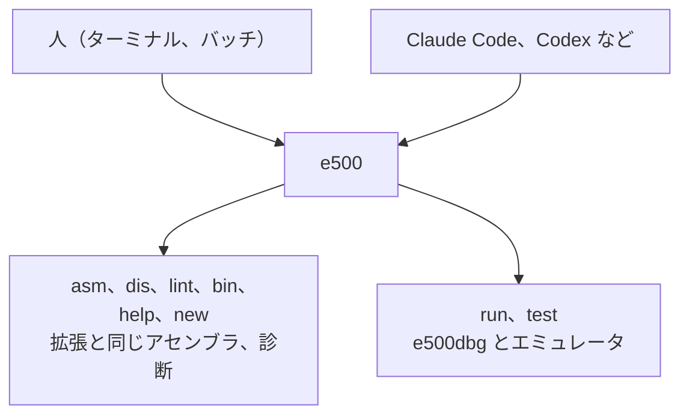
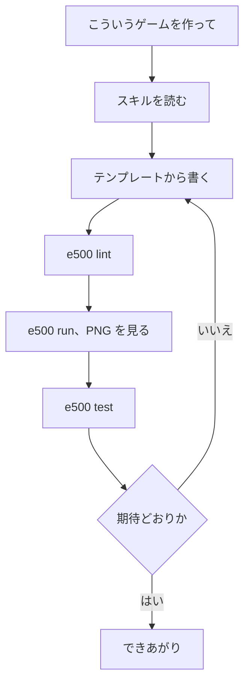
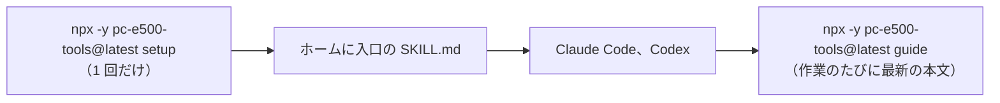

# 22. コマンド e500 と AI

この章は VS Code 拡張の機能をコマンドで使う `e500` と、Claude Code や Codex などの AI アシスタントに PC-E500 のプログラムを書かせる方法の説明です。`e500` は普通のコマンドなので、人がターミナルで打っても、バッチから呼んでも、AI が呼んでも、同じように動きます。VS Code を開いている必要はありません。

[目次へ戻る](README.md)

この章にはどの OS でも同じこと（それぞれのコマンドが何をするか、オプションの意味）だけを書きます。準備の手順、打ち方、実行例は OS ごとの章に分けました。

| 自分の OS | 読む章 |
|---|---|
| Windows | [23. Windows のコマンド](23_COMMAND_LINE_WINDOWS.md) |
| Linux | [24. Linux のコマンド](24_COMMAND_LINE_LINUX.md) |
| macOS | [25. macOS のコマンド](25_COMMAND_LINE_MACOS.md) |

初めてのときは先に自分の OS の章を読み、オプションを調べたくなったらこの章に戻ってください。

## 22.1 コマンドの一覧

| コマンド | 何をするか | 作るファイル | Windows | Linux | macOS |
|---|---|---|---|---|---|
| [`e500 check`](#e500-check) | エミュレータと ROM が使えるかを調べる | なし | ○ | ○ | ○ |
| [`e500 new`](#e500-new) | テンプレートからプログラムを作る | ソースと絵 | ○ | ○ | ○ |
| [`e500 help`](#e500-help) | 命令、IOCS、BASIC の命令の書き方を表示する | なし | ○ | ○ | ○ |
| [`e500 lint`](#e500-lint) | 間違いを探す（`.asm`、`.bas`） | なし | ○ | ○ | ○ |
| [`e500 asm`](#e500-asm) | ASM を機械語にする（`e500asm` と同じ出力） | `.bin` など | ○ | ○ | ○ |
| [`e500 dis`](#e500-dis) | 機械語を ASM に戻す（`e500dasm` と同じ出力） | `.asm` | ○ | ○ | ○ |
| [`e500 bin`](#e500-bin) | 実機用の BIN や BAS を作り、実機で打つ行を表示する | `.BIN`、`.BAS` | ○ | ○ | ○ |
| [`e500 run`](#e500-run) | エミュレータで動かし、画面を表示する | 指定すれば PNG | ○ | ○ | ○ |
| [`e500 test`](#e500-test) | `*.e500test.json` のテストを実行する | なし | ○ | ○ | ○ |
| [`e500 setup`](#e500-setup) | どのフォルダでも AI がスキルを使えるようにする | スキルの入口 | ○ | ○ | ○ |
| [`e500 guide`](#e500-guide) | スキルの本文を表示する | なし | ○ | ○ | ○ |
| [`e500 skill`](#e500-skill) | AI 用のスキルを、1 つのフォルダに置く | スキル | ○ | ○ | ○ |



ふだんは「`new` で作る → 書く → `lint` で間違いを探す → `run` で動かす → `test` で確かめる → `bin` で実機用にする」の順に使います。

## 22.2 打ち方の決まり

```text
e500 run mygame.asm --seconds 2 --png screen.png
```

| 部分 | 意味 |
|---|---|
| `e500` | コマンドの名前 |
| `run` | させること（22.1 の表のどれか） |
| `mygame.asm` | 相手のファイル。今いるフォルダのファイルなら名前だけでよい |
| `--seconds 2` | オプション。`--名前 値` の形。`--seconds=2` とも書ける |
| `--png screen.png` | 2 つ目のオプション。順番は自由 |

`e500 --help` で全部のコマンドの形、`e500 run --help` のように打つと、そのコマンドの形が出ます。`e500 --version` はバージョンです。どれも表示するだけで、何も変えません。

メッセージは、OS の言語が日本語なら日本語、ほかは英語です。環境変数 `E500_LANG` に `ja` か `en` を入れると選べます。

## 22.3 エミュレータと ROM の探し方

`run`、`test`、`check` は次の順に探し、最初に見つかったものを使います。

| 順 | 場所 | 向いている使い方 |
|---|---|---|
| 1 | オプション `--emulator フォルダ`、`--rom ファイル` | そのときだけ変える |
| 2 | 環境変数 `PCE500_EMULATOR`、`PCE500_ROM` | いつも同じものを使う |
| 3 | VS Code の**ユーザー**設定 `pcE500.emulatorPath`、`pcE500.romPath` | VS Code と同じものを使う |
| 4 | PATH、インストール先、リポジトリの隣の `Emulator` | 何も設定しない |

作業フォルダの `.vscode/settings.json` は読みません。知らないフォルダの設定で、思わぬプログラムが動くのを防ぐためです。

`--rom 8.5` のように、ROM の名前の一部でも選べます。内蔵 RAM は `--ram 64` のように書けばその大きさ（KB）です。書かなければ VS Code のユーザー設定 `pcE500.ramKB`、それもなければ、ROM の名前が PC-E550、PC-E650、PC-1490UII、PC-U6000 のとき 64 KB、ほかは 32 KB になります。`--rom` を付けたときは、設定ではなく ROM の名前で決まります。

## 22.4 それぞれのコマンド

### e500 check

```text
e500 check
```

エミュレータ、ROM、デバッグサーバーがどこにあるかを探し、実際に一度起動して、使えるかどうかを調べます。ファイルは何も変えません。`run` や `test` が動かないときは、まずこれを打ちます。

| 出る行 | 意味 |
|---|---|
| `server` | エミュレータを操作するプログラム（`e500dbg`）の場所 |
| `emulator` | 見つかったエミュレータのフォルダ。`-` は見つからない |
| `core` | エミュレータの本体のファイル |
| `rom` | 使う ROM |
| `ram` | 内蔵 RAM の大きさ（KB） |
| `from` | 何から見つけたか（`PCE500_EMULATOR`、`PATH` など） |
| `node` | 動かしている Node.js のバージョン |
| `started` | 起動できた。ROM のバージョン、内蔵 RAM、起動にかかった時間 |
| `error` | 起動できなかった理由（`started` の代わりに出る） |

### e500 new

```text
e500 new 名前 [フォルダ]
```

ひな形から、すぐに動くプログラムを作ります。名前を決めるだけで、何で作るか（BASIC か機械語か）、何を作るか（アプリかゲームか）は、続けて出る質問で選びます。`ENTER` だけ打つと、おすすめのものになります。フォルダを省くと、今いるフォルダに作ります。

```text
何で作りますか？
  1  BASIC: 計算、一覧、記録、文字のゲーム。読んで直しやすい（ENTER）
  2  機械語: 速い。絵を動かす、大量の処理
>
何を作りますか？
  1  BASIC のアプリ：メニュー、入力、一覧、合計、ファイルへの保存。テスト付き（ENTER）
  2  BASIC のゲーム：DATA に書いたキャラクタ、キー、点数、音。テスト付き
>
```

質問なしで作るときは、次のように書きます。バッチや AI から動かしたときは、質問せずに自動で決めます（BASIC のアプリ。名前に `game` が入っていれば BASIC のゲーム）。

| 書き方 | できるもの |
|---|---|
| `e500 new memo.bas`、`e500 new memo.asm` | BASIC のアプリ、機械語のアプリ |
| `e500 new memo --kind 種類` | 下の表の種類 |

| 種類 | できるもの |
|---|---|
| `basicapp` | BASIC のアプリ。メニュー、入力、一覧、合計、ファイルへの保存（テスト付き） |
| `basicgame` | BASIC のゲーム。`DATA` に書いたキャラクタを動かす（テスト付き） |
| `app` | 機械語のアプリ。メニュー、1 行入力、計算、結果の表示（テスト付き） |
| `game` | 機械語のゲーム。キャラクタを動かす（絵のファイルも付く） |
| `screen` | 画面を使うプログラム |
| `text` | 文字を表示する |
| `routine` | BASIC から呼ぶルーチン（テスト付き） |
| `minimal` | 最小のプログラム |

名前は英字で始まる 8 文字までの英数字と `_` です。同じ名前のファイルがあると止まります。`--force` を付けると上書きします（**前のファイルの内容は消えます**）。

### e500 help

```text
e500 help 言葉
```

命令、IOCS、BASIC の命令の書き方を表示します。VS Code でマウスを乗せたときの説明と同じ内容です。`e500 help MV SCRN_PUTS` のように、いくつも並べられます。言葉を書かないと、調べられる言葉の一覧が出ます。

### e500 lint

```text
e500 lint ファイルかフォルダ
```

ソースを読んで、間違いを探します。動かしません。ソースも変えません。フォルダを渡すと、その下の `.asm` と `.bas` を全部調べます（`e500 lint .` の `.` は「今いるフォルダ」）。INCLUDE ファイル（`iocs.inc` など）は、隣になくても見つかります。`error` があると、`e500 run` も動かさずに止まります。`warning` は動くけれど確かめたほうがよいところです。

間違いは次の形で出ます。

```text
bad.bas:1:4: error E500021: PC-E500 BASIC にない命令 'PRNT' です。
```

| 部分 | 意味 |
|---|---|
| `bad.bas` | ファイル |
| `1:4` | 1 行目の 4 文字目 |
| `error` | 種類。`error` は直さないと動かないもの |
| `E500021` | 間違いの番号 |
| 残り | 説明 |

### e500 asm

```text
e500 asm ソース.asm [-o 出力] [-l リスト] [-s シンボル表] [--org アドレス]
```

ASM のソースを機械語にします（アセンブル）。`e500asm` と同じバイト列ができます。

| オプション | 意味 |
|---|---|
| `-o ファイル` | 機械語の出力先。省くとソースの名前の拡張子を `.bin` に変えたもの |
| `-l ファイル` | リスト（アドレス、機械語、ソースを並べたもの）も作る |
| `-s ファイル` | シンボル表（ラベルとアドレスの表）も作る |
| `-f hex` | 機械語の代わりに Intel HEX を作る |
| `-f ce140f` | 実機の `LOAD M` で読める形（16 バイトのヘッダー + 機械語）を作る |
| `--org アドレス` | ソースに `ORG` がないときの開始アドレス（いつも 16 進） |
| `--fill 数` | 空きを埋める値 |
| `-I フォルダ` | `INCLUDE` を探す場所を足す |
| `-D 名前=値` | 定数を外から決める |

くわしくは [e500asm のオプション](04_ASSEMBLER_REFERENCE.md#41-コマンドライン)と同じです（`--encoding` はありません。ソースは UTF-8）。`-f` を付けずに作った `.bin` は機械語だけで、実機の `LOAD M` では読めません。実機用には `-f ce140f` か `e500 bin` を使います。

出力先がソース、`INCLUDE`、`INCBIN` のファイルのどれかだと、止まります。出力のどれか 1 つでも書けないときは、どれも書き換えません。

### e500 dis

```text
e500 dis 機械語のファイル [-o 出力.asm] [--org アドレス]
```

機械語を ASM に戻します（逆アセンブル）。元のファイルは変えません。`SAVE M` や `e500 bin` で作ったファイルは、アドレスがヘッダーに書いてあるので `--org` は要りません。機械語だけのファイル（`e500 asm` の `.bin`）は、`--org BEC00` のように先頭のアドレスを書きます。`-o` を省くと、拡張子を `.asm` にした名前で作ります。その名前のファイルが逆アセンブラの作ったものでなければ、自分のソースを消さないように止まります（`--force` で置き換えます）。ほかのオプションは [e500dasm](15_DISASSEMBLER.md#154-コマンドで使う) と同じです。

### e500 bin

```text
e500 bin ソース.asm [-o 出力.BIN]
e500 bin ソース.bas [-o 出力.BAS]
```

`.asm` はアセンブルして、実機の `LOAD M` で読める BIN（16 バイトのヘッダー付き）を作ります。VS Code の「BIN を作成」と同じです。続けて、実機の BASIC で打つ行を表示します。

| 出る行 | 意味 |
|---|---|
| `MYGAME.BIN: 4814 バイト、BE000〜BF2CD、開始 BE000` | ファイルの名前、大きさ、置くアドレス、呼び出すアドレス |
| `POKE &HBFE03,…:CALL &HFFFD8` | 機械語エリアを確保する行。実機で最初の 1 回だけ打つ |
| `LOAD M "X:MYGAME.BIN"` | ファイルを読み込む行 |
| `CALL &HBE000` | 動かす行 |

`.bas` は文字と改行を本体のものに変えて、実機の `LOAD` で読めるテキストにします。カナ、記号の決まりは [16 章](16_BASIC_FILES.md)にあります。

```text
OUT.BAS: 26 バイト
  LOAD "X:OUT.BAS"
  RUN
```

`-o` を付けないと、ソースの名前を大文字にした名前で作ります。その名前のファイルがあり、前に `e500 bin` が作ったものでないか、同じフォルダの別のソースからも同じ名前ができる（日本語の名前はどれも `PROGRAM.BIN`）ときは、止まります（`--force` で置き換えます）。`.bas` では、出力がソースと同じファイルになるとき（Windows と macOS）は止まるので、`-o` で別の名前を付けます。

### e500 run

```text
e500 run ソース [オプション]
```

エミュレータを裏で起動し、プログラムを入れて動かし、終わったときの画面を文字で表示します。`.asm` なら、アセンブル → 初期化 → 機械語エリアの確保 → 書き込み → `CALL` を、`.bas` なら、読み込み → `RUN` を自動で行います。ウィンドウは開きません。動かすたびに新しく初期化するので、エミュレータのアプリの状態には影響しません。

| オプション | 意味 |
|---|---|
| `--seconds 数` | 動かす長さの上限（エミュレータの時間で数えた秒。書かなければ 10） |
| `--keys 並び` | 動き出した後に押すキーを、`,` で区切って並べる。`wait:秒` は待つ。例 `RIGHT,RIGHT,wait:1` は、右を 2 回押して 1 秒待つ |
| `--type 文字` | `INPUT` などに打つ文字。`\n` は RETURN。書いたとおりに打つ（小文字も） |
| `--basic 行` | 始めに打つ行を変える。書かなければ `CLS:CALL …`（`.bas` は `RUN`）。`\n` で複数行 |
| `--type-file`、`--basic-file` | `--type`、`--basic` の文字をファイルから読む（改行は RETURN）。`"` や `>` をそのまま書ける |
| `--call ラベル` | 開始アドレスを変える。書かなければ START → MAIN → 先頭の順に探す |
| `--png ファイル` | 終わったときの画面を PNG の画像にする。フォルダがなければ作る |
| `--memory アドレス:長さ` | 終わったときのメモリを表示する。アドレスはラベルでもよい。`(名前):長さ` は内部 RAM |
| `--no-screen` | 画面の文字を出さない |
| `--emulator` `--rom` `--ram` | [22.3](#223-エミュレータと-rom-の探し方) |

最後の行の `state: …` で、終わり方が分かります。

| 状態 | 意味 | 終了コード |
|---|---|---|
| `ended`（終了） | BASIC のプロンプトに戻った | 0 |
| `running`（実行中） | 時間まで動いていた。ゲームなら正常 | 0 |
| `error`（BASIC のエラー） | エラーの文が出た。`STOP` の `Break in …` も | 1 |
| `menu`（暴走） | メインメニューに出た、`NO MEMORY` になった、電源が切れた。`RET` で戻った、など | 1 |

`.bas` では終わったときの変数も出ます（`I=6` など）。プログラムが `X:` に書いたファイルは、一時フォルダに残し、その場所を表示します。途中の行を `LOAD` できなかったときは、その行の番号を表示して止まります。

### e500 test

```text
e500 test [ファイルかフォルダ]
```

`*.e500test.json` に書いたテストをエミュレータで実行します。`.asm` と `.bas` のどちらもテストできます。フォルダを渡すと、その下のテストを全部実行します。何も書かないと、今いるフォルダの下を探します。テストの書き方は[テスト](11_TESTS.md)にあります。

| 出るもの | 意味 |
|---|---|
| `✓ 名前` | 通った |
| `✕ 名前` と、その下の行 | 失敗した。期待した値と実際の値が出る |
| `成功 59 件、失敗 0 件` | まとめ |

`--only 名前` を付けると、その名前のテストだけを実行します。プログラムが見つからない、書き方が違う、テストが 1 つもないファイルは、そのファイルの失敗になります。

### e500 setup

```text
e500 setup [--force]
```

ホームフォルダの `.claude/skills/pc-e500/` と `.agents/skills/pc-e500/` に、スキルの入口（`SKILL.md` 1 つ）を置きます。Claude Code と Codex はどのフォルダで起動しても、このスキルを使います。入口には本文を `e500 guide` で読むことだけが書いてあり、本文はコマンドと一緒に新しくなります。ふつうは `e500` を入れずに `npx -y pc-e500-tools@latest setup` で実行します（[22.6](#226-ai-に書かせる)）。

同じ場所に、`e500 setup` が置いたものでないスキルがあると、残して知らせます。`--force` を付けると置き換えます。

### e500 guide

```text
e500 guide [名前]
```

スキルの本文を表示します。名前を付けると、その資料（`basic`、`assembly`、`app`、`game`、`hardware`、`testing`、`manual`）を表示します。AI がスキルの入口から実行するもので、人が読んでもかまいません。

### e500 skill

```text
e500 skill [フォルダ]
```

AI 用のスキル（[22.6](#226-ai-に書かせる)。リポジトリでは `skills/pc-e500`）を、フォルダの中の `.claude/skills/pc-e500/` と `.agents/skills/pc-e500/` に置きます。フォルダを省くと、今いるフォルダに置きます。`--force` を付けると、前に置いたものを新しいものに置き換えます。付けなければ、中身の違うファイルはそのまま残ります。VS Code では、コマンド「PC-E500: AI 用のスキルを置く」が同じことをします。

## 22.5 終了コードと JSON

終了コードは、コマンドがうまくいったかどうかを表す数です。バッチや CI で、次に進むかどうかを決めるのに使います。

| 終了コード | 意味 |
|---|---|
| 0 | 成功 |
| 1 | プログラムに間違いがある、テストが失敗した |
| 2 | コマンドの書き方が違う、必要なもの（エミュレータ、ROM など）がない |

`check`、`lint`、`test`、`run`、`bin`、`help` に `--json` を付けると、人が読む文の代わりに、プログラムで読みやすい JSON を出します。

| コマンド | JSON の主な項目 |
|---|---|
| `lint` | `files`（調べた数）、`errors`（エラーの数）、`issues`（1 件ずつ） |
| `test` | `passed`、`failed`、`tests` |
| `run` | `state`、`screen`、`registers`、`memory`、`variables`（`.bas`） |
| `bin` | `file`、`origin`、`end`、`bytes`、`entry`、実機で打つ行 |

これらを使った自動化の例は OS ごとの章にあります。

## 22.6 AI に書かせる

AI は SC62015 や PC-E500 BASIC をほとんど知らないので、そのまま頼むと、ほかの CPU の命令や、ない BASIC の命令を書きます。スキルは、間違えやすい決まり、`e500` での確かめ方、文書の引き方を 1 枚にまとめた案内です。AI はこれを読んで、書く、調べる、動かす、直すを自分で繰り返します。



AI は動かした画面を PNG の画像で見て確かめます。見せたい画面（タイトル、プレイ中など）は、作業フォルダの `screens/` に残し、終わりの報告にパスを書きます。VS Code ならファイルを選ぶだけで見られます。

できあがると、実機用のファイルの隣に、使い方の説明書 `名前_MANUAL.txt` も作ります。動かし方、操作、困ったときを書いたテキストです。機械語なら、機械語エリアの確保のしかたと返し方、`LOAD M` と `CALL` の行も入ります。

### どのフォルダでも使う（おすすめ）

Node.js が入っていれば、次の 1 行を 1 回だけ実行します。`e500` や拡張機能が入っていなくてもかまいません。

```text
npx -y pc-e500-tools@latest setup
```

Claude Code と Codex がどのフォルダでも PC-E500 のプログラムを作れるようになります。AI は作業を始めるときに、`npx -y pc-e500-tools@latest guide` でスキルの本文を読みます。本文はいつも最新のバージョンなので、置き直す必要はありません。



`e500` をいつでも使えるようにするなら、`npm install -g pc-e500-tools` で入れます。更新も同じコマンドです。Codex は、`npx` が使えないとき（Windows のサンドボックスの中など）に、入れた `e500` を使います。OS ごとの手順は [Windows](23_COMMAND_LINE_WINDOWS.md#237-ai-に書かせる)、[Linux](24_COMMAND_LINE_LINUX.md#247-ai-に書かせる)、[macOS](25_COMMAND_LINE_MACOS.md#257-ai-に書かせる) にあります。

### このリポジトリの中で

何もしなくて済みます。Claude Code は `CLAUDE.md`（`AGENTS.md` を読み込む）と `.claude/skills/`、Codex は `AGENTS.md` と `.agents/skills/` を読みます。

### 1 つのフォルダだけで使う

そのフォルダにスキルを置いてから、AI を起動します。スキルの全部をフォルダに写すので、ネットにつながらなくても使えます。そのかわり、新しいバージョンにするには置き直します。置き方は 2 つあり、結果は同じです。

- VS Code: エクスプローラーでフォルダを右クリックして「AI 用のスキルを置く」。コマンドパレット（`Ctrl+Shift+P`、macOS は `Cmd+Shift+P`）の「PC-E500: AI 用のスキルを置く」なら、開いているフォルダに置く
- コマンド: そのフォルダで `e500 skill` を 1 回実行する。VS Code のターミナルでは、拡張が入っていれば設定なしで `e500` が使える

コマンドを使う手順は [Windows](23_COMMAND_LINE_WINDOWS.md#237-ai-に書かせる)、[Linux](24_COMMAND_LINE_LINUX.md#247-ai-に書かせる)、[macOS](25_COMMAND_LINE_MACOS.md#257-ai-に書かせる) に分けてあります。

| AI | 読む場所 |
|---|---|
| Claude Code | `.claude/skills/pc-e500/` |
| Codex | `.agents/skills/pc-e500/` |
| そのほか | `SKILL.md` を読むように頼む |

### 最初に聞かれること

新しいプログラムを頼むと、AI は書き始める前に、BASIC と機械語のどちらで作るかを聞きます。BASIC で実現できるものには BASIC を、動きが速いものや絵を動かすものには機械語をすすめます。好きなほうを答えてください。頼むときに「BASIC で」「機械語で」と書けば、聞かれません。

### 頼み方の例

- 「PC-E500 で、落ちてくる荷物をトラックで受けるゲームを作って。3 回落としたら終わり」
- 「この BASIC の並べ替えが遅いので、機械語のルーチンにして。テストも書いて」
- 「`Samples/Assembler/StarCatch` に、ハイスコアを足して」

できたものはエミュレータで確かめただけです。実機で動かす手順は [実機へ送る](14_TRANSFER.md) にあります。

### うまくいかないとき

| 症状 | 対処 |
|---|---|
| AI がスキルを使わない | 「pc-e500 のスキルを読んで」と頼む。`SKILL.md` が、AI を起動したフォルダの下にあるか確かめる |
| AI が確かめずに終わる | 「e500 lint と e500 run で確かめて」と頼む |
| AI が `e500` を見つけられない | AI を起動する前のターミナルで `e500 --version` か `npx -y pc-e500-tools@latest --version` が動くか確かめる |
| Codex で `npx` が `EPERM` で止まる | Codex のサンドボックスが npm のキャッシュへの書き込みを止めている。`npm install -g pc-e500-tools` で入れておく |
