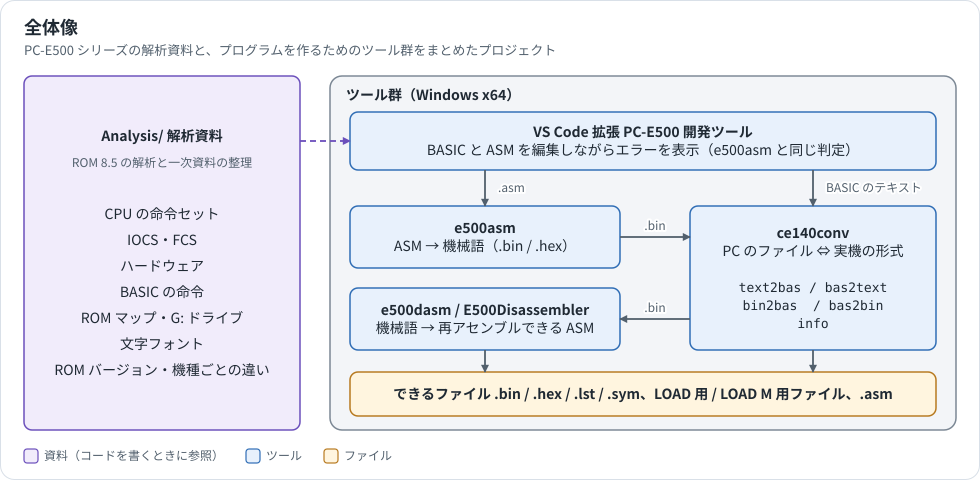
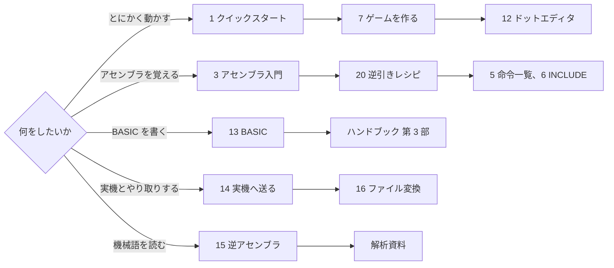

# PC-E500 Tools マニュアル

SHARP PC-E500 シリーズ（PC-E500 / PC-E500S / PC-E550 / PC-E650 / PC-1480U / PC-U6000 など、CPU が SC62015 の機種）のプログラムを PC で作るためのツールの使い方です。

## ツールの一覧

| ツール | できること | 主なマニュアル |
|---|---|---|
| **PC-E500 開発ツール**（VS Code 拡張） | 編集、実行、デバッグ、テスト、ドット絵、BIN 作成 | [8](08_EDITOR.md)〜[14](14_TRANSFER.md) |
| **e500asm** | アセンブラ（ASM → 機械語） | [3](03_ASSEMBLER_TUTORIAL.md)、[4](04_ASSEMBLER_REFERENCE.md) |
| **e500dasm** / **E500Disassembler** | 逆アセンブラ（機械語 → ASM） | [15](15_DISASSEMBLER.md) |

## この本の使い方

全部を順に読む必要はありません。目的によって、次の道を選んでください。

本体の使い方（電卓、統計、BASIC の打ち込みなど）は、別の本[ハンドブック](../handbook/README.md)にあります。

## 読む順番

| # | 文書 | 内容 |
|---|---|---|
| 1 | [クイックスタート](01_QUICKSTART.md) | 入れてから、最初のプログラムを動かすまで。OS ごと（[Windows](01_QUICKSTART_WINDOWS.md)、[Linux](01_QUICKSTART_LINUX.md)、[macOS](01_QUICKSTART_MACOS.md)） |
| 2 | [インストールと設定](02_INSTALL.md) | OS ごとの入れ方（[Windows](02_INSTALL_WINDOWS.md)、[Linux](02_INSTALL_LINUX.md)、[macOS](02_INSTALL_MACOS.md)）、エミュレータの指定、環境の確認 |
| 3 | [アセンブラ入門](03_ASSEMBLER_TUTORIAL.md) | 機械語を 1 から。12 の例題で順に覚える |
| 4 | [アセンブラの文法](04_ASSEMBLER_REFERENCE.md) | e500asm の全オプション、書き方、疑似命令、エラー |
| 5 | [命令一覧](05_INSTRUCTIONS.md) | SC62015 の全命令の動作、書き方、フラグ |
| 6 | [INCLUDE ファイル](06_INCLUDE_FILES.md) | IOCS の名前、画面、キャラクタ、キー、文字、乱数 |
| 7 | [ゲームを作る](07_GAME.md) | テンプレートから始めて、自分のゲームにするまで |
| 8 | [編集](08_EDITOR.md) | 診断、候補、説明、定義へ移動、スニペット |
| 9 | [エミュレータのパネル](09_EMULATOR.md) | 実行、画面とキー、変数とウォッチ |
| 10 | [デバッグ](10_DEBUG.md) | ASM と BASIC のデバッグ、デバッグ画面 |
| 11 | [テスト](11_TESTS.md) | `*.e500test.json` の書き方と実行 |
| 12 | [ドットエディタ](12_DOT_EDITOR.md) | `.lcd`（画面の絵）と `.spr`（キャラクタ） |
| 13 | [BASIC](13_BASIC.md) | BASIC の編集、診断、実行 |
| 14 | [実機へ送る](14_TRANSFER.md) | BIN を作成、`LOAD M`、BASIC の転送、実機から読む |
| 15 | [逆アセンブラ](15_DISASSEMBLER.md) | CLI と GUI |
| 16 | [BASIC のファイルと文字](16_BASIC_FILES.md) | テキストの決まり、カナ、`e500 bin` |
| 17 | [設定とコマンド](17_SETTINGS.md) | 全設定、全コマンド、キー、launch.json |
| 18 | [困ったとき](18_TROUBLESHOOTING.md) | メッセージと症状ごとの対処 |
| 19 | [ファイル形式](19_FILE_FORMATS.md) | BIN、`.lcd`、`.spr`、リスト、文字コード表 |
| 20 | [逆引きレシピ](20_RECIPES.md) | 「こうしたい」から探す、ASM と BASIC の短い書き方 |
| 21 | [用語集](21_GLOSSARY.md) | 言葉の意味 |
| 22 | [コマンド e500 と AI](22_COMMAND_LINE_AI.md) | `e500` のコマンドが何をするか、オプションの意味、Claude Code や Codex 用のスキル |
| 23 | [Windows のコマンド](23_COMMAND_LINE_WINDOWS.md) | Windows での `e500` の準備と使い方。1 行ずつの説明付き |
| 24 | [Linux のコマンド](24_COMMAND_LINE_LINUX.md) | Linux での `e500` の準備と使い方。1 行ずつの説明付き |
| 25 | [macOS のコマンド](25_COMMAND_LINE_MACOS.md) | macOS での `e500` の準備と使い方。1 行ずつの説明付き |

## やりたいことから探す

| やりたいこと | 読むところ |
|---|---|
| とにかく動かしてみたい | クイックスタート（[Windows](01_QUICKSTART_WINDOWS.md)、[Linux](01_QUICKSTART_LINUX.md)、[macOS](01_QUICKSTART_MACOS.md)） |
| アセンブラを基礎から覚えたい | [アセンブラ入門](03_ASSEMBLER_TUTORIAL.md) |
| 命令の書き方を調べたい | [命令一覧](05_INSTRUCTIONS.md) |
| 掛け算や文字の変換のルーチンが欲しい | [逆引きレシピ](20_RECIPES.md) |
| 動くプログラムを見たい | [サンプル](../../Samples/README.md) |
| IOCS の番号と引数を調べたい | [INCLUDE ファイルの iocs.inc](06_INCLUDE_FILES.md#iocsinc) |
| ゲームを作りたい | [ゲームを作る](07_GAME.md) |
| 絵を描きたい | [ドットエディタ](12_DOT_EDITOR.md) |
| 途中で止めて値を見たい | [デバッグ](10_DEBUG.md) |
| 自動で確かめたい | [テスト](11_TESTS.md) |
| 実機で動かしたい | [実機へ送る](14_TRANSFER.md) |
| 実機のプログラムを読みたい | [逆アセンブラ](15_DISASSEMBLER.md) |
| コマンドやバッチから使いたい | [Windows](23_COMMAND_LINE_WINDOWS.md)、[Linux](24_COMMAND_LINE_LINUX.md)、[macOS](25_COMMAND_LINE_MACOS.md) |
| AI に書かせたい | [AI に書かせる](22_COMMAND_LINE_AI.md#226-ai-に書かせる) |
| エラーの意味を知りたい | [困ったとき](18_TROUBLESHOOTING.md) |

## ほかの文書

- 本体の使い方は[ハンドブック](../handbook/README.md)にあります。
- ツールの中身や作り方は [設計](../design/README.md) にあります。
- CPU、ROM、ハードウェアの資料は [解析資料](../analysis/) にあります。
